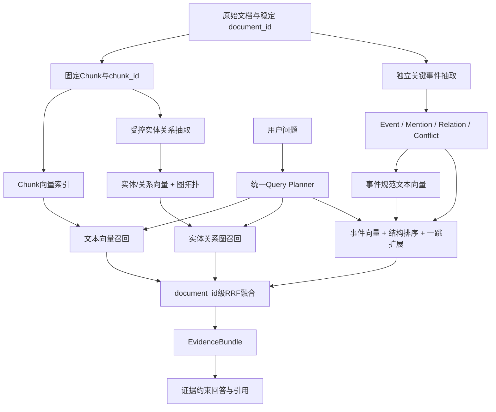
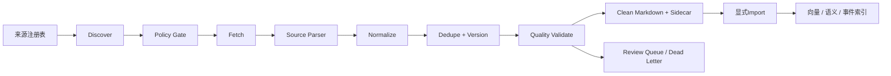
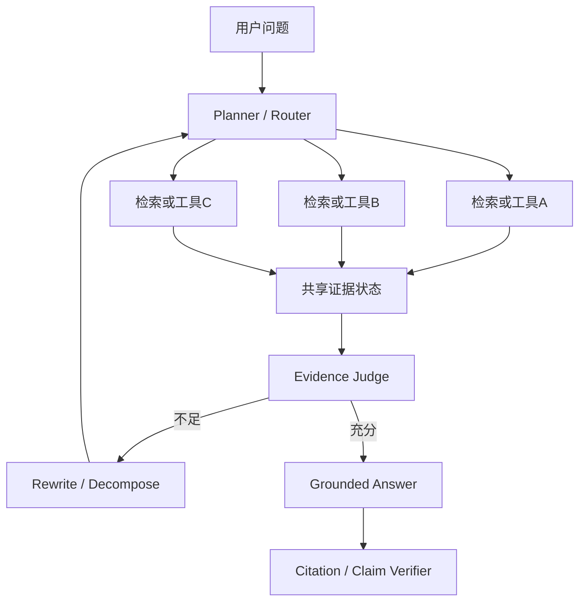
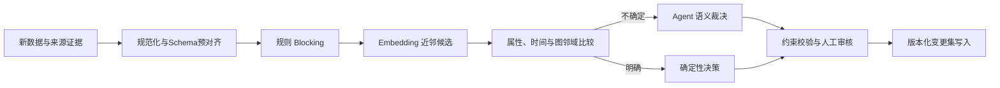
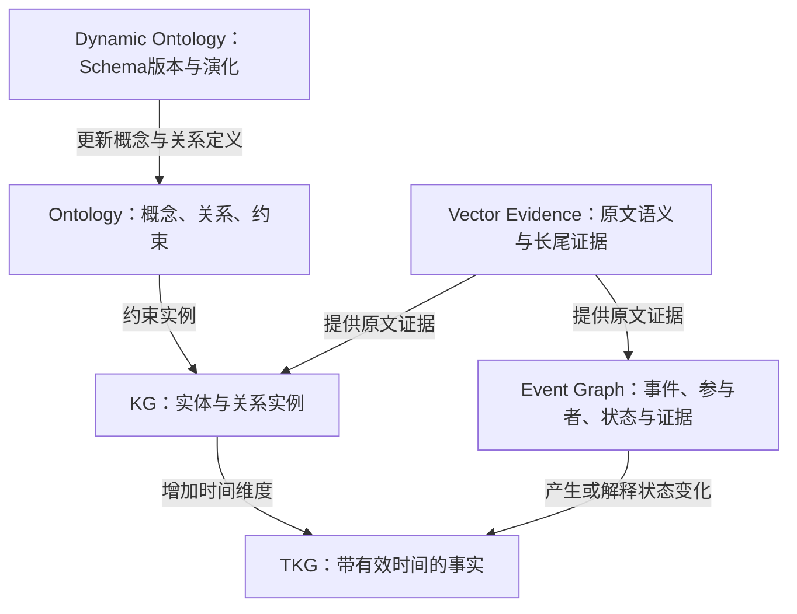
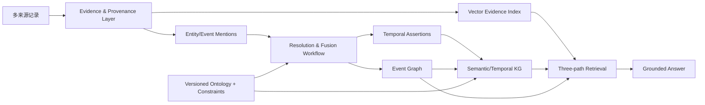

# 260811 项目总结汇报

> 项目：多通路知识组织与检索增强生成系统  
> 汇报日期：2026-08-11  
> 报告定位：答辩分享版；“当前实现”“本次实验观察”“后续研究方案”分开陈述  
> 外部资料检索截止：2026-08-11

## 汇报摘要

本项目面向多来源、长文本、跨文档和时间敏感问题，构建了文本向量、实体关系语义图、关键事件三条互补通路。三路在索引阶段共享稳定的文档身份和原始证据，在查询阶段由统一 Query Planner 生成查询计划，并行召回后按 `document_id` 做文档级 RRF 融合，最后由证据约束型大模型生成带引用回答。

当前系统的核心并不是“同时用了向量库和知识图谱”，而是对三种不同信息需求进行了职责拆分：文本向量通路回答“原文哪里与问题最相似”，语义图通路回答“涉及哪些核心对象及其关系”，事件通路回答“谁在何时做了什么、状态如何变化、来源是否一致”。事件通路始终保留到原文 `EventMention` 的证据链接，因此结构化摘要只参与检索和排序，不取代原文。

在指定的固定实验中，`ours` 的主要优势体现在证据覆盖：Evidence Recall@10 为 0.8007，Complete Recall@10 为 0.5652，均为四种方法中的最高值；`hybrid` 的 Hits@10、MRR@10 和总体 NDCG@10 更高，说明稠密向量与 BM25 的组合仍然擅长快速把首条相关证据排到前面。实验结果支持“事件通路提高多证据找全能力”，但不支持“所有排序指标全面领先”。

系统已经具备继续向知识治理、时序知识图谱和动态本体演进的基础，包括实体关系图、事件记录、来源提及、时间关系、冲突结构和证据区间；但当前仍是事件增强的检索图，不是形式化动态本体。后续工作的重点应从“继续增加抽取字段”转向统一实体身份、双时间建模、来源与声明分离、Schema版本、约束校验和可审计的本体变更流程。

---

# 第1章 系统组件与三通路技术架构

## 1.1 系统要解决的问题

传统单路 RAG 主要依赖 Chunk 与问题的向量相似度。它对直接事实和近义表达有效，但遇到以下问题时容易不足：

- 一个答案需要来自多篇文档的证据，单个相似Chunk无法覆盖完整证据链；
- 问题需要识别实体关系和跨文档连接，而关系并未集中出现在一个片段中；
- 同一对象的状态随时间变化，静态实体关系无法说明“何时成立”；
- 不同来源存在肯定、否认、纠正或替代，简单文本拼接容易抹平冲突；
- 最终回答虽然流畅，但无法追踪到结构化断言对应的原文。

因此，系统将“原文语义、稳定关系、动态事件”拆成三条通路，并在文档证据层重新汇合。

## 1.2 实验与系统组件

| 环节 | 当前组件 | 可选项或实现形式 | 主要职责 | 本次指定实验 |
|---|---|---|---|---|
| 文档解析 | Markdown Parser、Docling | Markdown直接读取；PDF/DOCX经Docling；可选OCR | 统一为可切分的Markdown并保留来源信息 | 实验语料已规范化 |
| RAG引擎 | LightRAG 1.5.3 | `naive/local/global/hybrid/mix`模式 | Chunk、实体、关系索引和图检索 | 受控实体图通路复用LightRAG |
| 传统关系数据库 | 当前未引入 | 后续可选PostgreSQL等 | 适合事务、审核队列、双时间和版本表 | 不使用 |
| 向量数据库 | Qdrant | Chunk、Entity、Relation不同向量集合 | 相似度检索及向量元数据管理 | 图相关通路使用 |
| 图拓扑 | NetworkX GraphML | 实体节点、关系边及来源属性 | 邻域、多跳和图结构保存 | `light_entity`与`ours`共享 |
| 事件存储 | Event Registry | JSON原子存储 | 保存事件、来源提及、事件关系与冲突 | `ours`使用 |
| 事件向量 | NumPy压缩索引 | `event_vectors.npz`，内容指纹缓存 | 事件规范文本的向量召回 | `ours`使用 |
| Embedding | 本地/远程可切换 | Qwen3-Embedding-0.6B、百炼`text-embedding-v4`、智谱`embedding-3` | 文档、问题、实体、关系和事件向量化 | 智谱`embedding-3/1024d` |
| Reranker | BGE Reranker | `BAAI/bge-reranker-v2-m3`，可选 | 对候选结果做交叉编码重排 | 关闭 |
| LLM接口 | DeepSeek兼容OpenAI API | Chat模型与Extraction模型可分别配置 | 抽取、规划、合并、回答、Agent控制 | 用于图与事件索引、查询规划 |
| API与界面 | FastAPI、Streamlit | REST API与演示UI | 文档、事件、查询、任务、诊断与可视化 | 非评测核心 |
| Agent编排 | LangGraph | 有状态节点、条件路由、循环与轨迹 | 证据评估、查询重写、再次检索、回答 | 已实现可选模式，未进入本次四方法结果 |

Qdrant把一个Collection组织为“向量加可选Payload的Points”，并支持稠密、稀疏向量和元数据过滤，适合承担本系统的向量定位职责；图拓扑仍由NetworkX保存，避免把“向量邻近”和“事实关系边”混为一类。[Qdrant官方文档](https://qdrant.tech/documentation/manage-data/collections/)

Docling负责把PDF、DOCX等多种格式转换为统一文档表示，再导出Markdown；当前项目只使用其文档标准化能力，不让解析器参与知识判断。[Docling官方文档](https://docling-project.github.io/docling/reference/document_converter/)

### 1.2.1 LLM调用与模板划分

项目显式定义的主要模板可以按任务分为以下几组：

| 模板组 | 调用阶段 | 输入 | 输出 | 是否直接生成答案 |
|---|---|---|---|---|
| 受控实体关系抽取 | 索引 | 单个Chunk | 最多4个实体、4条关系及描述 | 否 |
| 关键事件抽取 | 索引 | 文档事件片段 | 事件数组及时间、参与者、证据、立场 | 否 |
| Query Planner | 查询 | 用户问题 | 高低层关键词、实体提示、事件类型、时间与状态意图 | 否 |
| 统一证据回答 | 查询 | 问题与三路证据 | 带数字引用的回答 | 是 |
| Agent证据评估 | Agentic查询 | 问题与当前证据 | 相关性、充分性、缺失信息 | 否 |
| Agent查询重写 | Agentic查询 | 原问题、旧查询、缺失信息 | 新查询与理由 | 否 |
| Agent约束回答 | Agentic查询 | 问题、证据、评估 | 回答、引用和证据不足标志 | 是 |

此外，LightRAG内部还会使用关键词、实体描述合并、关系描述合并和回答等内置Prompt。报告不把依赖库内部的所有Prompt都计为项目自定义模板，而是按照实际业务任务说明其作用。

## 1.3 总体数据流与共享身份



三路协同最关键的不是统一分数，而是统一身份。索引时保留稳定的 `document_id` 和来源路径，查询时每个Chunk、图结果和事件Mention都映射回父文档。这样才能做到：

- 同一文档被多路命中时合并贡献，而不是重复占据Top-K；
- 保留每条通路最好的可追踪片段；
- 最终引用始终指向原文文档，而不是只引用LLM生成的事件摘要；
- `ours`能够直接复用`light_entity`的实体关系索引，使事件通路增量更容易解释。

## 1.4 索引阶段

### 1.4.1 文本向量通路

文本通路先对语料做统一切块。指定实验采用Recursive切分，目标大小700 tokens，重叠100 tokens，共形成883个Chunk。每个Chunk生成Embedding后进入向量索引。

这一路不依赖实体抽取是否成功，主要保留：

- 数字、日期、引语、条件和细粒度事实；
- 图谱模板没有覆盖的长尾内容；
- 与问题用词不同但整体语义接近的片段；
- 回答阶段所需的完整自然语言上下文。

因此，文本向量通路是原文安全网。即使图谱漏掉实体或事件，原始Chunk仍可能被召回。

### 1.4.2 实体关系语义通路

语义通路的目标不是穷举所有命名实体，而是从原文中建立一张可检索、可连接的“核心实体—关键关系”图。处理过程可以分为四步。

**第一步：抽取实体和关系。** 系统对每个Chunk调用受控抽取模板，最多保留4个绝对关键实体和4条关键关系。实体类型包括人物、组织、地点、研究对象、方法、模型、数据集、材料、设备和概念等；事件本身不在这里重复抽取，而是交给事件通路。每条关系必须连接最终保留的两个实体，并保存关系描述、关系关键词和来源Chunk。普通共现、宽泛主题、标题词和边缘引用作者不建图。

**第二步：分别保存拓扑、向量和来源。** 语义通路形成三类互相对应的索引对象：

| 索引对象 | 保存内容 | 作用 |
|---|---|---|
| 实体节点 | 规范名称、实体类型、合并后的描述、来源Chunk/文件 | 形成稳定知识锚点 |
| 关系边 | 起点、终点、关系描述、关键词、来源Chunk/文件 | 表达实体之间的关键联系 |
| 来源Chunk | 原文、文档ID和位置 | 支持回到原始证据 |

NetworkX GraphML保存实体节点和关系边的拓扑；Qdrant保存实体、关系和Chunk向量。实体向量文本由“实体名称＋合并后的描述”组成，关系向量文本由“关系关键词＋起点实体＋终点实体＋合并后的关系描述”组成。这样，查询既可以按实体语义定位节点，也可以按关系语义定位边。

**第三步：新数据进入时做归并和去重。** 当前实现以规范化实体名称作为实体合并键：同名实体写入同一节点，来源Chunk与文件列表合并去重；多次出现的描述先去重，内容较长时再由LLM归纳为合并描述。若同一实体出现不同类型，当前按已有和新增结果中的多数类型确定节点类型。关系则以实体端点对作为合并键：同一对实体之间的新关系证据会合并来源，关系关键词与描述去重后更新到同一条边；若关系涉及尚未建立的端点，系统会先补建未知类型实体，保证关系证据不丢失。

**第四步：保留可追踪来源，同时承认当前冲突边界。** 语义图会保留合并前后的来源Chunk，因此能够追溯“这个实体或关系来自哪些原文”；但当前还没有独立的Claim/Assertion冲突对象。实体类型分歧会被多数结果归并，描述分歧会被合并或摘要，并不会像事件通路一样生成显式冲突记录。因此，这一路目前完成的是同名聚合、重复去除和来源合并，还不是带别名消歧、跨语言实体对齐和声明级冲突治理的完整实体解析系统。

### 1.4.3 关键事件通路

事件通路与实体关系通路使用独立的LLM抽取模板，关注“发生了什么、涉及谁、何时发生、结果或状态如何”。系统优先提取发布、部署、合同、采购、合作、投资、实验结果、能力变化、监管、诉讼、人员变化、否认、纠正、撤回和替代等关键事件；没有满足条件的事件时允许为空。

**抽取与保存。** 每个事件候选至少包含明确动作、命名参与者，以及对象、结果或状态变化中的一项。可保存字段包括：事件类型、摘要、动作、参与者、对象、开始/结束时间、时间精度、地点、结果、触发因素、立场、抽取置信度，以及来源文档、原文证据和字符区间。索引层将其组织为四类对象：

| 对象 | 保存重点 | 作用 |
|---|---|---|
| `EventRecord` | 规范事件及结构化字段 | 表示跨文档归并后的事件 |
| `EventMention` | 单篇来源中的原文证据、立场与位置 | 保留每个来源的独立表述 |
| `EventRelation` | 共享参与者/对象的相邻事件 | 表示`precedes/same_time/related` |
| `EventConflict` | 同一事件的肯定与否定Mention | 显式保留来源冲突 |

**事件向量。** 系统将规范事件拼成一段统一文本：

```text
时间 + 事件类型 + 参与者 + 动作 + 对象 + 结果 + 摘要 + 状态
```

该文本生成Embedding并缓存到事件向量索引。摘要不是唯一向量内容，而是与时间、类型、参与者、动作、对象、结果和状态共同表示事件，从而兼顾自然语言近义表达和关键结构信息。

**新事件的去重、合并与冲突记录。** 新事件先按事件类型、参与者、对象和时间形成规范候选，再与已有事件比较。事件类型相同、参与者/对象相容且时间不冲突时，归并到同一`EventRecord`；新的来源不会覆盖旧数据，而是新增`EventMention`，并合并来源文档。若同一规范事件同时存在肯定和否定表述，则生成`EventConflict`并将事件标记为有争议；如果只是多来源重复报道，则保留一个规范事件和多个来源Mention。

**与实体的关联。** 当前事件通过参与者和对象的规范化名称建立轻量关联：共享同一参与者或对象的事件按时间排序，并连接相邻事件。它已经能够支持事件链与来源回溯，但还没有把Actor/Object正式链接到语义图中的全局实体ID。因此，现阶段“事件—实体关联”主要是字符串层的规范化匹配，统一实体身份是后续数据融合的重要工作。

### 1.4.4 三路索引如何协同

三路不是三份互不相干的知识库：

- 文本Chunk提供所有断言的原始语境；
- 语义图从Chunk中抽取较稳定的实体与关系，并把图节点、图边与来源Chunk对应起来；
- 事件图从文档中抽取发生性、时间性和状态性信息，并把规范事件与来源Mention对应起来；
- 实体关系图与事件图最终都必须回到来源文档和证据片段；
- `light_entity`与`ours`共享同一份受控实体图，`ours`只增加事件索引。

目前两类结构化索引仍是“通过文档来源协同、尚未通过统一实体ID完全贯通”：语义图中的实体和事件中的Actor/Object可以指向相同现实对象，但系统尚未建立正式的跨通路实体链接。这个缺口也是后续动态本体和数据治理要优先解决的问题。

## 1.5 检索召回阶段

### 1.5.1 统一Query Planner

每个问题只运行一次Planner，同时为三路生成：

- `low_level_keywords`：具体实体、产品、机构、编号；
- `high_level_keywords`：关系、主题、动作、能力；
- `entities`和`event_types`：事件结构排序的软提示；
- `start_time/end_time`：只从问题中明确出现的年份生成；
- `state_intents`：latest、change、conflict、denial、correction、replacement；
- `expand_event_chain`：是否扩展相邻事件。

Planner只分析问题，不回答问题。结果还会经过确定性清洗并按版本、日期和问题缓存，避免不同方法因规划随机性失去可比性。

### 1.5.2 文本向量召回

文本路使用原问题调用LightRAG的`naive`数据查询：

```text
问题 → Query Embedding → Chunk向量相似度 → 排序Chunk
```

它不依赖图拓扑，擅长直接事实、完整原文和语义近邻。

### 1.5.3 实体关系图召回

图路把Query Planner的输出拆成两组：实体关键词用于寻找具体对象，关系关键词用于寻找动作、能力、归属、合作等关系语义。召回过程如下：

1. **实体入口：** 用实体关键词检索实体向量，找到与问题最相关的实体节点；
2. **关系入口：** 用关系关键词检索关系向量，找到与问题所问关系最相近的图边；
3. **图扩展：** 从命中的实体读取邻接关系，从命中的关系读取两端实体和相关图上下文，形成候选关系链；
4. **链路归并：** 合并实体入口和关系入口产生的重复节点、重复边与相同关系链，避免同一知识被多次计算；
5. **统一原文证据：** 根据节点和边保存的来源ID取回对应Chunk，并与直接向量命中的Chunk合并去重，最后映射回父文档参与召回。

这可以理解为“向量定位图元素＋图邻域/关系链扩展＋来源Chunk回收”的检索式图推理。这里的LightRAG `hybrid`是实体入口和关系入口在图内部的协同，不是第2章的Dense＋BM25实验基线。

### 1.5.4 事件召回、结构排序与事件链

事件检索先追求高召回，再利用结构字段提高候选顺序的合理性：

1. 将原问题编码为向量，在事件规范文本向量中做相似度检索，获得一批高召回事件种子；
2. 读取Query Planner得到的实体、事件类型、时间范围和状态意图，并与事件种子的参与者、对象、动作、时间、结果、立场、抽取置信度和来源情况进行结构匹配；
3. 对询问变化、演化、纠正或替代的问题，从高相关种子沿事件边扩展相邻事件，补齐前后变化链；
4. 综合事件向量顺序与结构匹配顺序，选取每个事件最有代表性的来源Mention，再把原文证据映射回对应文档参与召回。

结构匹配不是对全库做昂贵的逐条判断，而是在向量检索缩小后的候选集合中进行。实体和事件类型默认作为软提示，避免因为抽取缺失或名称差异误删候选；没有日期的事件也不会仅因时间缺失被直接排除。事件边中的`precedes`只表示时间先后，不自动推导因果。最终返回的是`EventMention.evidence`原文，而不是只把LLM生成的事件摘要交给回答器。

### 1.5.5 三通路RRF与证据Bundle

若最终Top-K为K，每路先取 `max(K, 3K)` 个候选。三路异步并行执行，随后按文档去重：

\[
Score(d)=\sum_{c\in Channels}\frac{1}{60+rank_c(d)}
\]

每个通路先在内部完成候选归并，再以文档为统一身份进入三路RRF。每个通路对同一文档最多贡献一次RRF分数，避免一篇长文因切出多个Chunk而重复加权。系统再为每篇文档保留最多3条不同证据，并优先保留不同通路各自最好的片段，形成`EvidenceBundle`。因此，最终融合的是“文本Chunk召回、语义图回收的Chunk、事件Mention证据”三类文档级结果，而不是直接混加三种不同量纲的原始相似度。

### 1.5.6 回答与故障退化

统一回答器只接收最终证据Bundle，要求每个事实使用数字引用；证据不足时明确说明，冲突和否认不能被静默合并。事件通路出现异常时，系统可以退化到文本向量与图通路，基础RAG不会因事件库暂时不可用而整体中断。

## 1.6 本章结论

三通路的技术重点是“互补职责、文档级统一身份、后融合、原文可追踪”。向量路保证原文覆盖，语义图提供稳定关系连接，事件路补充时间、变化和冲突。最终融合发生在文档证据层，而不是把不同量纲的原始分数直接相加；实体级统一身份仍是下一阶段工作。

---

# 第2章 实验设计、基线、指标与结果分析

## 2.1 实验设置

本章数据全部读取自：

`data/exports/evaluation/multihop_seed42_plus20260807_n60_zhipu_recursive_v1`

| 项目 | 设置 |
|---|---|
| 数据集标识 | `multihop-rag-seed42-plus20260807-n60-corpus200` |
| 文档数 | 200 |
| Chunk数 | 883 |
| 问题数 | 60 |
| 切分策略 | Recursive |
| Chunk大小/重叠 | 700 / 100 tokens |
| Embedding | 智谱`embedding-3/1024d` |
| 评测截止 | @4、@10 |
| 三路检索版本 | `three_path_v2_soft_event_hints` |
| Planner版本 | `query_planner_v2_soft_event_hints` |

结果表直接采用本次固定运行导出的Summary，不进行额外可信区间或显著性推断。

## 2.2 四种对比方法

| 方法 | 实现 | 特点 | 主要观察目的 |
|---|---|---|---|
| `naive` | Dense Embedding检索 | 结构简单、速度快，只依赖语义相似度 | 纯向量基线 |
| `hybrid` | Dense＋BM25，RRF融合 | 同时利用语义相似和关键词精确匹配 | 传统混合检索基线 |
| `light_entity` | 文本向量＋受控实体关系图 | 使用统一Planner和文档级融合，无事件通路 | 观察语义图增益，也是事件消融基线 |
| `ours` | 文本向量＋受控实体关系图＋事件 | 增加事件向量、结构排序、事件链和三路融合 | 完整系统 |

`ours`与`light_entity`复用同一实体关系索引，因此两者差异主要来自事件索引、事件召回和三路融合；`hybrid`是Dense＋BM25基线，不应与LightRAG内部的图`hybrid`模式混淆。

### 2.2.1 `naive`：纯Dense向量基线

所有883个Chunk预先生成Embedding并缓存；查询时生成Query Embedding，计算查询与Chunk向量相似度，直接返回Top-K。它没有关键词倒排、图扩展、事件结构和多路融合，优点是实现简单、查询路径短，弱点是专有名词、编号和多证据问题可能被整体语义相似度掩盖。

### 2.2.2 `hybrid`：Dense＋BM25＋RRF

该方法分别取Dense和BM25候选，每路候选数为最终Top-K的4倍，再用`rrf_k=60`做倒数排名融合。英文和数字按字母数字Token切分，连续中文加入二元字符Token。它同时覆盖近义表达与精确词面，尤其适合产品名、机构名、日期和专有术语；但它仍不显式表示跨文档关系或事件状态。

### 2.2.3 `light_entity`：向量＋实体关系图

统一Planner先生成高低层关键词。文本路使用LightRAG `naive`召回原文Chunk，图路使用实体与关系检索召回来源Chunk，两路并行执行，最后按`document_id`做RRF。它通过受控实体关系图组织稳定知识，但不读取事件表，因此是完整系统的无事件消融。

### 2.2.4 `ours`：向量＋实体关系图＋事件

`ours`完全复用`light_entity`的实体关系图和Planner，在同样文本、图候选之外增加事件向量种子、结构排序、可选一跳事件链和来源Mention，再进行三路文档级RRF。事件摘要只用于定位，交给评测和回答的仍是来源原文证据。

## 2.3 指标含义

| 指标 | 直观含义 | 适合回答的问题 |
|---|---|---|
| Hits@K | Top-K中是否至少出现一条金证据 | 系统有没有“碰到”答案依据 |
| Evidence Recall@K | Top-K找回的金证据比例 | 多篇证据找回了多少 |
| Complete Recall@K | 是否找齐全部金证据 | 多跳问题能否形成完整证据集 |
| MRR@K | 第一条相关证据排名的倒数 | 用户多快看到第一条正确证据 |
| MAP@K | 多条相关证据的平均排序精度 | 相关项是否整体靠前且连续 |
| NDCG@K | 带位置折损的排序收益 | 高排名位置的质量如何 |
| P50/P95延迟 | 中位与尾部响应时间 | 典型体验与慢查询情况 |

对于多跳RAG，Hits高并不代表证据完整。例如Hits@10为1只说明至少命中一条证据，而Complete Recall@10才能说明回答所需证据是否全部进入上下文。

## 2.4 总体结果

### 2.4.1 Top-4结果

| 方法 | Hits@4 | Evidence Recall@4 | Complete Recall@4 | MAP@4 | MRR@4 | NDCG@4 |
|---|---:|---:|---:|---:|---:|---:|
| `naive` | 0.9348 | 0.4873 | 0.1522 | 0.3928 | 0.7319 | 0.4882 |
| `hybrid` | 0.9348 | 0.5707 | 0.2174 | 0.4820 | **0.7971** | 0.5668 |
| `light_entity` | 0.9130 | 0.5833 | 0.2609 | 0.4869 | 0.7609 | 0.5683 |
| `ours` | **0.9348** | **0.6395** | **0.2826** | **0.4915** | 0.7156 | **0.5778** |

在较紧的Top-4预算下，`ours`的Evidence Recall、Complete Recall、MAP和NDCG最高，说明三路融合能在较小上下文中放入更多所需证据；`hybrid`的MRR最高，第一条相关结果更靠前。

### 2.4.2 Top-10结果

| 方法 | Hits@10 | Evidence Recall@10 | Complete Recall@10 | MAP@10 | MRR@10 | NDCG@10 |
|---|---:|---:|---:|---:|---:|---:|
| `naive` | 0.9565 | 0.6594 | 0.3043 | 0.4479 | 0.7362 | 0.5643 |
| `hybrid` | **1.0000** | 0.7518 | 0.3913 | 0.5426 | **0.8087** | **0.6538** |
| `light_entity` | 0.9783 | 0.7591 | 0.4565 | 0.5428 | 0.7707 | 0.6502 |
| `ours` | 0.9783 | **0.8007** | **0.5652** | **0.5489** | 0.7230 | 0.6527 |

在本次固定实验中观察到：

- `naive`作为纯向量基线，Evidence Recall@10为0.6594，说明只依赖语义近邻会遗漏一部分跨文档证据；
- `hybrid`把Evidence Recall@10提升到0.7518，并获得最高Hits、MRR和NDCG，关键词信号对首条命中和整体排序仍然有效；
- `light_entity`的Complete Recall@10为0.4565，高于`hybrid`的0.3913，实体关系图对证据找全有帮助；
- `ours`的Evidence Recall@10达到0.8007，Complete Recall@10达到0.5652，是本次运行中多证据覆盖最好的方法；
- `ours`的MRR@10低于`hybrid`与`light_entity`，表明第三路引入更多相关文档的同时，没有稳定提高第一条相关文档的名次。

### 2.4.3 相对增量

| 比较 | Evidence Recall@10变化 | Complete Recall@10变化 | MAP@10变化 | MRR@10变化 | NDCG@10变化 |
|---|---:|---:|---:|---:|---:|
| `ours - naive` | +0.1413 | +0.2609 | +0.1010 | -0.0132 | +0.0884 |
| `ours - hybrid` | +0.0489 | +0.1739 | +0.0063 | -0.0857 | -0.0011 |
| `ours - light_entity` | +0.0417 | +0.1087 | +0.0061 | -0.0477 | +0.0026 |

`ours - light_entity`最适合观察事件通路增量：完整召回增加10.87个百分点，而NDCG基本持平、MRR下降。其机制可以理解为，事件路为部分查询补回了之前缺失的第二、第三篇证据，但额外候选也改变了文档级RRF排序。

从逐查询结果看，提升集中在少量比较和时序问题，而不是所有问题平均小幅变化：

| Query | 类型 | `naive` ER@10 | `hybrid` ER@10 | `light_entity` ER@10 | `ours` ER@10 | `ours`是否完整召回 |
|---|---|---:|---:|---:|---:|---:|
| q-02419 | comparison | 1.0000 | 1.0000 | 0.5000 | 1.0000 | 1 |
| q-02179 | temporal | 0.3333 | 0.6667 | 0.6667 | 1.0000 | 1 |
| q-01379 | temporal | 0.6667 | 0.6667 | 0.6667 | 1.0000 | 1 |
| q-00245 | comparison | 0.6667 | 0.6667 | 0.6667 | 1.0000 | 1 |
| q-00027 | temporal | 0.6667 | 0.6667 | 0.6667 | 1.0000 | 1 |

这组样本说明事件路的价值具有条件性：当缺失证据恰好包含事件动作、时间、状态或来源立场时，第三路能把完整召回从0推到1；当问题主要依赖稳定关系时，事件路可能只改变排序而不增加证据。

## 2.5 不同问题类型

### 2.5.1 比较类问题

| 方法 | Hits@10 | Evidence Recall@10 | Complete Recall@10 | MAP@10 | MRR@10 | NDCG@10 |
|---|---:|---:|---:|---:|---:|---:|
| `naive` | 0.9286 | 0.6310 | 0.2857 | 0.4078 | 0.6214 | 0.5258 |
| `hybrid` | 1.0000 | 0.7619 | 0.5000 | **0.4667** | **0.6429** | **0.5982** |
| `light_entity` | 1.0000 | 0.7262 | 0.4286 | 0.4523 | 0.6234 | 0.5770 |
| `ours` | **1.0000** | **0.8095** | **0.5714** | 0.4390 | 0.5560 | 0.5807 |

比较类问题通常需要同时取回多个对象或来源。`ours`取得最高Evidence Recall和Complete Recall，但MAP、MRR不如`hybrid`，说明“找得更全”与“相关文档全部排得更靠前”仍有差距。可考虑让Planner识别比较对象数量，并在融合时增加来源覆盖约束，而不是仅靠固定RRF。

### 2.5.2 推理类问题

| 方法 | Hits@10 | Evidence Recall@10 | Complete Recall@10 | MAP@10 | MRR@10 | NDCG@10 |
|---|---:|---:|---:|---:|---:|---:|
| `naive` | 1.0000 | 0.6667 | 0.2500 | 0.5066 | 0.8854 | 0.6013 |
| `hybrid` | 1.0000 | 0.7656 | 0.3125 | 0.6271 | **0.9375** | 0.7005 |
| `light_entity` | 1.0000 | **0.8073** | **0.5625** | **0.6309** | **0.9375** | **0.7179** |
| `ours` | 1.0000 | 0.7917 | **0.5625** | 0.6144 | 0.8438 | 0.6784 |

推理类问题中，`light_entity`表现最好，`ours`没有提高Complete Recall，且排序指标下降。这说明并非所有问题都需要事件路：当问题主要依赖稳定实体关系而非时间、状态或发生性动作时，事件候选可能成为额外噪声。下一步应做查询级通路路由或动态权重，而不是让三路对所有问题同权参与。

### 2.5.3 时序类问题

| 方法 | Hits@10 | Evidence Recall@10 | Complete Recall@10 | MAP@10 | MRR@10 | NDCG@10 |
|---|---:|---:|---:|---:|---:|---:|
| `naive` | 0.9375 | 0.6771 | 0.3750 | 0.4244 | 0.6875 | 0.5611 |
| `hybrid` | **1.0000** | 0.7292 | 0.3750 | 0.5245 | **0.8250** | 0.6559 |
| `light_entity` | 0.9375 | 0.7396 | 0.3750 | 0.5338 | 0.7329 | 0.6465 |
| `ours` | 0.9375 | **0.8021** | **0.5625** | **0.5796** | 0.7485 | **0.6901** |

时序类是事件通路贡献最清楚的类型。`ours`在Evidence Recall、Complete Recall、MAP和NDCG上均最高，说明事件的时间字段、状态提示和来源Mention确实补充了静态关系图的表达能力。MRR仍由`hybrid`领先，说明事件路的优势更多在完整证据链，而不是第一条证据。

## 2.6 通路贡献与延迟

### 2.6.1 通路诊断

| 方法 | 文本向量启用率 | 图通路启用率 | 事件通路有效率 | 平均向量候选文档 | 平均图候选文档 | 平均事件候选文档 |
|---|---:|---:|---:|---:|---:|---:|
| `naive` | — | — | — | — | — | — |
| `hybrid` | — | — | — | — | — | — |
| `light_entity` | 1.00 | 1.00 | 0.00 | 6.85 | 8.43 | 0.00 |
| `ours` | 1.00 | 1.00 | 0.75 | 7.12 | 7.98 | 2.50 |

这里的诊断字段只由统一多通路检索器输出，因此`naive`和`hybrid`用“—”表示不适用，而不是没有执行检索。`ours`中事件通路对75%的问题返回有效候选，平均贡献2.5篇文档，说明事件路是稀疏增量通路，而非每个问题都强制返回相同数量。

### 2.6.2 查询延迟

| 方法 | Mean/ms | P50/ms | P95/ms |
|---|---:|---:|---:|
| `naive` | 154.88 | 146.92 | 178.80 |
| `hybrid` | 163.40 | 157.13 | 225.96 |
| `light_entity` | 1784.90 | 1780.68 | 2134.15 |
| `ours` | 610.80 | 335.92 | 550.32 |

延迟只作为本次运行现象展示，不用于证明方法本身更快。`light_entity`与`ours`共享实体图引擎和缓存，方法按顺序执行；`ours`可能复用前序图查询缓存，而事件向量又在首次查询时延迟构建。`ours`还存在约15.23秒的首查询异常值，因此Mean高于P95。若后续要做严格延迟实验，应提前构建事件向量、统一缓存冷热状态、随机方法顺序并拆分Planner、向量、图、事件和融合耗时。

## 2.7 结果讨论与下一步优化

本次固定实验可以总结为三点：

1. Dense＋BM25仍然是很强的检索基线。它在Hits、MRR和总体NDCG上表现突出，不能因为系统增加了图就忽视关键词检索。
2. 实体关系图主要改善稳定关系和推理类问题，事件路主要改善时序、比较以及多来源证据找全。
3. 三路固定同权并不是最终形态。下一步应由Planner输出通路预算，例如稳定关系问题提高图权重，时间变化问题提高事件权重，精确名称或编号问题引入BM25权重。

更合适的下一版融合不是简单学习一个全局权重，而是：

```text
问题类型识别
→ 每路候选预算
→ 每路内部重排
→ 文档覆盖约束
→ RRF或可解释学习排序
→ 证据充分性检查
```

## 2.8 本章结论

`ours`在本次固定实验中最突出的价值是提高多证据完整召回，尤其是时序类问题；`hybrid`更擅长把首条相关证据排到前面；`light_entity`在稳定关系推理上表现较好。下一阶段应从“三路始终同权”转向“按问题选择通路和预算”。

---

# 第3章 系统评测边界与辅助量化指标

## 3.1 三层质量框架

系统可以拆成三层质量：

| 层次 | 主要问题 | 当前地位 |
|---|---|---|
| 知识构建 | 实体、关系、事件是否抽对、合对、冲突是否保留 | 尚缺专门金标 |
| 检索召回 | 回答所需证据是否进入Top-K及排序是否合理 | 当前核心实验 |
| 响应生成 | LLM是否忠实使用证据、回答完整并正确引用 | 当前非主要归因目标 |

本项目当前最适合把检索作为主指标，因为三通路、Planner、事件排序和融合都直接作用于召回；实体抽取和最终生成仍主要依赖通用LLM，且没有针对这两层建立独立算法与完整金标。

## 3.2 实体抽取、合并、消歧和冲突为何暂不做正式准确率

当前语料是围绕RAG问题构建的检索语料，不是实体、关系或事件标注语料。若直接从同一批数据抽出若干文档临时打标签，会遇到以下问题：

- 还没有定义“关键实体”与“所有命名实体”的边界；
- 没有统一关系类型、方向、粒度和跨句关系规则；
- 同名合并、别名合并、跨语言对齐和真正实体消歧的标准不同；
- 事件是否为同一事件，需要同时规定时间容差、参与者重叠和对象重叠；
- 冲突是事实冲突、来源立场冲突还是时间变化，必须先建立Scheme；
- 由同一LLM辅助生成金标再评估同类LLM，容易形成自我验证。

因此，现阶段直接给出“实体准确率”数字意义有限。更合适的路线是先建立标注Scheme，再在专门知识图谱数据集上验证：

- 实体对齐：DBP15K、DWY100K、OpenEA；
- 关系与知识图谱：FewRel、TACRED、FB15k-237、WN18RR；
- 事件抽取：ACE 2005、MAVEN；
- 时序知识图谱：ICEWS14、ICEWS05-15、GDELT、YAGO11k、Wikidata12k。

与此同时，项目可以先记录不依赖金标的运行健康指标，例如空抽取率、平均实体/关系/事件数量、孤立节点率、重复规范名率、多来源事件率、证据区间有效率和冲突候选数量。这些指标用于排查管线，不宣称语义正确率。

## 3.3 检索召回为何是当前主指标

检索评测可以直接利用问题与金证据文档，且与系统改动有清晰对应：

- Chunk与Embedding影响Dense召回；
- 实体关系抽取和图结构影响图召回；
- 事件抽取、事件向量与结构排序影响事件召回；
- RRF和去重影响最终Top-K；
- Evidence Recall与Complete Recall直接衡量多通路是否把证据找全。

因此，本轮实验把检索与生成解耦是合理的：先证明知识组织方式是否改善证据集合，再讨论LLM如何使用这些证据。

## 3.4 响应生成为何暂不做额外核心实验

当前回答由通用LLM基于证据生成，项目没有对生成模型进行微调、解码算法改造或专门的回答规划学习。如果此时把BLEU、ROUGE或单次LLM-as-a-judge分数作为主贡献，很难说明变化来自三通路，还是来自生成模型自身波动。

因此本阶段可以把生成质量定位为系统约束，而非主要对比指标：

- 只能根据给定证据回答；
- 每个事实必须引用文档编号；
- 证据不足时说明不足；
- 事件先后不能自动写成因果；
- 否认、争议和不确定状态必须显式呈现。

后续如果要宣称端到端回答质量提升，再增加引用正确性、引用完整性、事实忠实度、无依据陈述率、拒答正确性和小规模人工评分。RAGAS将RAG评测拆成检索上下文、答案忠实度和答案质量等维度，也说明检索与生成应分层观察。[RAGAS论文](https://arxiv.org/abs/2309.15217)

## 3.5 建议的分阶段评测路线

| 阶段 | 目标 | 评测内容 |
|---|---|---|
| 当前 | 验证三通路检索 | Recall、Complete Recall、MRR、MAP、NDCG、延迟 |
| 下一步A | 验证知识构建 | 小规模双人标注＋KG/Event公开数据集 |
| 下一步B | 验证端到端回答 | 忠实度、引用、完整性、人工评分 |
| 下一步C | 验证动态本体 | Schema匹配、版本兼容、约束违反、变更回放 |

## 3.6 本章结论

当前先把检索作为核心指标是符合项目变量位置的。实体和事件构建需要先定义Scheme并引入专门KG数据集，回答生成则应等检索机制稳定后再做忠实度与引用评测，避免把通用LLM能力误当成系统结构贡献。

---

# 第4章 自动采集、解析与知识库接入管线

## 4.1 总体流程

系统的Collection模块与知识索引模块刻意解耦。采集阶段只写入`data/collection/`，不会直接写Qdrant、LightRAG或文档注册表；只有经过审核的Clean数据才由导入脚本进入三通路索引。



## 4.2 来源配置与覆盖

`config/sources.yaml`把来源、权威级别、适配器、抓取频率、授权方式、robots/ToS检查时间、速率限制和内容许可集中配置。当前来源包括：

| 类型 | 代表来源 | 适配器能力 |
|---|---|---|
| 企业官网 | Anduril官网 | Sitemap、Next.js、JSON-LD、正文和发布日期 |
| 政府合同 | USAspending | 分页搜索、Award详情、金额字段与合同身份 |
| 专利 | PatentsView | 按受让人检索、专利详情；API Key策略跳过 |
| 学术 | OpenAlex | 按机构关联检索、论文元数据、开放许可判断 |
| 新闻 | Defense News、The War Zone、Defense One等 | RSS发现，回源抓取Canonical正文 |
| 智库 | RUSI、CSET等 | RSS持续监控 |
| 历史页面 | Sitemap Archive | URL与归档发现、历史回填 |

来源还分为P0—P3权威层级：P0偏官方和结构化来源，P1为高质量补充来源，P2用于线索与观点，P3只用于发现。该分层目前主要进入元数据和策略判断，后续可以进入冲突消解和检索排序。

## 4.3 关键技术能力

### 4.3.1 发现与调度

适配器只负责各来源的发现与规范化，Runner统一串联阶段。每个来源有独立Cursor、Run Lock和状态文件；运行成功率达到90%才推进Cursor，防止部分失败后漏抓。默认使用Fixture离线模式，只有显式`--live`才访问真实网络，便于测试复现。

### 4.3.2 合规与访问策略

Policy Gate检查允许的方法、robots策略、授权、域名和速率限制。项目记录robots与ToS最近核验日期，并保存内容许可说明。Robots Exclusion Protocol已经由RFC 9309标准化，规定了抓取客户端应遵循的`robots.txt`解析、错误与缓存规则；但robots不是访问授权，因此仍要独立处理许可、版权和API条款。[RFC 9309](https://www.rfc-editor.org/rfc/rfc9309.html)

### 4.3.3 抓取与解析

HTTP层使用`httpx`、域级限速和重试。解析层按HTML、JSON、XML、PDF等MIME分派，并针对来源处理：

- Next.js `__NEXT_DATA__`、JSON-LD和Canonical URL；
- RSS只做发现，再抓取正文页面；
- API分页、详情补全和来源原字段保留；
- 标题、作者、发布日期、正文、表格和解析告警；
- PDF等复杂文件后续可交给Docling统一转换。

### 4.3.4 规范化、去重和版本

所有来源转换为统一Pydantic记录，包含：

- 稳定`record_id`与内容`version_id`；
- 来源、Publisher、Authority Tier；
- 标题、Canonical URL、作者、发布日期和日期置信度；
- 原始SHA-256、规范化SHA-256、MIME、许可和Raw路径；
- `discovered_by`、查询、适配器及版本等Provenance；
- 解析置信度、告警和`needs_review`。

金额使用十进制字符串并保留货币与来源字段名，避免浮点误差。去重同时考虑Canonical身份、规范化内容哈希和SimHash近重复；内容变化生成新版本，而不是静默覆盖旧记录。

### 4.3.5 质量门控与错误隔离

质量模块进行硬校验与质量评分。不满足要求的记录进入Review Queue，而不是直接丢弃；单条记录失败写入Dead Letter，不中断整个来源运行。每次运行生成Manifest和分阶段计数，便于复查发现量、成功量、策略跳过和失败原因。

## 4.4 与三通路系统的结合

采集管线输出Clean Markdown和Sidecar，导入阶段再建立文档注册、稳定`document_id`和三路索引。其结合亮点是：

1. **采集与知识写入解耦。** 网页解析错误不会立刻污染向量库和图谱。
2. **来源身份贯穿全链路。** 抓取URL、Raw内容、Clean版本、文档ID、Chunk、事件Mention可以逐级追踪。
3. **结构化来源字段不被文本化丢失。** 合同金额、专利号、发布日期和权威级别可以进入后续过滤与排序。
4. **增量和重跑安全。** Hash、Version、Cursor和Run Lock降低重复写入风险。
5. **适合事件更新。** 新版本文档可以触发事件重建，旧Mention仍可作为历史来源保留。

## 4.5 当前不足

| 不足 | 影响 |
|---|---|
| 适配器仍依赖站点HTML与API结构 | 页面改版可能导致正文为空或字段漂移 |
| 去重以文档和文本近似为主 | 尚不能完成跨来源实体级、事件级去重 |
| 权威层级未充分进入事实融合 | 多来源冲突时仍缺统一可信度与时效规则 |
| 更新以抓取版本为主 | 缺少字段级Diff、删除传播和知识失效处理 |
| 解析质量主要靠规则 | 表格、扫描PDF、复杂布局仍需专门基准 |
| 采集与索引之间依赖人工Import | 稳定但实时性有限，缺少可审计自动发布流程 |
| 缺少统一数据血缘图 | 目前可通过文件追踪，但影响分析和版本回放不够直观 |

## 4.6 下一步路线

建议按以下顺序推进：

1. 为每个来源建立固定解析回归样本和字段完整率监控；
2. 对Clean版本生成结构化Diff，区分新增、修订、撤回和页面删除；
3. 建立SourceRecord—Document—Chunk—Entity—Event—EvidenceSpan统一血缘；
4. 用规则和Embedding先生成实体/事件合并候选，只把边界样本交给LLM；
5. 把权威级别、发布日期、抓取时间和来源独立性加入冲突分析；
6. 增加“自动导入候选—质量检查—人工批准—发布”的状态机；
7. 增加Schema变更检测，为动态本体提供新概念和新关系候选。

## 4.7 本章结论

当前采集管线已具备来源注册、合规检查、抓取、解析、规范化、版本、去重、审核和错误隔离的完整骨架。它与索引解耦是重要优点。下一阶段的关键不是盲目增加来源数量，而是补齐字段级变更、统一血缘、实体/事件级融合和受控自动发布。

---

# 第5章 Agentic RAG：概念、能力与关键模式

> 本章独立介绍Agentic RAG，不映射当前项目实现。

## 5.1 什么是Agentic RAG

传统RAG通常是一条固定流水线：一次查询、一次检索、一次生成。Agentic RAG则把RAG变成带状态的决策过程：系统能够根据问题难度选择工具、拆分任务、检查证据、发现缺口、重写查询、再次检索，并在满足停止条件后生成回答。

Agentic RAG不是“多调用几次LLM”的同义词。它至少应具备三个要素：

- **可观察状态：** 当前问题、子问题、已检索证据、缺失信息、调用预算和历史轨迹；
- **可选择动作：** 选择知识源、查询方式、过滤条件、重排器、外部工具或人工审核；
- **闭环控制：** 根据检索结果决定继续、纠正、停止或拒答。

Agentic RAG综述通常把Reflection、Planning、Tool Use和Multi-Agent Collaboration视为主要设计模式。[Agentic RAG Survey](https://arxiv.org/abs/2501.09136)

## 5.2 与其他RAG形态的区别

| 形态 | 检索策略 | 是否检查证据 | 是否改变后续动作 | 适用问题 |
|---|---|---|---|---|
| 传统RAG | 固定Top-K一次检索 | 通常不检查 | 否 | 简单事实问答 |
| 迭代RAG | 固定执行多轮 | 可选 | 规则化 | 多跳、查询扩展 |
| 自反思RAG | 模型评价检索或生成 | 是 | 可重写或重生成 | 降低错误上下文影响 |
| Agentic RAG | 动态规划、工具路由、多轮检索 | 是 | 是，有状态和停止条件 | 复杂任务、异构知识源、开放式研究 |

## 5.3 核心功能

### 5.3.1 问题分解与规划

把复合问题拆为可检索子问题，识别实体、时间、比较维度和所需证据数量。规划器还应决定先查什么、哪些子问题可并行、何时合并结果。

### 5.3.2 自适应检索

不是所有问题都需要相同Top-K或相同检索器。Adaptive-RAG根据问题复杂度在不检索、单步检索和迭代检索之间选择策略，说明“先判断问题，再决定检索成本”本身就是能力。[Adaptive-RAG](https://aclanthology.org/2024.naacl-long.389/)

### 5.3.3 工具和知识源路由

Agent可以在向量库、关键词搜索、知识图谱、SQL、Web、API和计算工具之间选择。ReAct将推理轨迹与环境动作交替组织，使模型能够根据观察结果更新计划和处理异常。[ReAct](https://arxiv.org/abs/2210.03629)

### 5.3.4 证据评估与纠错

CRAG为检索结果设置质量评估器，根据置信程度触发不同纠正动作，并可扩展到外部Web搜索和片段过滤。[CRAG](https://arxiv.org/abs/2401.15884)

Self-RAG则让模型通过Reflection Tokens学习何时检索、证据是否相关、回答是否被支持，将检索和自我批评纳入生成过程。[Self-RAG](https://arxiv.org/abs/2310.11511)

### 5.3.5 记忆和任务状态

复杂任务需要区分：

- 当前轮工作记忆；
- 已确认事实和证据；
- 尚未解决的子问题；
- 失败过的查询与工具；
- 长期用户或任务记忆。

没有状态管理的多轮检索容易反复搜索同一内容或把暂时假设写成确定事实。

### 5.3.6 验证、引用与停止

Agent必须知道何时停止。常见停止条件包括证据覆盖全部子问题、达到调用预算、连续两轮没有新增证据，或关键事实仍无法确认而选择拒答。最终回答还应检查每个声明是否有引用、引用是否支持声明。

## 5.4 常见架构



| 架构 | 优点 | 风险 |
|---|---|---|
| 单Agent＋多工具 | 状态简单、成本可控 | 单个Agent负担过重 |
| Router＋专用Retriever | 工具边界清晰、易观察 | Router错误会选错路径 |
| Planner—Executor | 计划与执行分离 | 计划可能在新证据出现后过时 |
| 多Agent协作 | 可并行、角色专门化 | 通信成本、重复工作和责任不清 |
| 层级Agent | 适合大任务和长流程 | 调试与停止条件复杂 |

## 5.5 Agentic RAG解决了什么

- 固定一次检索无法处理多跳问题；
- 同一检索器无法适配实体、时间、数字、关系和开放Web问题；
- 检索错误后传统RAG仍会继续生成；
- 复杂问题需要明确子任务和证据覆盖；
- 多知识源结果需要冲突检查、可信来源选择和引用核验；
- 长任务需要预算、失败恢复和过程可观察性。

## 5.6 主要风险

1. **错误放大：** Planner早期误判会影响后续所有工具。
2. **伪反思：** 让同一模型无外部信号地反复自评，不保证真正纠错。
3. **延迟与成本：** 多轮评估、重写和工具调用显著增加响应时间。
4. **不可复现：** 路径、工具顺序和停止点可能随模型输出变化。
5. **上下文污染：** 错误证据在多轮中被反复引用，逐渐变成“已知事实”。
6. **权限风险：** Agent能调用外部工具时，检索权限与写权限必须分离。
7. **评价困难：** 只看最终答案无法发现无效调用、循环和错误中间状态。

## 5.7 评测Agentic RAG应看什么

除最终准确率外，还应记录：

- 子问题覆盖率；
- 工具选择正确率；
- 每轮新增证据量；
- 证据充分性判断准确率；
- 查询重写是否带来召回增益；
- 检索轮数、LLM调用数、Token与延迟；
- 无效循环和重复调用率；
- 引用正确性与拒答正确性；
- 完整可回放轨迹。

## 5.8 本章结论

Agentic RAG的核心价值是把固定RAG流水线升级为可规划、可选择工具、可检查证据和可纠错的闭环。它适合复杂、多源和多跳任务，但前提是工具接口确定、状态可观察、循环有预算、证据可验证。Agent数量不是先进程度，闭环控制质量才是。

---

# 第6章 知识治理、数据融合与智能体化关联分析

## 6.1 前沿系统如何做知识库与知识治理

当前较先进的知识系统通常不是一个“万能知识库”，而是五层组合：

1. **接入层：** 连接数据库、文件、API、消息流和Web来源；
2. **治理层：** 元数据、Owner、质量、权限、血缘、数据合同和版本；
3. **融合层：** Schema Mapping、实体解析、关系/事件归并、冲突保留；
4. **知识服务层：** 关系库、搜索引擎、向量库、知识图谱和事件库协同；
5. **智能访问层：** RAG、GraphRAG、Agent和自然语言查询。

DataHub把数据发现、血缘、数据契约和治理组织成统一元数据平台；OpenMetadata提供跨实体、可配置上下游深度和列级映射的血缘图。这类项目说明，先进知识库不仅要“能搜”，还要知道数据从哪里来、谁负责、经过什么转换以及变化会影响谁。[DataHub](https://docs.datahub.com/)；[OpenMetadata Lineage](https://docs.open-metadata.org/v1.12.x/api-reference/lineage/index)

## 6.2 知识关联和融合的主流技术路线

### 6.2.1 固定前处理：先缩小候选，再处理不确定案例

知识关联可以整理成一条固定的治理前处理管线。它位于“新数据已经解析完成”和“正式知识写入数据库”之间，适用于实体对齐、关系归并、事件合并、Schema映射和冲突识别等任务。



| 阶段 | 主要工作 | 为什么需要 |
|---|---|---|
| 1. 证据与规范化 | 保留来源、时间和原文位置；统一大小写、别名格式、日期与字段 | 先保证任何判断都能回到原始记录 |
| 2. Schema预对齐 | 把新字段、实体类型和关系类型映射到现有Schema候选 | 避免同一含义以多套字段进入知识库 |
| 3. 规则Blocking | 按名称、编号、类型、时间窗口或业务键筛选候选 | 用低成本规则排除绝大多数不可能匹配 |
| 4. Embedding近邻 | 对名称、描述、关系或事件摘要检索近邻 | 补足关键词不同但语义相近的候选，提高召回 |
| 5. 结构精判 | 比较属性、参与者、时间、关系邻域和来源 | 将“语义相似”进一步判断为同一、相关或不同 |
| 6. Agent裁决 | 只处理规则与结构特征无法确定的边界样本 | 利用LLM理解缩写、上下文和复杂语义，并输出理由 |
| 7. 受控写入 | 执行约束校验、高影响人工审核、版本与回滚 | 防止模型判断直接污染正式知识 |

这里最重要的不是引入多少个Agent，而是形成稳定的决策漏斗：结构规则和Embedding负责缩小候选，Agent只处理不确定案例，并输出“候选对象、判断结果、使用证据、理由和建议动作”。Agent的输出是变更建议，不是数据库写指令；正式合并、冲突记录或新增实体仍由确定性状态机、约束校验和审核策略完成。

MILA在本体匹配中采用Retrieve—Identify—Prompt并结合优先深度优先搜索，只在边界案例调用LLM，体现的也是这种“程序化候选＋向量召回＋提示式精判”协同，而不是把全量记录两两交给模型。[MILA](https://arxiv.org/abs/2501.11441)

### 6.2.2 声明、来源与对象分离

先进融合系统不应把“实体A有关系R指向B”直接覆盖为唯一事实，而应保存：

- 规范实体；
- 来源中的实体Mention；
- 关系或事件声明；
- 声明证据与来源；
- 有效时间、记录时间；
- 立场、置信度和审核状态。

W3C PROV-O用Entity、Activity、Agent及其生成、使用和归属关系表达可交换的溯源信息，适合作为来源与处理过程的参考模型。[W3C PROV-O](https://www.w3.org/TR/prov-o/)

### 6.2.3 Schema与约束并重

仅有图结构不等于受治理知识。OWL 2用于表达术语、类别和关系语义，SHACL用于描述和验证RDF图约束。前者回答“概念是什么、彼此如何关联”，后者回答“数据必须满足哪些形状与字段要求”。[OWL 2](https://www.w3.org/TR/owl2-overview/)；[SHACL](https://www.w3.org/TR/shacl/)

### 6.2.4 图检索与原文共同服务

Microsoft GraphRAG通过文本抽取、网络分析、社区与摘要支持全局主题问题；LightRAG用图结构与双层检索降低图RAG复杂度；HippoRAG使用知识图和图传播模拟长时记忆关联。这些项目共同说明：图适合组织关联与聚合，但原文仍是事实核验和细节回答的重要依据。[Microsoft GraphRAG](https://www.microsoft.com/en-us/research/project/graphrag/)；[LightRAG论文](https://arxiv.org/abs/2410.05779)；[HippoRAG](https://arxiv.org/abs/2405.14831)

## 6.3 有没有智能体做数据融合和关联

答案是有，而且正在从“LLM直接判断”转向“可解释的分步Agent”。

| 工作 | 任务 | 值得借鉴的做法 |
|---|---|---|
| KG-Agent | 复杂知识图谱推理 | 规划与KG动作交替，限制Agent在图工具内执行 |
| ChatEA | 跨KG实体对齐 | 把图结构转成LLM可理解表示，再做两阶段对齐 |
| AgentEA（ACL 2026） | 实体对齐 | 轻量辩论验证＋深度辩论，只处理不确定候选 |
| EA-Agent（ACL 2026） | 实体对齐 | 多步规划，先选择属性和关系三元组，再让LLM判断 |
| AutoSchemaKG（ACL 2026） | 无预定义Schema的KG构建 | 同时抽取三元组、事件并归纳Schema和概念层级 |
| Wikontic（EACL 2026） | 本体感知KG构建 | Wikidata类型/关系约束、实体规范化、保留Qualifier |
| GraphJudge | KG构建质量审查 | 实体中心去噪，用LLM做图质量Judge而非唯一抽取器 |

相关资料：[KG-Agent](https://aclanthology.org/2025.acl-long.468/)；[ChatEA](https://aclanthology.org/2024.acl-long.408/)；[AgentEA](https://aclanthology.org/2026.findings-acl.297/)；[EA-Agent](https://aclanthology.org/2026.acl-long.1420/)；[AutoSchemaKG](https://aclanthology.org/2026.acl-long.942/)；[Wikontic](https://aclanthology.org/2026.eacl-long.388/)；[GraphJudge](https://aclanthology.org/2025.emnlp-main.554/)。

这些工作的共同点不是“多个Agent自由讨论”，而是把Agent嵌入受约束的工作流：系统先用结构规则或Embedding缩小候选，Agent再处理不确定案例，判断过程保留输入证据、工具调用、理由和建议动作。多Agent即使存在，也通常承担候选检索、对齐判断、质量复核等分工；它们的讨论结果仍需经过约束验证或人工审核，不能直接覆盖正式知识库。可追踪决策链比Agent数量更重要。

## 6.4 对本课题的启示

本课题可以把上述方法吸收到两个位置：索引写入前采用“候选生成—Agent精判—受控写入”的数据关联流程；查询阶段则可把向量、语义图和事件检索封装为三个边界清楚的工具，必要时由一个Controller或三个通路Agent进行路由与协作。无论采用单Agent还是“一通路一Agent”，它们之间传递的都应是统一证据对象，而不是无法校验的自由文本结论。

共享证据对象至少应包含`document_id`、`evidence_span`、`channel`、`entity_ids`、`event_id`、有效时间、来源和检索理由。这样，数据治理和查询召回可以复用同一套身份、来源与证据标准，也能记录每次关联、合并和召回的依据。

## 6.5 本章结论

先进知识治理强调元数据、血缘、版本、约束和来源；先进数据融合强调规则或Embedding候选、结构比较、Agent边界判断和受控写入。智能体适合处理Schema映射、实体对齐、事件归并和查询路由中的不确定环节，但不应自由讨论后直接修改知识库。对本课题而言，关键不是先增加Agent数量，而是先固化候选生成、证据契约、约束校验、变更记录和评测接口。

---

# 第7章 知识图谱、时序知识图谱、事件通路与动态本体

## 7.1 概念定义

| 概念 | 定义 | 主要功能 | 是否涉及Schema变化 |
|---|---|---|---|
| 知识图谱（KG） | 以实体、关系和属性组成的图结构事实集合 | 关联、检索、多跳和推理 | 不一定 |
| 时序知识图谱（TKG） | 为事实增加时间点或有效区间，如`(s,r,o,t)` | 历史状态、演化、时序预测 | 不一定 |
| 语义通路 | 本项目中的实体关系图检索路径 | 稳定实体、关系和跨文档连接 | 当前没有正式Schema演化 |
| 事件通路 | 以事件、参与者、动作、时间、状态和来源为中心的路径 | 发生性事实、变化、否认、纠正和事件链 | 当前主要是实例变化 |
| 本体（Ontology） | 对领域概念、关系、约束和含义的形式化描述 | 统一语义、互操作、约束和推理 | 本体本身是Schema层 |
| 动态本体 | 能够受控增加、修改、废弃概念和关系，并保存版本、映射与影响 | 适应领域变化和新知识类型 | 是 |

OWL 2把本体描述为形式化术语及术语之间关系的计算制品；时序知识图谱则通常把静态三元组扩展为带时间的四元组或时间区间，使只在某段时间成立的事实可以被表示。[OWL 2 Primer](https://www.w3.org/TR/owl-primer/)；[TKG Survey](https://arxiv.org/abs/2403.04782)

## 7.2 它们之间是什么关系



需要区分两种“动态”：

1. **知识实例动态：** 例如某公司在2024年签署合同、2025年合同被修改。实体和关系类型不变，事实随时间变化。这属于事件图或时序知识图谱。
2. **本体Schema动态：** 例如系统发现原来的“产品”类型不足以区分“自主飞行器”和“指挥控制平台”，需要新增类别、关系、约束和旧数据映射。这才是动态本体。

因此，有时间字段不等于动态本体；事件数量持续增加也不等于本体演化。

## 7.3 知识图谱与事件通路的互补

实体关系图适合表达较稳定事实：

```text
Anduril Industries --develops--> Lattice
Lattice --type--> Command-and-Control Platform
```

事件图适合表达一次发生和状态变化：

```text
Event E1:
  actor = Organization A
  action = signed
  object = Contract B
  valid_time = 2025-06
  stance = affirmed
  source = Document D1
```

时序知识图谱可以把事件结果转成带有效期的声明：

```text
(Organization A, holdsContract, Contract B, valid_from=2025-06)
```

三者合理分工是：事件记录“发生了什么”，TKG记录“某关系何时有效”，普通KG记录“当前或不强调时间的稳定知识”。事件先后关系不能自动转成因果关系，只有原文明确说明或规则/模型提供可验证因果证据时才建立`causes`。

## 7.4 当前系统能否结合

答案是可以，而且已有较好的基础。

### 已具备的基础

- 稳定`document_id`和Chunk来源路径；
- 受控实体类型与关键关系；
- 事件、事件Mention、时间、状态和冲突对象；
- `precedes/same_time/related`事件关系；
- 事件向量与结构化查询；
- Planner对实体、事件类型、时间和状态意图的解析；
- 回答阶段回到原文证据。

### 尚缺的关键能力

| 缺口 | 当前影响 |
|---|---|
| 全局实体ID与Entity Mention | 事件Actors和图实体可能只是相似字符串 |
| 正式关系与事件类型Schema | 类型仍由Prompt和自然语言名称约束 |
| 双时间 | 只有事件时间与记录时间，尚未统一有效时间/系统记录时间 |
| Assertion层 | 关系边与来源声明没有完全分离 |
| Ontology Version | 无法说明某条数据依据哪个Schema版本生成 |
| Schema Change Set | 新增、改名、拆分、合并、废弃无法回放 |
| 约束与Reasoner | 缺少SHACL/规则校验和一致性检查 |
| 变更影响分析 | 本体改变后哪些实体、事件、向量需要重建尚不明确 |

## 7.5 三通路建模动态本体的目标模型

建议建立以下核心对象：

| 对象 | 关键字段 |
|---|---|
| `Entity` | canonical_id、type_id、label、aliases |
| `EntityMention` | document_id、evidence_span、surface_form |
| `RelationAssertion` | subject_id、predicate_id、object_id、valid_time、stance |
| `Event` | type_id、actor_ids、object_ids、time、state |
| `EventMention` | source、evidence、stance、recorded_at |
| `SourceDocument` | authority、published_at、fetched_at、version |
| `OntologyTerm` | term_id、label、definition、parent、constraints |
| `OntologyVersion` | version_id、effective_at、status |
| `SchemaChange` | add/rename/split/merge/deprecate、mapping、reason、reviewer |

### 7.5.1 时间模型

至少区分：

- `valid_from/valid_to`：事实在现实世界中何时成立；
- `recorded_at`：系统何时知道或写入该事实；
- `published_at`：来源何时发布；
- `fetched_at`：系统何时抓取；
- `ontology_version`：使用哪个Schema解释该事实。

OWL-Time提供Instant、Interval、Duration以及时间拓扑关系，可作为时间词汇参考。[OWL-Time](https://www.w3.org/TR/owl-time/)

### 7.5.2 状态与冲突模型

建议把声明状态明确为：

```text
asserted / denied / uncertain / superseded / retracted
```

新来源否定旧事实时，不直接删除旧断言，而是新增Mention和冲突/替代关系。若事实只是随时间变化，则关闭旧Assertion的`valid_to`并创建新Assertion，而不是标记为来源冲突。

### 7.5.3 三通路如何消费动态本体

| 通路 | 动态本体作用 | 保持的独立价值 |
|---|---|---|
| 文本向量 | 保存`ontology_version`、实体/事件标签用于过滤和扩展 | 继续保存未结构化长尾与完整原文 |
| 语义图 | 使用全局实体ID、类型层级、受约束关系和有效时间 | 提供稳定关系与多跳连接 |
| 事件 | 使用正式事件类型、角色、状态机和时间关系 | 提供发生、变化、否认、纠正和来源立场 |

动态本体不应强迫所有原文都先完全结构化。向量通路必须继续存在，以容纳Schema尚未覆盖的知识，并为本体演化提供新概念候选。

## 7.6 动态本体构建工作分解

### 阶段一：最小领域Schema

从当前模板中提炼一套小而可解释的核心类型：Organization、Person、Product/System、Method、Dataset、Contract、Event、Source、Claim、Evidence。关系优先覆盖develops、uses、evaluates、supplies、participatesIn、supports、contradicts、supersedes和hasEvidence。

### 阶段二：统一实体与证据

建立`EntityMention → Entity`链接，别名、缩写和同名消歧独立保存。事件Actors/Objects必须链接到实体ID，不能只依赖字符串相等。

### 阶段三：Assertion与双时间

把图边升级为带来源、立场、有效时间和记录时间的Assertion。历史事实不覆盖，支持任意时间点回放。

### 阶段四：事件驱动状态变化

为重点事件类型定义状态转移，例如合同“宣布—签署—修改—完成—取消”，产品“发布—部署—升级—替代—退役”。只有满足类型约束的事件才能改变对应关系状态。

### 阶段五：Schema候选与版本治理

从向量长尾、未映射实体类型和高频新关系中发现Schema候选。LLM/Agent负责生成候选定义、父类和映射理由；系统通过重复度、覆盖量、约束冲突和人工审核决定是否进入新版本。

2026年的AutoSchemaKG展示了从大规模文本同时抽取实体、事件并动态归纳Schema的方向，但项目落地时仍应保留版本、约束和审核，避免Schema随模型输出无控制漂移。[AutoSchemaKG](https://aclanthology.org/2026.acl-long.942/)

### 阶段六：校验、迁移与评测

每个Ontology Version发布前执行：

- SHACL或等价规则约束校验；
- 新旧类型与关系映射；
- 受影响实体、关系、事件和向量清单；
- 历史数据迁移或兼容视图；
- 旧版本回放和回滚；
- Competency Questions回归测试；
- 实体对齐、事件归并、时序查询和检索指标联合评测。

## 7.7 推荐的最终架构



## 7.8 本章结论与工作展望

当前系统可以自然演进为“原文向量证据＋实体关系图＋事件/时序图＋版本化本体”的知识架构。最关键的概念边界是：事件和时间描述实例变化，动态本体描述Schema变化。在此基础上，后续工作收束为三个方向：

1. **基于动态本体的知识建模：** 建立统一实体身份、声明与时间模型，并以版本、约束和审核控制Schema演化；
2. **三通路协同的数据融合、治理与评测：** 让向量、语义图和事件通路共享来源与证据标准，并建立面向抽取、关联、冲突和召回的分层评测方法；
3. **打通数据与检索通路：** 将自动采集、解析、知识关联、索引更新、三路召回和引用反馈连接成可追踪的端到端闭环。

---

## 总结与建议

本项目已经完成了从单一向量RAG向多通路知识组织的关键跨越：文本向量保留原文，语义图连接稳定对象，事件通路表达时间、状态和冲突，三路通过统一Planner和文档级RRF形成可追踪证据集合。指定实验中最明确的观察是完整证据召回提升，尤其体现在时序类问题；同时，推理类排序下降说明下一阶段不应继续固定同权叠加，而应做问题级路由和通路预算。

后续工作不再展开为零散功能清单，而以三条主线组织：一是基于动态本体完善知识建模；二是研究三通路协同的数据融合、治理和评测方法；三是在此基础上打通从数据接入到索引、召回和反馈的完整通路。Agent作为其中处理不确定案例和查询路由的手段，始终受证据、约束、版本和审核机制控制。

## 主要参考资料

1. Guo et al. [LightRAG: Simple and Fast Retrieval-Augmented Generation](https://arxiv.org/abs/2410.05779).
2. Microsoft Research. [Project GraphRAG](https://www.microsoft.com/en-us/research/project/graphrag/).
3. Gutierrez et al. [HippoRAG](https://arxiv.org/abs/2405.14831).
4. Singh et al. [Agentic Retrieval-Augmented Generation: A Survey](https://arxiv.org/abs/2501.09136).
5. Yao et al. [ReAct](https://arxiv.org/abs/2210.03629).
6. Asai et al. [Self-RAG](https://arxiv.org/abs/2310.11511).
7. Yan et al. [Corrective Retrieval Augmented Generation](https://arxiv.org/abs/2401.15884).
8. Jeong et al. [Adaptive-RAG](https://aclanthology.org/2024.naacl-long.389/).
9. Es et al. [RAGAS](https://arxiv.org/abs/2309.15217).
10. Bai et al. [AutoSchemaKG](https://aclanthology.org/2026.acl-long.942/).
11. Chepurova et al. [Wikontic](https://aclanthology.org/2026.eacl-long.388/).
12. Nan et al. [EA-Agent](https://aclanthology.org/2026.acl-long.1420/).
13. Wang et al. [AgentEA](https://aclanthology.org/2026.findings-acl.297/).
14. Cai et al. [A Survey on Temporal Knowledge Graph](https://arxiv.org/abs/2403.04782).
15. Trivedi et al. [Know-Evolve](https://arxiv.org/abs/1705.05742).
16. W3C. [OWL 2 Overview](https://www.w3.org/TR/owl2-overview/).
17. W3C. [SHACL](https://www.w3.org/TR/shacl/).
18. W3C. [PROV-O](https://www.w3.org/TR/prov-o/).
19. W3C. [OWL-Time](https://www.w3.org/TR/owl-time/).
20. IETF. [RFC 9309: Robots Exclusion Protocol](https://www.rfc-editor.org/rfc/rfc9309.html).
