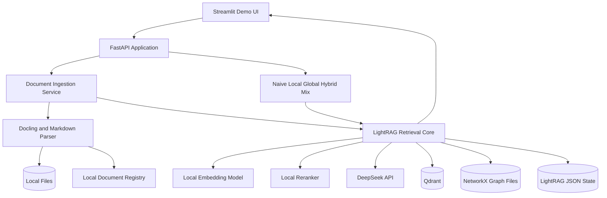

# 多文档混合 RAG 与图谱分析 Demo 项目计划书

> 文档版本：v1.0  
> 制定日期：2026-07-31  
> 项目代号：`rag-graph-demo`  
> 目标运行环境：Apple Silicon M4、16GB 内存、macOS  
> 项目性质：本地演示、技术验证、后续可持续扩展

---

## 当前实施状态

截至 2026-07-31，第一版代码已经覆盖文档上传与注册、Markdown/DOCX/PDF 解析、
LightRAG 五种检索模式、Qdrant/NetworkX/JSON 存储、DeepSeek 适配、来源引用、
FastAPI、Streamlit、图谱展示、模式对比、批量导入、重建、诊断与自动测试。

已在本机通过假模型完成 LightRAG → Qdrant → NetworkX 的初始化、单文档索引、图谱
生成和 `naive` 查询闭环。最终真实语料验收仍需用户在 `.env` 填写
`DEEPSEEK_API_KEY`，并准备 Markdown、DOCX 或文字型 PDF 数据。

---

## 1. 文档用途

本文档是该项目后续设计、Vibe Coding、代码审查和验收的唯一主计划书。

后续使用 Codex 实施时，应以本文档为任务依据，并遵守以下原则：

1. 优先完成可运行、可展示、可验证的最小闭环。
2. 不为了所谓生产化提前引入无必要的基础设施。
3. 每个阶段都必须具有独立的运行结果和验收标准。
4. 先保证检索证据与引用正确，再追求回答语言质量。
5. 向量检索与图谱检索必须能够独立运行和横向比较。
6. 所有模型、端点和密钥必须配置化，禁止硬编码。
7. 在 M4 16GB 环境下控制并发和模型常驻数量。

---

## 2. 项目背景

项目需要构建一个能够处理 Markdown、Word 和 PDF 文档的本地知识库 Demo。初始语料以中英文混合的文字型新闻报道为主，预计几十篇文档。

系统不仅需要提供传统向量检索问答，还需要体现知识图谱对跨文档实体、关系、主题和全局趋势的分析能力，并为最终回答提供可追溯的文档引用。

项目允许将文档内容发送到 DeepSeek API，因此生成式大语言模型和实体关系抽取不要求完全离线。Embedding、Reranker、文档解析和数据库应尽量在本地运行。

---

## 3. 项目目标

### 3.1 核心目标

构建一个可以在本地启动和演示的多文档 RAG 系统，具备以下能力：

1. 上传和管理 Markdown、DOCX、PDF 文档。
2. 将不同格式文档解析为统一的结构化内容。
3. 建立带页码、章节和来源信息的向量索引。
4. 建立跨文档实体关系知识图谱。
5. 提供纯向量、图谱局部、图谱全局和综合检索模式。
6. 使用 DeepSeek 根据检索证据生成答案。
7. 回答中显示文档标题、页码或章节、原文片段等引用。
8. 展示知识图谱，并允许查看实体和关系的证据来源。
9. 支持同一问题在不同检索模式下的结果对比。
10. 在 M4 16GB Mac 上以合理资源占用稳定运行。

### 3.2 展示目标

最终 Demo 应当清楚展示以下差异：

- 向量检索擅长查找具体事实、数字、日期和原文。
- 局部图谱检索擅长分析某个实体周围的直接和间接关系。
- 全局图谱检索擅长总结跨文档主题、趋势和共同模式。
- 综合检索能够同时利用原文证据和图谱关系生成答案。
- 所有模式都应尽可能返回可核验的来源，而不是只展示模型答案。

### 3.3 非目标

第一版明确不实现以下内容：

- 企业级多租户系统。
- 复杂用户、组织和角色权限。
- 公网 SaaS 部署。
- 高可用集群和分布式任务队列。
- 百万级文档处理。
- 视频和音频知识库。
- 复杂扫描件 OCR 优化。
- Neo4j、PostgreSQL、Redis、Elasticsearch、MinIO。
- 本地运行大型生成式语言模型。
- Agent、多工具调用和自动执行工作流。

---

## 4. 已知约束

| 约束 | 当前结论 |
|---|---|
| 计算机 | Apple Silicon M4 |
| 内存 | 16GB |
| 数据规模 | 初期几十篇新闻报道 |
| 文档格式 | Markdown、DOCX、PDF |
| 文档特征 | 文字为主，暂不重点处理复杂扫描件 |
| 文档语言 | 中英文混合 |
| 隐私限制 | 允许发送至 DeepSeek API |
| 项目侧重点 | 快速展示和理解不同 RAG 模式 |
| 本地生成模型 | 不需要 |
| 向量数据库 | 必须使用独立向量数据库 |
| 图谱需求 | 必须展示图谱分析能力 |

---

## 5. 总体技术决策

### 5.1 核心决策

系统采用“LightRAG 单核心、多检索模式”架构：

1. LightRAG 统一负责文本切块后的向量索引、实体关系抽取、知识图谱构建和查询。
2. Qdrant 作为 LightRAG 的向量存储后端，保存文本块、实体和关系向量。
3. NetworkX 作为第一版图存储后端。
4. `naive` 提供纯向量检索基线。
5. `local`、`global`、`hybrid` 提供不同范围的图谱检索。
6. `mix` 同时融合向量、局部图谱和全局图谱，作为默认模式。
7. 项目自定义代码只负责文档解析、来源映射、应用 API、UI 和运行诊断，不重复实现向量检索引擎。

该决策的原因：

- 满足快速 Demo 的优先级。
- 避免维护两套 Chunk、Embedding 和向量索引。
- 可以直接比较 LightRAG 的五种检索模式。
- Qdrant 仍然是独立、可观察的向量数据库。
- 页码和章节引用通过轻量 Sidecar 来源映射解决，无需重写向量 RAG。

### 5.2 技术栈

| 模块 | 选择 |
|---|---|
| 开发语言 | Python 3.11 |
| Python 包管理 | `uv` |
| 后端 API | FastAPI |
| Demo UI | Streamlit |
| 图谱 RAG | LightRAG |
| 文档解析 | Docling |
| 向量数据库 | Qdrant |
| 图存储 | LightRAG 默认 NetworkX 本地存储 |
| LightRAG KV/状态 | 默认本地 JSON 存储 |
| 原始文件存储 | 本地文件系统 |
| Embedding | `Qwen/Qwen3-Embedding-0.6B` |
| Embedding 维度 | 默认 1024，最终以模型实际配置为准 |
| Reranker | `BAAI/bge-reranker-v2-m3` |
| 生成与抽取 LLM | DeepSeek OpenAI 兼容 API |
| 默认 LLM | 通过环境变量配置，初始建议 `deepseek-v4-flash` |
| 容器化范围 | 第一版只容器化 Qdrant |
| 测试 | Pytest |
| 格式与静态检查 | Ruff |

### 5.3 模型名称原则

模型名称和 API 能力会变化，因此不得在业务代码中硬编码当前模型名。

实施时应：

1. 通过 `.env` 配置 DeepSeek 模型名称。
2. 在 README 标注该配置最后验证日期。
3. 启动诊断脚本应验证模型端点可访问。
4. Embedding 模型、维度和归一化策略应写入索引版本元数据。
5. 更换 Embedding 模型或维度后必须创建新索引，禁止混用旧向量。

---

## 6. 总体架构



### 6.1 运行进程

第一版运行以下进程：

1. Qdrant Docker 容器。
2. FastAPI 后端进程。
3. Streamlit UI 进程。
4. FastAPI 进程内按需加载 Embedding。
5. FastAPI 进程内按需加载 Reranker。
6. Docling 在索引任务中按需运行。
7. DeepSeek 通过外部 HTTPS API 调用。

不为 Embedding、Reranker 和 Docling额外建立微服务，避免增加部署与内存成本。

---

## 7. 检索模式定义

系统对用户暴露五种模式。

### 7.1 `naive`

中文名称：纯向量检索。

流程：

1. LightRAG 对用户问题生成查询向量。
2. LightRAG 从 Qdrant 文本块向量中召回候选。
3. 使用可选 Reranker 重排。
4. 将最终原文证据交给 DeepSeek 回答。
5. 通过来源映射返回文档、页码或章节引用。

适合：

- 数字、时间和具体事实。
- 查找某段报道原文。
- 单文档问答。
- 需要高精度引用的问题。

### 7.2 `local`

中文名称：图谱局部检索。

LightRAG 模式：`local`。

流程：

1. 识别问题中的关键实体。
2. 从图谱中获取实体、邻接关系和相关文本单元。
3. 尽量请求 LightRAG 返回上下文而非直接作为最终答案。
4. 由统一回答生成器输出最终答案。

适合：

- 人物、公司、产品和事件之间的关系。
- 围绕单个实体展开的关联分析。

### 7.3 `global`

中文名称：图谱全局分析。

LightRAG 模式：`global`。

适合：

- 整批新闻的核心主题。
- 行业趋势。
- 多个社区之间的共同模式。
- 跨文档的宏观总结。

### 7.4 `hybrid`

中文名称：图谱混合检索。

LightRAG 模式：`hybrid`。

适合：

- 同时需要实体局部关系和全局主题的问题。

### 7.5 `mix`

中文名称：综合检索，作为默认模式。

流程：

1. LightRAG 同时召回原始文本块、局部实体关系和全局图谱信息。
2. 使用可选 Reranker 对可重排文本证据排序。
3. LightRAG 控制上下文预算并调用 DeepSeek。
4. 答案只允许使用检索得到的证据。
5. 返回引用和本次使用的关键实体、关系。

### 7.6 模式对比

UI 应支持对同一个问题并行或顺序运行以下模式：

- `naive`
- `local`
- `global`
- `mix`

对比视图至少显示：

- 回答内容。
- 总耗时。
- DeepSeek 调用次数。
- 输入和输出 Token 数量，如 API 可返回。
- 检索到的 Chunk 数量。
- 使用的实体和关系数量。
- 引用数量。

---

## 8. 文档摄取流程

### 8.1 状态机

每个文档具有以下状态：

```text
uploaded
  -> parsing
  -> parsed
  -> vector_indexing
  -> vector_ready
  -> graph_indexing
  -> ready
```

失败状态：

```text
parse_failed
vector_failed
graph_failed
```

设计要求：

- 向量索引和图谱索引失败必须分开记录。
- `vector_ready` 状态下文档已经可以进行向量问答。
- 图谱构建较慢时，不应阻塞向量检索。
- 失败任务可以重试。
- 重新上传相同文件时根据 SHA-256 判断重复。

### 8.2 上传

支持扩展名：

- `.md`
- `.markdown`
- `.docx`
- `.pdf`

上传时执行：

1. 校验扩展名和 MIME 类型。
2. 限制单文件大小，默认 50MB，可配置。
3. 计算 SHA-256。
4. 创建 `document_id`。
5. 将原文件保存到 `data/raw/{document_id}/`。
6. 创建文档注册记录。

### 8.3 解析

#### Markdown

- 直接读取 UTF-8 文本。
- 解析标题层级。
- 保留列表、代码块和表格。
- 章节级引用优先使用标题路径。

#### DOCX

- 使用 Docling。
- 保留标题、段落、列表和表格。
- DOCX 通常没有稳定页面语义，引用使用章节标题和段落序号。

#### PDF

- 使用 Docling。
- 第一版主要支持文字型 PDF。
- 必须尽量保留页码。
- OCR 是否启用通过配置决定，默认关闭或自动。

### 8.4 规范化产物

每个文档解析后保存：

```text
data/parsed/{document_id}/document.md
data/parsed/{document_id}/document.json
data/parsed/{document_id}/chunks.jsonl
```

`document.json` 至少包含：

```json
{
  "document_id": "uuid",
  "title": "文档标题",
  "source_filename": "example.pdf",
  "mime_type": "application/pdf",
  "language": "mixed",
  "checksum": "sha256",
  "parser": "docling",
  "parser_version": "configured-version",
  "created_at": "ISO-8601",
  "pages": []
}
```

### 8.5 Chunk 设计

第一版使用标题感知加递归字符切块：

1. 优先按标题和段落划分语义区段。
2. 超长区段再递归切分。
3. 不跨越明显的文档章节边界。
4. 表格尽量作为完整块保留。
5. 每个 Chunk 保留稳定的来源信息。

初始建议参数：

| 参数 | 初始值 |
|---|---:|
| 目标 Chunk 长度 | 500 至 800 Token |
| 最大 Chunk 长度 | 1000 Token |
| 重叠长度 | 80 至 120 Token |
| 向量召回数 | 20 |
| Reranker 输出数 | 6 至 10 |
| 最终引用数 | 3 至 8 |

参数必须配置化，并在评估后调整。

### 8.6 Chunk 数据结构

```json
{
  "chunk_id": "stable-id",
  "document_id": "uuid",
  "source_id": "stable-source-id",
  "chunk_index": 0,
  "title": "文档标题",
  "section_path": ["一级标题", "二级标题"],
  "page_number": 3,
  "paragraph_start": 10,
  "paragraph_end": 13,
  "language": "zh-en",
  "text": "chunk text",
  "content_hash": "sha256",
  "embedding_model": "configured-model",
  "embedding_dimension": 1024
}
```

`chunk_id` 必须稳定。相同文档内容和切块配置不变时，重新构建应得到相同 ID。

---

## 9. 存储设计

### 9.1 Qdrant

Qdrant 作为 LightRAG 的唯一向量存储后端，由 LightRAG 管理文本块、实体和关系向量。

应用层不直接创建重复的向量集合，也不绕过 LightRAG 执行检索。来源页码和章节保存在本地 Sidecar 注册表中，通过稳定来源 ID、文件路径或内容哈希与 LightRAG 返回的文本单元建立映射。

设计要求：

- 开发环境只配置一个 Qdrant 节点。
- 数据持久化到本地 Docker Volume 或工作区目录。
- 文档删除和重建统一通过 LightRAG Adapter 执行。
- LightRAG 增量删除行为必须单独验证。
- 索引版本变化时优先新建集合，不在原集合中混用维度。

### 9.2 文档注册表

第一版采用本地 JSON 注册表，不增加 SQLite。

路径：

```text
data/registry/documents.json
data/registry/jobs.json
data/registry/index_versions.json
```

要求：

- 使用文件锁或原子写入，避免文件损坏。
- 每次写入先写临时文件再原子替换。
- 后续如需要多用户和并发，再迁移至 SQLite/PostgreSQL。

### 9.3 LightRAG 存储

第一版使用：

- 图存储：NetworkX 本地文件。
- KV 存储：LightRAG 默认 JSON。
- 文档状态：LightRAG 默认 JSON。
- 向量存储：Qdrant。

不使用 Neo4j。NetworkX 已足够承载几十篇新闻构建出的图谱。

### 9.4 文件目录

```text
data/
  raw/
  parsed/
  registry/
  lightrag/
  exports/
  logs/
```

`data/` 默认加入 `.gitignore`，但保留空目录占位文件。

---

## 10. 模型与调用策略

### 10.1 DeepSeek

通过 OpenAI 兼容客户端接入。

配置项：

```text
DEEPSEEK_API_KEY
DEEPSEEK_BASE_URL
DEEPSEEK_CHAT_MODEL
DEEPSEEK_EXTRACTION_MODEL
DEEPSEEK_THINKING_ENABLED
```

角色分工：

| 任务 | 初始策略 |
|---|---|
| LightRAG 实体关系抽取 | Flash 类模型，关闭思考 |
| 关键词提取 | Flash 类模型，关闭思考 |
| Query Rewrite | Flash 类模型，关闭思考 |
| 最终回答 | Flash 类模型，关闭思考 |
| 复杂全局分析 | 可配置启用思考或更高质量模型 |

要求：

- 索引阶段和查询阶段可以使用不同模型。
- 所有 API 调用设置超时和重试。
- 结构化输出失败应记录原始响应的安全摘要，不记录密钥。
- 为 LightRAG 启用已有缓存能力。
- UI 展示调用耗时和 Token 统计，不展示密钥。

### 10.2 Embedding

默认模型：

```text
Qwen/Qwen3-Embedding-0.6B
```

要求：

- 优先使用 Apple MPS。
- MPS 不可用时回退 CPU。
- 输出向量执行与模型建议一致的归一化。
- Query 和 Document 使用模型推荐的提示格式。
- 将模型名称、维度和归一化方式写入索引版本。
- 启动时检查 Qdrant 集合维度是否一致。

### 10.3 Reranker

默认模型：

```text
BAAI/bge-reranker-v2-m3
```

要求：

- 通过功能开关启用。
- 第一里程碑允许关闭 Reranker。
- 模型只在首次使用时懒加载。
- 限制候选数量，避免对过多文本逐条评分。
- 内存不足时回退到向量相似度排序，并在 UI 显示降级提示。

### 10.4 M4 16GB 资源策略

- 不运行本地生成式 LLM。
- 文档解析并发默认 `1`。
- 文档图谱索引并发默认 `1`。
- DeepSeek 抽取并发初始不超过 `2`。
- Embedding 批大小从保守值开始。
- Embedding 和 Reranker采用懒加载。
- 执行大量文档索引时避免同时运行多模式查询。
- 提供环境变量控制并发和批次。

---

## 11. 引用设计

### 11.1 引用目标

引用不是简单显示文件名，而是必须回答：

- 答案依据哪篇文档？
- PDF 的哪一页？
- Markdown 或 DOCX 的哪个章节？
- 对应原文是什么？
- 该引用来自向量召回还是图谱证据？

### 11.2 引用对象

```json
{
  "citation_id": "c1",
  "source_id": "stable-source-id",
  "document_id": "uuid",
  "document_title": "title",
  "source_filename": "file.pdf",
  "page_number": 3,
  "section_path": ["section"],
  "excerpt": "source excerpt",
  "retrieval_channel": "vector",
  "score": 0.91
}
```

`retrieval_channel` 可选值：

- `naive`
- `graph_entity`
- `graph_relation`
- `graph_text_unit`
- `mix`

### 11.3 回答协议

最终回答生成 Prompt 要求模型：

1. 只能基于提供证据回答。
2. 每个重要事实后添加引用标记，例如 `[1]`。
3. 不得生成未提供的引用 ID。
4. 证据不足时明确说明。
5. 区分文档原文事实与图谱推断。
6. 对推断性内容使用“根据现有报道推断”等表述。

后端不得完全相信模型生成的引用标记，必须验证引用 ID 是否存在。

### 11.4 LightRAG 来源映射技术验证

项目早期必须执行一个技术验证：

1. 确认当前 LightRAG 版本能否返回图谱上下文关联的原始文本单元或文件路径。
2. 确认是否能向 LightRAG 插入自定义文档 ID 或来源标记。
3. 如果 LightRAG 无法保留页级元数据，则使用内容哈希或稳定来源标记建立 Sidecar 映射。
4. 如果图谱证据无法精确到页，则至少返回文档级引用，并明确标注为图谱来源。
5. `mix` 模式中的具体事实引用优先关联 LightRAG 返回的原始文本单元。

---

## 12. 后端 API

API 基础路径：

```text
/api/v1
```

### 12.1 健康检查

```text
GET /health
GET /ready
GET /diagnostics
```

`/ready` 至少检查：

- Qdrant 连接。
- DeepSeek 配置是否存在。
- 数据目录可写。
- LightRAG 工作目录可用。
- Embedding 模型配置有效。

### 12.2 文档管理

```text
POST   /documents
GET    /documents
GET    /documents/{document_id}
DELETE /documents/{document_id}
POST   /documents/{document_id}/reindex
POST   /documents/{document_id}/retry-graph
```

上传接口使用 `multipart/form-data`。

文档列表返回：

- 文件名。
- 文档标题。
- 类型。
- 大小。
- 上传时间。
- 页数。
- Chunk 数量。
- 向量索引状态。
- 图谱索引状态。
- 错误摘要。

### 12.3 任务状态

```text
GET /jobs/{job_id}
GET /jobs
```

第一版允许使用进程内后台任务，但必须保存任务状态。应用重启后未完成任务标记为中断，不假装成功。

### 12.4 问答

```text
POST /query
```

请求示例：

```json
{
  "question": "这些报道反映了哪些 AI 行业趋势？",
  "mode": "mix",
  "document_ids": [],
  "top_k": 20,
  "rerank_top_n": 8,
  "include_context": true,
  "include_graph": true
}
```

响应示例：

```json
{
  "answer": "... [1]",
  "mode": "mix",
  "citations": [],
  "vector_contexts": [],
  "graph_context": {},
  "entities": [],
  "relationships": [],
  "timing": {
    "retrieval_ms": 0,
    "rerank_ms": 0,
    "generation_ms": 0,
    "total_ms": 0
  },
  "usage": {
    "prompt_tokens": 0,
    "completion_tokens": 0
  },
  "warnings": []
}
```

### 12.5 模式比较

```text
POST /query/compare
```

默认比较：

- `naive`
- `local`
- `global`
- `mix`

第一版可以顺序执行，避免同时占用过多内存和 API 并发。

### 12.6 图谱

```text
GET /graph
GET /graph/entities/{entity_id}
GET /graph/relationships/{relationship_id}
GET /graph/search?q=...
```

图谱响应应转换为前端友好的节点和边：

```json
{
  "nodes": [],
  "edges": [],
  "stats": {
    "node_count": 0,
    "edge_count": 0
  }
}
```

---

## 13. Streamlit UI

### 13.1 页面结构

第一版包含五个页面：

1. 系统状态。
2. 文档管理。
3. 知识库问答。
4. 检索模式对比。
5. 知识图谱。

### 13.2 系统状态

显示：

- Qdrant 状态。
- DeepSeek 配置状态。
- Embedding 模型状态。
- Reranker 状态。
- 文档数量。
- Chunk 数量。
- 图节点和边数量。
- 当前索引版本。

### 13.3 文档管理

功能：

- 拖拽上传多个文件。
- 查看解析和索引状态。
- 查看解析后的 Markdown。
- 查看失败原因。
- 重试向量索引。
- 重试图谱索引。
- 删除文档。

删除功能必须提示：LightRAG 图谱中的实体可能来自多个文档，第一版如果无法安全增量删除图数据，应提供“删除后重建图谱”的明确操作。

### 13.4 知识库问答

功能：

- 问题输入框。
- 模式选择。
- 文档范围筛选。
- 是否启用 Reranker。
- 回答区。
- 引用列表。
- 检索证据折叠面板。
- 实体和关系摘要。
- 耗时和 Token 信息。

### 13.5 检索模式对比

同一个问题展示四列或四个标签页：

- 纯向量。
- 局部图谱。
- 全局图谱。
- 综合检索。

每种模式显示回答、引用、耗时和检索统计。

### 13.6 知识图谱

第一版可以使用 PyVis、Plotly 或适合 Streamlit 的轻量网络图组件。

功能：

- 展示图谱节点和边。
- 按实体名称搜索。
- 按实体类型过滤。
- 控制最大节点数量。
- 点击节点查看描述和来源。
- 点击关系查看关系说明和来源。
- 避免一次渲染整个大图导致浏览器卡顿。

---

## 14. 建议目录结构

```text
rag-graph-demo/
  PROJECT_PLAN.md
  README.md
  pyproject.toml
  uv.lock
  .env.example
  .gitignore
  docker-compose.yml

  src/
    rag_graph_demo/
      __init__.py
      config.py
      logging_config.py

      api/
        app.py
        dependencies.py
        routes/
          health.py
          documents.py
          jobs.py
          query.py
          graph.py

      domain/
        models.py
        enums.py
        exceptions.py

      ingestion/
        service.py
        markdown_parser.py
        docling_parser.py
        normalizer.py
        chunker.py
        source_ids.py

      lightrag/
        lightrag_adapter.py
        graph_reader.py
        source_mapper.py
        context_budget.py

      generation/
        deepseek_client.py
        prompts.py
        answer_service.py
        citation_validator.py

      storage/
        atomic_json.py
        document_registry.py
        job_registry.py
        file_store.py

      services/
        document_service.py
        query_service.py
        diagnostics_service.py

      ui/
        streamlit_app.py
        pages/
          system_status.py
          documents.py
          chat.py
          compare.py
          graph.py

  scripts/
    doctor.py
    ingest_directory.py
    rebuild_vector_index.py
    rebuild_graph_index.py
    reset_demo_data.py

  tests/
    unit/
    integration/
    fixtures/

  data/
    raw/.gitkeep
    parsed/.gitkeep
    registry/.gitkeep
    lightrag/.gitkeep
    exports/.gitkeep
    logs/.gitkeep
```

允许在实施中根据 LightRAG 当前 API 轻微调整目录，但不得打破向量、图谱、融合、生成和存储之间的职责边界。

---

## 15. 环境变量

`.env.example` 至少包含：

```dotenv
APP_ENV=development
APP_HOST=127.0.0.1
APP_PORT=8000
STREAMLIT_PORT=8501
DATA_DIR=./data

QDRANT_URL=http://127.0.0.1:6333
QDRANT_API_KEY=
QDRANT_COLLECTION_PREFIX=rag_demo
INDEX_VERSION=v1

DEEPSEEK_API_KEY=
DEEPSEEK_BASE_URL=
DEEPSEEK_CHAT_MODEL=deepseek-v4-flash
DEEPSEEK_EXTRACTION_MODEL=deepseek-v4-flash
DEEPSEEK_THINKING_ENABLED=false
LLM_REQUEST_TIMEOUT_SECONDS=120
LLM_MAX_RETRIES=3
LLM_MAX_CONCURRENCY=2

EMBEDDING_MODEL=Qwen/Qwen3-Embedding-0.6B
EMBEDDING_DIMENSION=1024
EMBEDDING_DEVICE=auto
EMBEDDING_BATCH_SIZE=8

RERANKER_ENABLED=true
RERANKER_MODEL=BAAI/bge-reranker-v2-m3
RERANKER_DEVICE=auto

PARSER_OCR_ENABLED=false
MAX_UPLOAD_SIZE_MB=50
CHUNK_TARGET_TOKENS=700
CHUNK_MAX_TOKENS=1000
CHUNK_OVERLAP_TOKENS=100

VECTOR_TOP_K=20
RERANK_TOP_N=8
MAX_CONTEXT_TOKENS=24000

LIGHTRAG_WORKING_DIR=./data/lightrag
LIGHTRAG_WORKSPACE=demo_v1
GRAPH_INDEX_CONCURRENCY=1
```

实际变量名称可以根据 LightRAG 当前版本要求适配，但应用层变量应保持清晰。

---

## 16. Docker Compose

第一版 `docker-compose.yml` 只包含 Qdrant：

- 使用固定版本镜像，不使用浮动 `latest`。
- 映射 `6333` 和需要的管理端口。
- 持久化数据。
- 设置重启策略。
- 不在 Compose 中写入 DeepSeek 密钥。

应用、UI 和模型在 macOS 主机运行。

---

## 17. 日志和可观测性

日志必须使用结构化字段，至少包含：

- `request_id`
- `job_id`
- `document_id`
- `query_mode`
- `duration_ms`
- `model`
- `retry_count`
- `error_type`

不得记录：

- DeepSeek API Key。
- 完整 Authorization Header。
- 无限制的完整文档内容。

UI 或 API 应显示：

- 索引进度。
- 最近失败任务。
- LLM 请求次数。
- Token 使用情况。
- 各检索阶段耗时。

---

## 18. 错误处理和降级

### 18.1 DeepSeek 不可用

- 文档解析和向量索引仍可完成。
- 图谱索引标记失败或等待重试。
- 查询返回明确错误，不伪造回答。

### 18.2 Reranker 加载失败

- 回退到向量相似度排序。
- UI 显示“Reranker 已降级”。

### 18.3 LightRAG 图索引失败

- 文档保持 `vector_ready`。
- 纯向量模式继续可用。
- 图谱模式显示索引未完成。

### 18.4 Qdrant 不可用

- `/ready` 返回未就绪。
- 禁止开始新的向量索引。
- 不尝试静默切换到内存数据库。

### 18.5 引用不足

- 回答服务返回“现有文档证据不足”。
- 不允许模型仅凭自身知识补全关键事实。

---

## 19. 测试策略

### 19.1 单元测试

覆盖：

- 稳定 Chunk ID。
- 来源 ID 生成。
- Markdown 标题解析。
- Chunk 元数据保留。
- 引用 ID 验证。
- JSON 原子写入。
- 状态机转换。
- Context Token 预算。
- 模式路由。

### 19.2 集成测试

覆盖：

- Qdrant 写入、查询和按文档删除。
- DeepSeek 客户端使用 Mock Server 的重试和超时。
- Docling 对小型 PDF、DOCX 的解析。
- LightRAG Adapter 的最小插入和查询。
- 综合检索的上下文融合。

### 19.3 端到端测试

准备至少三份小型测试文档：

1. Markdown。
2. DOCX。
3. 两页文字型 PDF。

验证：

- 上传。
- 解析。
- 向量索引。
- 图谱索引。
- 四种模式查询。
- 引用点击。
- 删除或重建。

### 19.4 测试边界

- 不在普通测试中调用真实 DeepSeek API。
- 提供一个显式的手动 Smoke Test 命令调用真实 API。
- 网络测试和模型下载测试必须与快速单元测试分离。

---

## 20. 效果评估

### 20.1 评估问题集

准备 15 至 30 个问题，分为：

- 具体事实型。
- 单文档摘要型。
- 实体关系型。
- 跨文档比较型。
- 全局趋势型。
- 证据不足型。

### 20.2 指标

第一版人工评估：

| 指标 | 说明 |
|---|---|
| Answer Correctness | 答案事实是否正确 |
| Citation Correctness | 引用是否支持对应事实 |
| Citation Completeness | 重要事实是否都有引用 |
| Retrieval Relevance | 召回内容是否相关 |
| Graph Usefulness | 图谱是否带来向量检索没有的关系信息 |
| Latency | 各模式耗时 |
| Cost | DeepSeek Token 和请求数量 |

### 20.3 必须保留的基线

不得只展示综合模式。必须保留纯向量模式作为基线，否则无法判断图谱带来的真实收益。

---

## 21. Demo 语料要求

最终演示语料应围绕一个集中主题收集 20 至 50 篇新闻，例如：

- AI 公司及人物关系。
- 模型发布和竞争。
- 融资和投资关系。
- 芯片供应链。
- 监管政策。

不建议使用彼此完全无关的新闻，否则图谱会形成大量孤立节点，难以展示跨文档分析能力。

每份演示文档应记录：

- 来源标题。
- 发布时间。
- 发布机构。
- 原始文件。
- 是否允许演示。

---

## 22. 实施阶段

### Phase 0：技术验证

目标：在写完整应用前验证核心依赖在 M4 16GB 上可用。

任务：

1. 建立 Python 3.11 和 `uv` 项目。
2. 启动 Qdrant ARM64 容器。
3. 验证 Qwen3 Embedding 在 MPS 上运行。
4. 验证 Reranker 在 MPS 或 CPU 上运行。
5. 验证 DeepSeek OpenAI 兼容调用。
6. 验证 LightRAG 使用 DeepSeek 完成最小实体关系抽取。
7. 验证 LightRAG 使用 Qdrant 向量存储。
8. 验证 Docling 解析一份 PDF 和一份 DOCX。
9. 验证 LightRAG 上下文和来源信息可映射程度。

验收：

- 所有核心组件均能单独运行。
- 输出一份技术验证报告。
- 明确 MPS 回退策略。
- 明确 LightRAG 来源映射实现方案。

### Phase 1：文档接入与 LightRAG `naive`

任务：

1. 实现配置、日志和目录结构。
2. 实现上传、注册和文件保存。
3. 实现 Markdown、DOCX、PDF 解析。
4. 实现规范化内容和来源映射。
5. 封装 LightRAG Adapter。
6. 配置 LightRAG 使用 Qdrant 和本地 Embedding。
7. 跑通 `naive` 纯向量模式。
8. 实现文档级和页级引用映射。
9. 实现基础 Streamlit 文档页和问答页。

验收：

- 三种文档格式均可上传。
- 纯向量模式可回答问题。
- PDF 引用可以定位页码。
- Markdown/DOCX 引用可以定位章节。

### Phase 2：LightRAG 图谱模式

任务：

1. 使用规范化文档进行实体关系抽取和图谱索引。
2. 完成 DeepSeek 抽取模型配置和失败重试。
3. 支持 `local`、`global` 和 `hybrid` 查询。
4. 读取并转换图谱节点和边。
5. 实现图谱页面。
6. 实现图谱文档来源映射。

验收：

- 文档可建立实体关系图谱。
- 可以查看节点和关系。
- 可以运行局部与全局图谱问题。
- 图谱失败不影响向量模式。

### Phase 3：`mix` 与模式对比

任务：

1. 跑通 LightRAG `mix` 模式。
2. 调整 LightRAG 上下文 Token 预算。
3. 接入 Reranker。
4. 完善统一回答与引用展示。
5. 实现模式对比页面。
6. 记录耗时、Token、召回和引用统计。

验收：

- 同一问题可以比较四种模式。
- `mix` 模式同时使用向量和图谱证据。
- 回答中的引用经过后端校验。

### Phase 4：稳定性和演示完善

任务：

1. 完善失败重试和降级。
2. 增加诊断脚本。
3. 增加批量目录导入。
4. 增加重建向量和图谱索引脚本。
5. 准备测试语料和演示问题。
6. 完善 README 和一键启动说明。
7. 执行端到端验收。

验收：

- 新环境按 README 可以完成启动。
- Demo 连续运行并完成预置问题。
- 已知限制得到明确说明。

---

## 23. 验收标准

### 23.1 功能验收

- [ ] 支持 Markdown 上传和索引。
- [ ] 支持 DOCX 上传和索引。
- [ ] 支持文字型 PDF 上传和索引。
- [ ] 使用 Qdrant 作为向量数据库。
- [ ] 使用 LightRAG 建立知识图谱。
- [ ] 支持纯向量模式。
- [ ] 支持局部图谱模式。
- [ ] 支持全局图谱模式。
- [ ] 支持综合检索模式。
- [ ] 回答包含可核验引用。
- [ ] PDF 引用尽量精确到页。
- [ ] Markdown/DOCX 引用精确到章节。
- [ ] 图谱节点和关系可以可视化。
- [ ] 同一问题可以比较不同模式。

### 23.2 工程验收

- [ ] Qdrant 可以通过 Docker Compose 启动。
- [ ] 应用不依赖 Neo4j、PostgreSQL 或 Redis。
- [ ] 密钥只从环境变量读取。
- [ ] 数据目录不会提交到 Git。
- [ ] 核心单元测试通过。
- [ ] 集成测试可单独运行。
- [ ] README 包含从零启动步骤。
- [ ] 提供系统诊断命令。
- [ ] 提供向量索引重建命令。
- [ ] 提供图谱索引重建命令。

### 23.3 资源验收

- [ ] 在 M4 16GB 上可以完成单文档解析和索引。
- [ ] 可以处理 20 至 50 篇文字型新闻。
- [ ] 不需要本地运行生成式 LLM。
- [ ] 索引并发默认不会导致明显内存交换或系统失去响应。

---

## 24. 风险与应对

### 风险 1：LightRAG 与 DeepSeek 结构化输出兼容性

应对：

- Phase 0 优先验证。
- 关闭思考模式。
- 使用较低温度。
- 缓存成功抽取结果。
- 对失败文档支持重试。

### 风险 2：LightRAG 来源不能精确映射页码

应对：

- 使用稳定 `source_id`、文件路径或内容哈希建立轻量 Sidecar 映射。
- 优先映射 LightRAG 返回的原始文本单元。
- 图谱证据最低保证文档级引用。

### 风险 3：MPS 模型兼容或内存不足

应对：

- 支持 CPU 回退。
- 模型懒加载。
- 降低批大小。
- Reranker 可关闭。
- 文档串行解析。

### 风险 4：图谱实体重复或关系错误

应对：

- 使用主题集中语料。
- 定义适合新闻的实体类型。
- 保留关系原始来源。
- Demo 中将图谱内容视为可验证分析，不视为绝对事实。
- 后续加入实体别名和规范化。

### 风险 5：删除单文档后的图谱一致性

应对：

- 第一版优先采用“删除后重建图谱”。
- 向量集合支持按文档精确删除。
- UI 明确提示图谱重建状态。

### 风险 6：上游 LightRAG API 变化

应对：

- 固定依赖版本。
- 所有 LightRAG 调用集中在 Adapter。
- 禁止业务代码直接散布 LightRAG 内部 API。

---

## 25. Codex 实施规则

后续 Codex 根据本文档编写代码时必须遵守：

1. 每次只实施一个 Phase 或一个可独立验收的子阶段。
2. 开始编码前先检查当前仓库和适用的 `AGENTS.md`。
3. 不未经批准升级已固定的核心依赖。
4. 不引入 Neo4j、PostgreSQL、Redis、Celery 等计划外组件。
5. 不重写 LightRAG 内核，优先通过 Adapter 集成。
6. 不让 Streamlit 直接操作 Qdrant 或 LightRAG，统一经过服务层或 API。
7. 所有外部调用必须有超时、重试和错误类型。
8. 所有持久化数据必须有稳定 ID 和版本信息。
9. 每完成一个阶段必须运行相关测试并更新 README。
10. 不为了演示隐藏失败；UI 应显示真实状态和降级情况。
11. 不将 DeepSeek 密钥、真实文档和模型缓存提交到 Git。
12. 如果当前 LightRAG API 与计划假设不一致，先记录差异并提出最小调整，不直接大规模改架构。

---

## 26. 推荐的 Codex 开发任务拆分

### Task 0：项目脚手架

生成：

- `pyproject.toml`
- `.env.example`
- `docker-compose.yml`
- 基础 `src` 目录
- 配置系统
- 健康检查
- Ruff/Pytest 配置

### Task 1：核心依赖技术验证

生成独立验证脚本，不立即开发完整 UI。

### Task 2：文档注册与解析

先实现 Markdown，再实现 DOCX/PDF。

### Task 3：LightRAG 向量模式

实现 Qdrant、Embedding、`naive` 查询、回答和引用映射。

### Task 4：LightRAG 图谱模式

完成插入、状态和三种图谱查询模式。

### Task 5：LightRAG `mix`

完成 `mix`、Reranker、Token 预算和统一回答。

### Task 6：Streamlit Demo

完成文档、问答、比较和图谱页面。

### Task 7：稳定性与文档

完成诊断、重建、测试、README 和演示数据说明。

---

## 27. Definition of Done

项目只有满足以下条件才视为完成：

1. 在 M4 16GB Mac 上按 README 从零启动成功。
2. Qdrant 数据可以持久化并在重启后保留。
3. Markdown、DOCX 和文字型 PDF 可以被索引。
4. 至少一批主题集中的新闻可以生成有意义的图谱。
5. 纯向量、局部图谱、全局图谱和综合模式都可以回答问题。
6. 向量模式中的关键事实具有准确引用。
7. 图谱模式至少具有文档级来源，能映射时提供更细引用。
8. 模式对比页面可以说明图谱检索相对向量检索的价值。
9. DeepSeek、Qdrant或Reranker失败时具有明确错误和降级行为。
10. 自动测试、手动 Smoke Test 和预置 Demo 问题均有记录。

---

## 28. 后续扩展方向

第一版完成后，可以按需求选择：

- 使用 SQLite 或 PostgreSQL 替换 JSON 注册表。
- 使用 Neo4j 替换 NetworkX。
- 支持网页抓取和 URL 导入。
- 支持扫描 PDF 和 MinerU。
- 支持文档标签和知识库集合。
- 支持对话历史和上下文追问。
- 支持时间线检索。
- 支持实体合并、别名和人工修正。
- 支持自动评估框架。
- 将 Streamlit 替换为 Next.js。
- 部署为局域网服务。
- 增加用户和知识库权限。

这些均不属于第一版范围。

---

## 29. 官方参考项目

- LightRAG：<https://github.com/HKUDS/LightRAG>
- Microsoft GraphRAG：<https://github.com/microsoft/graphrag>
- Qdrant：<https://github.com/qdrant/qdrant>
- Docling：<https://github.com/docling-project/docling>
- Qwen3 Embedding：<https://huggingface.co/Qwen/Qwen3-Embedding-0.6B>
- BGE Reranker：<https://huggingface.co/BAAI/bge-reranker-v2-m3>
- DeepSeek API 文档：<https://api-docs.deepseek.com/>

---

## 30. 最终架构摘要

本项目最终确定为：

> 使用 Docling 将 Markdown、DOCX 和 PDF 解析为带来源元数据的规范化内容；使用 LightRAG 作为唯一检索核心，以本地 Qwen3 Embedding、Qdrant、NetworkX 和 DeepSeek 同时实现 `naive`、`local`、`global`、`hybrid` 和 `mix`；通过轻量来源映射补充页码和章节引用；使用 FastAPI 和 Streamlit 构建适合 M4 16GB Mac 的本地演示系统。
