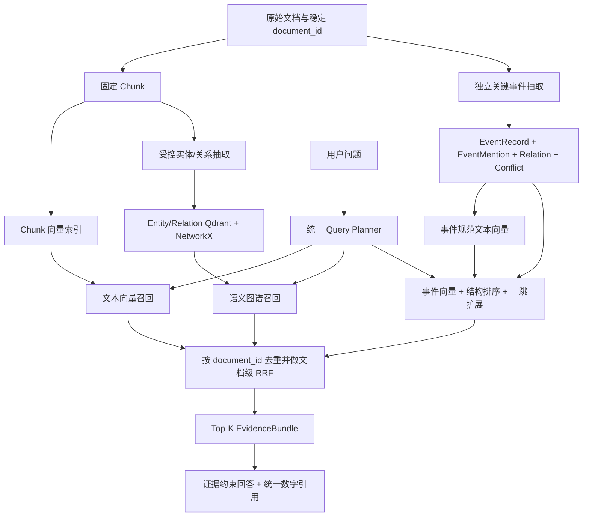

# 三通路协同与证据融合技术报告

> 版本：当前实现 `three_path_v2_soft_event_hints`  
> Query Planner：`query_planner_v2_soft_event_hints`  
> 事件抽取模板：`event_v4_key_events`  
> 范围：本文只说明 `light_entity` 与 `ours` 使用的数据组织、三路检索和证据融合，不讨论部署安装。

## 1. 设计目标

系统要解决的不是“把三种检索结果拼在一起”，而是让三条通路分别承担不可替代的职责，
最后交付同一批可追溯、可去重、可比较的文档证据：

| 通路 | 核心问题 | 擅长的信息 | 单独使用时的盲点 |
|---|---|---|---|
| 文本向量通路 | 哪段原文在整体语义上最像问题？ | 直接事实、近义表达、完整上下文 | 不显式表达跨文档关系、时间变化和立场 |
| 语义图谱通路 | 问题涉及谁，以及对象之间如何连接？ | 实体、关系、多跳连接、跨文档聚合 | 静态图容易弱化事件发生时间、状态变化和冲突 |
| 事件通路 | 什么在何时发生，以什么状态成立？ | 动作、时间、结果、演化、否认、纠正、多来源状态 | 抽取可能遗漏；不应代替完整原文和稳定实体图 |

三者的分工可以概括为：

- 文本向量保留“原文说了什么”；
- 语义图谱组织“核心对象之间有什么关系”；
- 事件通路表达“关系何时以何种状态发生或改变”。

因此事件不是关系的另一种命名。关系通常是较稳定的断言，例如“模型使用数据集”；事件是
带动作、时间、结果和立场的一次发生，例如“机构在2025年发布模型并替代旧版本”。

## 2. 方法边界与公平对比

当前实验中的三个 LightRAG 相关方法定义如下：

| 方法 | 图索引 | 查询通路 | 用途 |
|---|---|---|---|
| `light` | 官方 LightRAG 默认实体关系抽取 | 官方 `mix` | 原始基线 |
| `light_entity` | 受控实体关系抽取 | 文本向量＋语义图谱 | 无事件的核心消融 |
| `ours` | **完全复用 `light_entity` 的图索引** | 文本向量＋语义图谱＋事件 | 测量事件通路的增量 |

`light` 与 `light_entity` 使用不同的 LightRAG working directory 和 Qdrant
`workspace_id`，避免默认抽取与受控抽取互相污染。`ours` 不再建立第二份实体关系图，而是
直接使用 `light_entity_engine`，只增加事件表、事件向量和查询时的第三路融合。因此：

```text
ours - light_entity = 事件索引 + 事件检索 + 三路融合
```

两者使用相同问题、相同 Query Planner、相同文本向量路、相同语义图谱路、相同Top-K预算。
这使指标差异能直接解释为事件通路的贡献，而不是实体抽取或图索引不同造成的差异。

## 3. 总体数据流



索引阶段三路共享稳定的 `document_id`，查询阶段所有候选最终也映射回这个文档ID。这是跨
通路去重和证据追踪能够成立的基础。

## 4. 索引阶段

### 4.1 固定切块与文档身份

评测首先把所有方法使用的语料切成相同 Chunk。当前默认配置为：

- Chunk目标大小：700 tokens；
- Chunk重叠：100 tokens；
- 每个测试Chunk具有稳定 `chunk_id`；
- 文件路径编码父级 `document_id + chunk_id`，使LightRAG结果能够映射回金证据文档。

LightRAG可能根据自身token规则再次细分输入，但父文档ID和来源路径保持稳定。融合与评测
按父级 `document_id` 工作，而不是把同一篇长文中的多个片段误当成多份独立证据。

### 4.2 通路一：原文Chunk向量索引

文本向量通路对原文Chunk生成Embedding并存入Qdrant。它不要求问题或文档先被实体抽取，
所以能保留：

- 实体抽取器省略的细节；
- 金额、日期、指标、引语等局部事实；
- 与问题措辞不同但整体语义相近的片段；
- 图谱难以表达的长描述和条件。

这一通路是召回的“原文安全网”。即使实体图或事件图漏抽，相关原文仍有机会进入候选集。

### 4.3 通路二：受控实体关系图索引

`light_entity` 使用 `prompts/entity_type/light_entity.yaml`，不做穷举式NER。每个Chunk只抽取
删除后会明显损害核心事实或必要多跳链的稳定知识锚点：

- 最多4个绝对关键实体；
- 最多4条关键关系；
- 关系两端必须都属于最终保留实体；
- 单纯共现、标题、宽泛主题和普通引用作者不建图；
- 事件、发布、实验、纠正等发生性信息交给事件通路；
- 描述长度不压缩，保留理解断言所需的支持信息。

索引产物分为两层：

1. Qdrant保存实体向量、关系向量及来源Chunk向量，用于语义定位；
2. NetworkX GraphML保存实体—关系拓扑，用于邻域和多跳扩展。

同名实体和相同实体对由LightRAG聚合描述及来源。当前规范命名和同名合并不等同于完整的
实体链接系统：它尚未使用外部知识库ID、别名表或跨语言实体消歧器。

### 4.4 通路三：关键事件索引

事件与实体关系不是同一次LLM调用。受控实体图完成后，系统再按原始文档建立独立事件索引：

- 按最多12,000字符切分事件片段；
- 每片段最多5个关键事件；
- 每文档最多12个关键事件；
- 没有关键事件时允许返回空数组。

事件候选必须具备明确动作、命名参与者，以及对象、结果或状态变化中的至少一项。优先保留
发布、部署、合同、采购、合作、投资、实验结果、能力变化、监管、诉讼、人员变化、正式
否认、纠正、撤回和替代；普通提及、背景历史和泛泛“讨论/指出”被省略。

一个事件候选包含：

```text
event_type / summary / action
actors / objects
start_time / end_time / time_precision
location / result / trigger
stance / confidence
evidence及其在原文中的字符区间
```

写入Event Registry时进一步生成四类对象：

| 对象 | 作用 |
|---|---|
| `EventRecord` | 跨文档归并后的规范事件 |
| `EventMention` | 每篇来源文档中的独立原文证据 |
| `EventRelation` | 共享实体的相邻事件关系：`precedes/same_time/related` |
| `EventConflict` | 同一事件同时出现肯定与否定时的冲突记录 |

跨文档归并要求事件类型一致，并检查相容时间、参与者和对象的重叠。归并只合并规范事件，
不会删除各来源的 `EventMention`，因此多来源验证与回溯原文可以同时保留。

事件状态由来源提及聚合得到：

- `single_source`：只有一个来源；
- `multi_source`：至少两个不同文档来源；
- `disputed`：同时存在 `affirmed` 与 `denied`；
- `candidate`：尚无有效来源提及的候选状态。

事件边只连接共享实体的时间相邻事件，不把所有事件两两连接成完全图。`precedes`仅表示
时间先后，绝不自动表示因果。

### 4.5 事件为什么还要向量化

结构字段解决过滤和解释，但用户问题不一定使用与事件类型、动作、摘要完全相同的词。因此
系统把下列字段拼成“事件规范文本”并生成Embedding：

```text
时间 + 事件类型 + 参与者 + 动作 + 对象 + 结果 + 摘要 + 状态
```

事件向量当前保存在 `events/event_vectors.npz`。它按事件内容、更新时间和Embedding身份生成
指纹；指纹一致时直接加载，不重复请求Embedding API。事件向量命中的是规范事件，最终交给
回答器的仍是 `EventMention.evidence` 原文，而不是让模型用事件摘要自我证明。

## 5. 统一 Query Planner

每个问题只运行一次 Query Planner，同时服务三条通路。输出结构为：

| 字段 | 消费者 | 作用 |
|---|---|---|
| `low_level_keywords` | 语义图谱local侧 | 实体、产品、机构、编号等具体词 |
| `high_level_keywords` | 语义图谱global侧 | 关系、主题、能力和动作等抽象词 |
| `entities` | 事件结构排序 | 最多3个事件参与者或对象提示 |
| `event_types` | 事件结构排序 | 最多4个事件类型提示 |
| `start_time/end_time` | 事件时间约束 | 只接受问题原文明示的年份 |
| `state_intents` | 事件状态排序 | latest/change/conflict/denial/correction/replacement |
| `expand_event_chain` | 事件图 | 是否扩展相邻事件 |

Planner不回答问题，也不得从模型知识补充问题未给出的实体或日期。输出还会做确定性清洗：

- 高低层关键词分别最多12个并去重；
- 实体最多3个、事件类型最多4个；
- 状态词映射到固定枚举；
- 时间范围重新从原问题中的四位年份计算；没有显式年份就清空时间范围。

结果按“Planner版本＋日期＋问题”缓存到 `events/query_plan_cache.json`。`light_entity` 和
`ours`使用同一个计划，避免消融实验因Planner随机性而失去公平性。

## 6. 查询阶段：三路并行召回

设最终需要 `top_k=K` 篇文档，系统为每条通路先取：

```text
candidate_limit = max(K, 3 × K)
```

当前评测的最大截止位置为10，因此每路最多先取30个候选。三个异步任务并行执行，而不是
一条通路结束后再启动下一条。

### 6.1 文本向量召回

文本路直接用原问题调用LightRAG `mode="naive"`：

```text
question → query embedding → Qdrant chunk similarity → ranked chunks
```

每个结果保留 `chunk_id`、原文内容和 `file_path`，随后由文件路径恢复父级 `document_id`。
这条路不读取实体关系拓扑。

### 6.2 语义图谱召回

图谱路调用LightRAG `mode="hybrid"`，这里的 `hybrid` 指：

```text
low-level关键词 → local实体检索与邻域
high-level关键词 → global关系检索与图上下文
local + global → 来源Chunk
```

它不等于评测基线中的Dense＋BM25，也不包含BM25。系统把统一Planner生成的高低层关键词
直接交给LightRAG，避免图谱路再单独调用一次关键词生成LLM。

### 6.3 事件召回第一层：事件向量种子

事件路先用原问题检索事件规范向量，获得最多 `candidate_limit` 个种子事件及余弦相似度：

```text
question → event query embedding → event_vectors → vector_rank
```

这一步负责高召回，允许“签署采购协议”和“获得合同”等措辞不同但含义相近的事件相互命中。

### 6.4 事件召回第二层：结构化排序

EventService只在向量种子集合及可选的一跳扩展集合中计算结构信号：

| 信号 | 含义 | 权重 |
|---|---|---:|
| `lexical_score` | 问题词与事件完整字段的重叠 | 1.00 |
| `entity_score` | 问题/Planner实体与参与者、对象的匹配 | 0.15 |
| `action_score` | 问题动作、事件类型与事件动作的匹配 | 0.15 |
| `temporal_score` | 显式时间范围或“最新”意图 | 0.12 |
| `state_score` | 变化、冲突、否认、纠正等状态信号 | 0.15 |
| `confidence_score` | 事件自身置信度 | 0.20 |
| `source_score` | 多来源支持，两个来源封顶 | 0.05 |

结构分数为：

```text
S_struct = lexical
         + 0.15 × entity
         + 0.15 × action
         + 0.12 × temporal
         + 0.15 × state
         + 0.20 × confidence
         + 0.05 × source
```

当前v2设计把Planner的多个实体和事件类型作为软提示：匹配会加分，不要求一个事件同时
包含所有提示。只有API调用者显式传入单个 `entity` 时才执行严格实体过滤。

时间规则也避免过度过滤：

- 问题没有明确年份时，Planner不生成时间范围；
- 问题有明确年份时，只排除确定在范围外的有日期事件；
- 时间未知事件不会仅因缺日期而直接删除；
- “最新/当前”问题在候选内部对有日期事件做相对新近度排序。

系统还会从问题文本直接匹配已知事件参与者，以减少Planner把媒体、作者误当事件主体造成的
漂移。该确定性匹配命中时会收窄候选集合。

### 6.5 事件链扩展

当问题询问先后、变化、演化、原因、影响、纠正或替代时，Planner设置
`expand_event_chain=true`。系统从向量种子沿已有事件边扩展一跳：

```text
seed events + directly adjacent events → structured reranking
```

扩展只用于补全变化链，不做无限图遍历。关系为 `related` 时只表示共享实体的相邻联系；
即使关系为 `precedes`，回答阶段也被明确提示“时间先后不自动表示因果”。

### 6.6 事件内部的双排名融合

事件向量余弦分数和结构分数不在同一量纲，系统不直接加原始分数，而是再次使用排名融合。
对事件 `e`：

```text
S_event(e) = 1 / (60 + rank_vector(e))
           + 1 / (60 + rank_structured(e))
```

随后按 `S_event` 得到事件统一排名。对于每个规范事件：

- 同一来源文档只保留一个最强 `EventMention`；
- 最多向外层融合贡献两个不同来源文档；
- 来源按事件统一排名和提及置信度排序；
- 候选保留事件时间、类型、状态、参与者、向量排名、结构排名和原文字符区间。

“每事件最多两个来源”防止一个被大量转载的事件用多个近重复文档占满最终Top-K。

## 7. 统一证据模型

三路原始结果在融合前全部转换为 `EvidenceCandidate`：

```text
evidence_id
channel = vector | graph | event
rank
document_id
chunk_id/source_segment_id
text
file_path
score
metadata
```

向量和图谱候选通过 `file_path` 恢复 `document_id`；事件候选天然携带 `document_id`。这样
不同通路的“Chunk、图谱来源、事件提及”才能在同一个文档空间中比较和去重。

## 8. 外层融合：文档级RRF

### 8.1 为什么不直接合并原始分数

三条通路的分数含义不同：

- 文本路是Chunk向量相似度；
- 图谱路综合实体、关系、拓扑和LightRAG内部预算；
- 事件路是向量排名与结构排名的二次融合。

直接把这些分数相加会让数值范围更大的通路天然占优。RRF只使用每路排名，避免做不稳定的
跨模型分数归一化。

### 8.2 每路先按文档去重

同一篇文档可能在某一路命中多个Chunk。系统保留所有候选片段供后续证据选择，但计算文档
融合分时，每条通路对同一 `document_id` 只贡献一次，即该路的首次/最高排名。

### 8.3 文档融合公式

对于文档 `d`，设它在通路集合 `C` 中的排名为 `rank_c(d)`：

```text
S_doc(d) = Σ[c ∈ C] 1 / (60 + rank_c(d))
```

未命中某条通路时，该路不贡献分数。最终按 `S_doc` 排序并截取Top-K。

示例：

```text
文档A：向量第2、图谱第5、事件第3
S(A) = 1/62 + 1/65 + 1/63 ≈ 0.04739

文档B：只在向量路第1
S(B) = 1/61 ≈ 0.01639
```

文档B在单路更靠前，但文档A得到三路独立支持，因此融合后优先。这正是“三通路协同”而
不是“三路轮流塞结果”的含义。

### 8.4 最终证据片段选择

每个入选文档形成一个 `EvidenceBundle`，默认最多保留3个片段：

1. 先保证每条命中通路各保留一个最强、可独立追溯的片段；
2. 再按排名补足剩余名额；
3. 对片段文本做规范化去重，避免相同证据重复出现；
4. Bundle记录该文档由哪些通路支持。

因此最终Top-K是“文档排名”，但交给回答器的是该文档内最多三条有通路标签的证据，而不是
只有标题或融合分数。

## 9. 从证据包到最终回答

在线 `mix` 查询把每个EvidenceBundle编号为 `[1]、[2]……`，上下文中明确写入：

- 文档标题和命中通路；
- 每个片段的通路与Chunk/事件片段ID；
- 事件的时间、类型、摘要和状态；
- 可用的事件链；
- 可用的事件冲突说明。

回答系统提示要求：

- 只能依据给定原文证据；
- 每个事实使用对应的数字引用；
- 证据不足时明确说明；
- 不把时间先后自动解释为因果；
- 对否认、冲突和不确定状态必须明确呈现。

评测脚本当前只评测到“最终Top-K证据包”，不调用回答生成。因此检索指标测量的是融合后的
证据是否命中金证据，而不是大模型最终文字是否正确。

## 10. 三路在不同问题上的协同方式

### 10.1 直接事实问题

例如询问某合同金额或某次实验的具体指标：文本向量路通常提供完整原句；图谱路帮助锁定
正确机构或研究对象；事件路在问题带时间或动作时提供额外支持，但不应挤掉直接原文。

### 10.2 多跳关系问题

例如“某模型使用的数据集由哪个机构发布”：图谱路通过实体和关系链提高跨文档召回；文本
路补回关系附近的原文条件；事件路只在问题涉及发布、替代或版本演化时提供增量。

### 10.3 时间与演化问题

例如“产品能力后来如何变化”：事件向量先定位相关发生，结构排序强调时间与change意图，
一跳扩展补齐前后事件；图谱路稳定实体身份，文本路保留每次变化的详细原文。

### 10.4 冲突与纠正问题

同一规范事件的肯定与否定提及会形成 `disputed` 状态和冲突记录。事件路负责暴露冲突，
文本路提供两边原句，语义图谱路提供涉及的核心对象和关系。回答器必须并列呈现，而不是选
一个来源生成“单一事实”。

## 11. 30题消融结果

`key_extract_v7_soft_event_hints_n30` 使用固定种子42的MultiHop-RAG子集：100篇文档、459个
Chunk、30个问题，其中21题有金证据并计入指标。Embedding为智谱 `embedding-3/1024d`。

| 方法 | Evidence Recall@10 | Complete Recall@10 | NDCG@10 | MRR@10 |
|---|---:|---:|---:|---:|
| `light_entity` | 0.7937 | 0.5714 | 0.7071 | 0.8672 |
| `ours` | **0.8810** | **0.7619** | **0.7501** | **0.8984** |

事件证据进入最终Top-K的问题由旧版的3/30提高到19/30；v2软提示下事件通路覆盖率为63.3%。
相对 `light_entity`：

- Evidence Recall@10提高约8.73个百分点；
- Complete Recall@10提高约19.05个百分点；
- 时间问题的Evidence Recall@10由0.8095提高到0.9524；
- 时间问题的Complete Recall@10由0.5714提高到0.8571。

这些结果支持“事件通路主要改善完整证据召回，尤其改善时间和演化问题”的设计判断。由于
该实验复用了索引和Planner缓存，其延迟数字属于暖缓存查询，不应作为冷启动工程成本结论。
正式结论仍以当前60题五方法实验为准。

## 12. 可解释性与诊断字段

每次统一检索保留：

- 完整 `query_plan`；
- 三路各自的候选列表；
- 最终文档的 `channels`；
- 每个片段的通路、排名、Chunk ID和文件路径；
- 事件向量排名、结构排名、融合排名；
- 事件状态、时间、参与者和是否由一跳扩展得到；
- 事件证据的片段区间和字符区间；
- 事件通路异常信息和总耗时。

评测汇总中的 `retrieval_diagnostics` 进一步报告：

- 每条通路进入最终Top-K的问题数；
- 每条通路覆盖的问题比例；
- 每个问题由每条通路贡献的平均文档数。

这能区分三种情况：“事件完全没召回”“事件召回但被融合淘汰”“事件进入Top-K并改变金证据
指标”，避免只看最终Recall而无法定位原因。

## 13. 缓存、复用与隔离

| 数据 | 复用规则 |
|---|---|
| Dense Chunk向量 | 语料、切块、Embedding身份和指纹一致时复用 |
| 官方 `light` 图 | 独立 `lightrag/` 与官方workspace；不被`ours`修改 |
| 受控实体图 | `light_entity`与`ours`共同复用；Prompt或上限变化后换指纹 |
| 事件表 | 事件模板、文档内容和事件配置一致时复用 |
| 事件向量 | 事件内容、更新时间和Embedding身份一致时复用 |
| Query Plan | Planner版本、日期和问题一致时复用 |
| 查询结果 | 相同输出目录内按 `query_id` 断点续跑 |

同一个 runtime directory 还使用进程级互斥锁，防止两个评测进程同时写同一LightRAG图。
智谱Embedding在官方 `light` 与 `light_entity` 中使用独立API客户端，避免客户端内部锁对象
被第二个LightRAG实例深拷贝；模型和维度保持一致，不影响方法可比性。

## 14. 当前边界

当前实现有意保留以下边界，解释指标时不能超出系统实际能力：

1. 三通路系统没有把BM25作为第四路；只有独立评测方法 `hybrid` 使用Dense＋BM25。
2. 三通路当前关闭Reranker，最终排序依赖各路内部排名和文档RRF。
3. Planner尚未根据问题类型动态关闭无关通路或动态分配候选预算。
4. 文本路和图谱路尚未统一使用事件时间等元数据过滤。
5. 实体对齐主要依赖受控规范名和LightRAG同名合并，不是完整实体链接器。
6. 多来源分数按不同文档近似，尚未评估来源机构的独立性和权威等级。
7. 事件向量是本地NPZ矩阵，规模扩大后可迁移到独立Qdrant collection。
8. 事件边只表示时间相邻或相关，不证明因果。
9. 当前没有MMR等显式多样性算法；近重复主要依赖文档去重、文本去重和每事件来源上限。

## 15. 关键实现位置

| 功能 | 文件 |
|---|---|
| 统一 Query Planner | `src/rag_graph_demo/retrieval/planner.py` |
| 三路并行编排与事件内部融合 | `src/rag_graph_demo/retrieval/orchestrator.py` |
| 文档级RRF与证据保留 | `src/rag_graph_demo/retrieval/fusion.py` |
| 统一候选和证据包模型 | `src/rag_graph_demo/retrieval/models.py` |
| 事件抽取与结构排序 | `src/rag_graph_demo/services/event_service.py` |
| 事件归并、时间边和冲突 | `src/rag_graph_demo/storage/event_registry.py` |
| 事件向量缓存 | `src/rag_graph_demo/retrieval/event_vector.py` |
| 在线证据上下文和回答 | `src/rag_graph_demo/services/query_service.py` |
| 评测索引、消融与指标输出 | `src/rag_graph_demo/evaluation/runner.py` |
| 受控实体Prompt | `prompts/entity_type/light_entity.yaml` |

## 16. 一句话总结

当前 `ours` 的核心不是“多建一张事件图”，而是让文本、稳定语义关系和时间化事件分别召回
可回溯原文，再通过两级排名融合和统一 `document_id` 汇成同一Top-K证据包；最终答案只在
这批证据上生成，从而把三路互补性变成可测量、可解释、可消融的系统能力。
