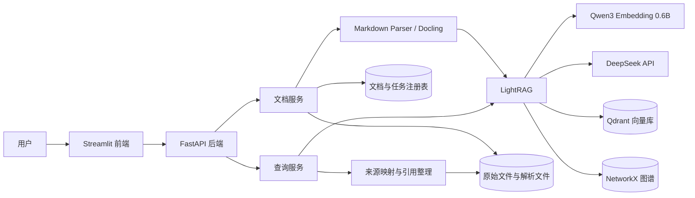
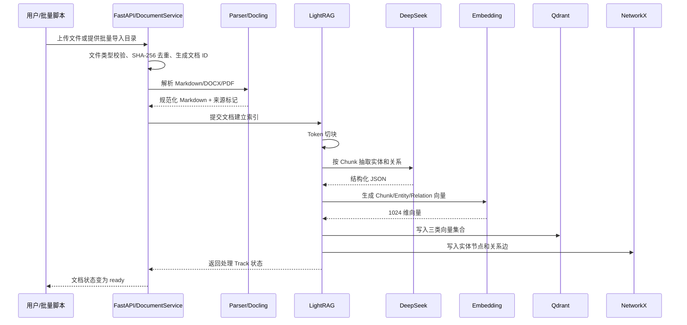
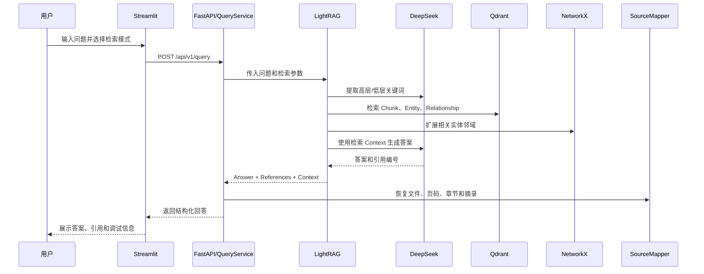

# RAG 知识库系统阶段性


## 0. 工作概述

### 0.1 阶段目标

本阶段围绕“本地文档如何转化为可分析的知识库”完成系统基础建设，形成了从文档上传到答案返回的完整闭环：

1. 支持 Markdown、DOCX 和 PDF 的统一导入与解析。
2. 将不同格式文档规范化为 Markdown，并保留文档、页码和章节来源。
3. 使用本地向量模型构建文本块、实体和关系向量。
4. 使用 LLM 从文档中抽取实体与关系，形成辅助检索的语义图谱。
5. 支持纯向量、局部图谱、全局图谱及综合检索模式。
6. 通过 FastAPI 提供统一后端接口，通过 Streamlit 提供可视化操作页面。
7. 支持文档管理、索引状态查看、知识库问答、模式对比和图谱浏览。

### 0.2 阶段成果

- 已搭建可在 Apple Silicon 本地运行的 RAG 系统原型。
- 已打通“原始文档—解析文本—向量索引—语义图谱—引用答案”的主链路。
- 原始文档和向量模型尽量保留在本地，生成式 LLM 使用外部 DeepSeek API。
- 系统采用模块化设计，后续可继续增加稀疏检索、领域图谱、自动路由和 Agent 能力。

### 0.3 一句话总结

> 本阶段完成了一套面向本地研究资料的“可导入、可索引、可检索、可引用、可展示”的基础知识库分析系统。

---

## 1. 整个系统搭建

### 1.1 系统定位

系统不是单纯的“文档聊天工具”，而是一套包含文档治理、向量检索、语义图谱和来源追踪的 RAG 原型。其核心目标是：

- 将分散的 PDF、Word 和 Markdown 资料统一纳入知识库。
- 在回答问题时同时利用原文语义相似度和实体关系上下文。
- 让回答能够返回原始文件、页码、章节和证据摘录。
- 保留后续向自动采集、领域知识图谱和 Agent 工作流扩展的接口。

### 1.2 总体架构



### 1.3 主要功能模块

| 模块 | 主要职责 | 当前技术选型 | 选型特点 |
|---|---|---|---|
| 文档摄取 | 上传、批量导入、去重、删除、重建索引 | FastAPI + 本地文件系统 | 实现简单，适合本地研究资料 |
| 文档解析 | 解析 Markdown、DOCX、PDF | Docling + 自定义 Parser | 多格式统一转 Markdown，保留结构 |
| RAG 引擎 | 切块、抽取、索引、查询 | LightRAG 1.5.3 | 同时支持文本向量和实体关系检索 |
| 向量模型 | 文档与问题向量化 | Qwen3 Embedding 0.6B | 本地运行、中英文支持、资源可控 |
| 生成式模型 | 实体关系抽取、关键词抽取、答案生成 | DeepSeek API | 通过 OpenAI 兼容接口接入，角色可拆分 |
| 向量数据库 | 保存 Chunk、Entity、Relationship 向量 | Qdrant 1.18.2 | Docker 部署、HNSW、Cosine、可持久化 |
| 图结构存储 | 保存图节点、边和属性 | NetworkX GraphML | 零运维，适合原型和中小规模图谱 |
| 后端接口 | 文档、任务、查询和图谱 API | FastAPI | 类型校验、自动接口文档、异步能力 |
| 前端展示 | 系统状态、文档管理、问答和图谱浏览 | Streamlit | 开发快速，适合研究演示和内部验证 |

### 1.4 技术选型原则

1. **优先本地化**：原始资料、解析文件、Embedding 和主要数据库在本机运行。
2. **控制硬件占用**：针对 M4 16GB 环境选用 0.6B 向量模型，默认不常驻 Reranker。
3. **降低部署复杂度**：第一阶段仅将 Qdrant 容器化，不引入 Neo4j、PostgreSQL、Redis 和 Elasticsearch。
4. **模块可替换**：Parser、Embedding、LLM、向量库、图存储和前端之间通过服务层解耦。
5. **先形成闭环**：优先验证端到端可用性，再逐步增加复杂检索和生产化能力。

### 1.5 当前部署方式

| 服务 | 默认地址 | 运行方式 |
|---|---|---|
| Qdrant | `127.0.0.1:6333` | Docker 容器 |
| FastAPI | `127.0.0.1:8000` | macOS 本地 Python 进程 |
| Streamlit | `127.0.0.1:8501` | macOS 本地 Python 进程 |
| Embedding | 无独立端口 | 在 API 或批处理进程中本地加载 |
| DeepSeek | 外部 API | HTTPS 调用 |

典型启动流程：

```bash
docker-compose up -d qdrant
uv run python scripts/doctor.py
uv run uvicorn rag_graph_demo.api.app:app --reload --host 127.0.0.1 --port 8000
uv run streamlit run src/rag_graph_demo/ui/streamlit_app.py --server.port 8501
```

### 1.6 当前部署特点与边界

**特点：**

- 单机即可完成演示，不依赖复杂服务器集群。
- 数据目录和 Qdrant 均可持久化，停止程序不会清空索引。
- 支持命令行批量导入，也支持网页上传。
- 提供诊断脚本检查目录、Qdrant、DeepSeek 和模型配置。

**边界：**

- 当前更适合单用户、本地研究和原型验证。
- FastAPI 后台任务不是可靠的分布式任务队列。
- NetworkX 和 JSON 注册表不适合高并发、多实例共同写入。
- 文档内容在实体关系抽取和答案生成时会以文本片段形式发送给 DeepSeek。

**PPT 页面建议：**“系统目标”“总体架构”“技术选型”“部署方式”可总结并简写成 1 页。

---

## 2. 文档解析和来源保真

### 2.1 支持的文档类型

| 文档类型 | 处理方式 | 当前能力 |
|---|---|---|
| Markdown | UTF-8 直接读取 | 保留原有标题和正文结构 |
| DOCX | Docling 解析后导出 Markdown | 支持标题、段落、列表和表格 |
| PDF | Docling 按页解析并导出 Markdown | 支持页码级来源标记，扫描件可选 OCR |

当前不直接支持旧式 `.doc`、PPTX、XLSX 和普通 TXT；如需纳入，应先转换格式或补充相应解析器。

### 2.2 为什么统一转换为 Markdown

- 将不同文件格式转化为统一中间表示，降低后续索引复杂度。
- Markdown 能保留标题层级、段落、列表和部分表格结构。
- 便于文本切块、章节识别、调试和人工检查。
- 解析结果可以独立保存，不必每次查询都重新解析原文件。

### 2.3 来源保真设计

系统在规范化文本中插入隐藏来源标记：

```html
<!-- rag-source document_id={uuid} page={page_number} -->
```

来源标记会跟随文本进入 Chunk，从而形成以下追踪链：

```text
回答中的引用编号
→ LightRAG 返回的 Chunk
→ Chunk 内的 document_id / page
→ 文档注册表
→ 原始文件、标题、页码、章节
→ 证据摘录
```

### 2.4 不同格式的保真能力

- **Markdown**：使用文档级来源标记，保留正文标题结构。
- **DOCX**：保留标题、段落、列表和表格，但当前不承诺与 Word 打印布局一致的页码。
- **PDF**：逐页导出，每页插入来源标记，因此更适合页码级引用。
- **扫描 PDF**：可启用 OCR，但会增加模型下载、CPU、内存和解析时间。

### 2.5 引用结果整理

系统不会直接把 LightRAG 的内部逻辑文件名展示给用户，而是通过 `SourceMapper`：

1. 找到回答实际使用的引用编号。
2. 恢复对应文档和文本块。
3. 提取文档标题、原文件名、页码和章节。
4. 生成不超过约 600 字符的证据摘录。
5. 移除答案中没有真正使用的候选引用。

### 2.6 当前限制

- 引用目前主要是“回答级引用列表”，尚未做到每个事实句后都有引用。
- PDF 页码依赖解析后来源标记是否仍保留在召回 Chunk 中。
- DOCX 缺少稳定的视觉页码语义。
- 复杂表格、跨页表格、图片和图注仍需进一步验证。
- OCR 文本可能存在识别错误，应保留原文件供人工复核。

**PPT 页面建议：**使用一页“多格式统一解析”，一页“来源追踪链路”。

---

## 3. 向量模型

### 3.1 当前选型

```text
Qwen/Qwen3-Embedding-0.6B
```

主要参数：

| 参数 | 当前设置 |
|---|---:|
| 向量维度 | 1024 |
| 最大输入长度声明 | 8192 Token |
| 批大小 | 8 |
| 输出类型 | `float32` |
| 向量归一化 | 开启 |
| 设备选择 | MPS 优先，其次 CUDA，最后 CPU |
| 相似度 | Cosine |

### 3.2 选择 Qwen3 Embedding 0.6B 的原因

- 适合中英文混合资料和跨语言语义匹配。
- 0.6B 模型规模适合 16GB 内存的 Apple Silicon 设备。
- 本地运行，文档向量化不需要调用第三方 Embedding API。
- 1024 维在召回能力、内存占用和索引规模之间较均衡。
- 基于 Sentence Transformers 接入，后续模型替换相对方便。

### 3.3 文档向量与查询向量

系统使用非对称检索：

- 文档侧：直接编码文本块、实体描述和关系描述。
- 查询侧：在用户问题前添加检索任务指令，再生成 Query Embedding。

查询指令示意：

```text
Instruct: Given a web search query, retrieve relevant passages that answer the query
Query: {用户问题}
```

这种方式让模型区分“待检索文档”和“检索问题”，有利于提升查询召回效果。

### 3.4 相似度与阈值

- Embedding 结果进行 L2 归一化。
- Qdrant 使用 Cosine 距离和 HNSW 索引。
- 当前最低相似度阈值为 `0.2`，适合小规模 Demo 的宽召回。
- 数据量扩大后，需要基于真实问题评测召回率和准确率，再调整阈值。

### 3.5 可选 Reranker

系统预留 `BAAI/bge-reranker-v2-m3` CrossEncoder 重排能力：

- Embedding 负责快速召回候选。
- Reranker 同时阅读问题和候选文本，重新计算相关性。
- Reranker 通常可以改善前几名结果，但速度更慢、内存占用更高。
- 当前默认关闭，优先保证本机运行稳定。

### 3.6 向量模型的索引契约

向量模型不是可以随意热切换的参数。以下任一项发生变化，都应新建 Workspace 并重建索引：

- 模型 ID。
- 向量维度。
- 是否归一化。
- Query Instruction。
- 切块方式或文本预处理方式。

**PPT 页面建议：**“模型选型与参数”“Dense 检索工作原理”各 1 页。

---

## 4. 数据库和存储机制

### 4.1 多存储协同，而不是单一数据库

系统中的数据形态不同，因此采用针对性存储：

| 数据 | 存储位置 | 作用 |
|---|---|---|
| 原始 PDF/DOCX/Markdown | `data/raw/` | 保存原始证据文件 |
| 解析后 Markdown 和 Sidecar | `data/parsed/` | 统一文本表示、来源和解析元数据 |
| 文档与任务状态 | `data/registry/` | 保存文档 ID、哈希、路径、状态和任务结果 |
| LightRAG 文档、Chunk、缓存和状态 | `data/lightrag/` | 保存内部 KV、索引状态和 LLM 缓存 |
| Chunk、实体和关系向量 | Qdrant | 稠密向量检索 |
| 图节点和边 | NetworkX GraphML | 图邻域扩展和关系组织 |
| Qdrant 持久化数据 | `qdrant_storage/` | 容器重启后恢复向量集合 |

### 4.2 Qdrant 的职责

Qdrant 当前保存三类向量集合：

1. **Chunk 向量**：用于寻找与问题语义相似的原文片段。
2. **Entity 向量**：用于定位与具体名称、产品和组织相关的实体。
3. **Relationship 向量**：用于检索主题性关系和宏观语义。

Qdrant 的特点：

- 使用 HNSW 进行近似最近邻检索。
- 使用 Cosine 相似度。
- Docker 单容器即可运行。
- 提供本地 Dashboard，方便检查集合和向量数量。
- 支持 Payload，为后续日期、来源类型和权限过滤留有扩展空间。

### 4.3 NetworkX 的职责

NetworkX 负责保存和读取实体关系图的拓扑结构：

```text
data/lightrag/{workspace}/graph_chunk_entity_relation.graphml
```

适用场景：

- 本地零运维原型。
- 实体邻域和关系扩展。
- 几百到几万节点规模的算法验证。
- 图谱可视化和离线分析。

主要限制：

- 不是支持事务和并发写入的图数据库。
- 图规模变大后，加载、遍历和写回成本上升。
- 不支持原生 Cypher、复杂权限和多租户。

### 4.4 JSON KV 和注册表

LightRAG 使用 JSON KV 保存：

- 完整文档和文本块。
- 完整实体和关系描述。
- 实体、关系到来源 Chunk 的映射。
- 文档处理状态。
- LLM 响应缓存。

项目自己的注册表则管理：

- 文档唯一 ID。
- 文件名、大小和内容哈希。
- 原始文件与解析文件路径。
- 上传、解析、索引、失败等状态。
- 索引任务的开始、完成和错误信息。

### 4.5 去重和持久化

- 上传时计算 SHA-256 内容哈希，完全相同的文件自动跳过。
- 文档状态从 `uploaded` 依次进入 `parsing`、`parsed`、`indexing` 和 `ready`。
- Qdrant 使用宿主机目录挂载，停止容器不会自动删除向量数据。
- LightRAG、注册表和图谱都落盘保存，程序退出后仍可恢复。

### 4.6 备份原则

完整恢复至少需要同时备份：

```text
data/raw/
data/parsed/
data/registry/
data/lightrag/
qdrant_storage/
```

仅备份 Qdrant 无法恢复原始文档、引用映射和图谱；仅备份 `data/` 也无法恢复向量集合。

**PPT 页面建议：**用一页表格说明“为什么采用多存储”，再用一页说明 Qdrant 与 NetworkX 的职责边界。

---

## 5. 知识库组织过程中 LLM 完成的工作

### 5.1 LLM 在索引阶段的职责

文档解析和文本切块本身不由 LLM 完成。LLM 主要处理非结构化文本中的语义组织任务：

1. **实体抽取**：从每个 Chunk 中识别人、组织、地点、产品、方法、数据、概念等实体。
2. **关系抽取**：识别实体之间直接陈述的关系，并生成关系关键词和说明。
3. **结构化输出**：按 JSON 格式返回实体和关系，便于程序校验与写入。
4. **描述合并**：同名实体或相同实体对多次出现时，合并不同来源中的描述。
5. **冲突保留**：在描述汇总时尽量保留不同来源中的差异和不确定性。

### 5.2 LLM 不直接写数据库

实际流程是：

```text
文本 Chunk
→ DeepSeek 返回实体/关系 JSON
→ LightRAG 解析并校验
→ 同名实体和同实体对聚合
→ 本地 Embedding 生成向量
→ 程序写入 Qdrant 和 NetworkX
```

因此 LLM 负责“理解和抽取”，代码负责“验证、合并、索引和存储”。

### 5.3 LLM 在查询阶段的职责

1. **关键词拆分**：将问题拆成高层主题词和低层实体词。
2. **检索上下文理解**：根据检索模式使用实体、关系和原文 Chunk。
3. **上下文压缩与组织**：在 Token 预算内选择相关内容。
4. **答案生成**：仅根据提供的知识库 Context 回答问题。
5. **引用生成**：在回答结尾输出实际使用的参考编号。

### 5.4 高层词和低层词

示例问题：

```text
Anduril 与美国陆军在反无人机领域有哪些合作？
```

LLM 可以拆分为：

```text
高层关键词：反无人机合作、国防技术
低层关键词：Anduril、美国陆军、Counter-UAS
```

- 低层关键词用于定位具体实体和局部关系。
- 高层关键词用于定位关系主题和全局上下文。

### 5.5 当前 Prompt 特点

- 实体关系抽取采用 JSON 模式，减少格式解析失败。
- 输出语言设为中文，专有名词在必要时保留原语言。
- 关系默认按无向关系处理，N 元关系拆成多个二元关系。
- 要求只抽取文本中明确、重要、直接陈述的关系。
- 设置实体和关系数量上限，避免单个 Chunk 无限扩张。

### 5.6 当前不足

- 实体类型仍以 LightRAG 通用类型为主，缺少 Anduril 产品谱系领域本体。
- 中英文名称、缩写和多种译名主要依靠 LLM 保持一致，缺少稳定的 `canonical_id`。
- 关系以关键词和自然语言描述表达，缺少统一的领域关系谓词。
- 通用抽取容易把技术字段、图示编号和低价值概念写入语义图谱。

**PPT 页面建议：**用一页展示“LLM 在索引阶段做什么”，一页展示“LLM 在查询阶段做什么”。

---

## 6. 检索模式

### 6.1 五种模式对比

| 模式 | 主要数据来源 | 适合问题 | 主要特点 |
|---|---|---|---|
| `naive` | 原文 Chunk 向量 | 数字、日期、原话、具体事实 | 直接、证据性强，不使用图谱 |
| `local` | 实体向量、实体邻域、关系及来源 Chunk | 某个产品、公司或项目的关系 | 围绕具体实体展开 |
| `global` | 关系向量和广域图上下文 | 趋势、主题、战略方向 | 更适合跨文档宏观总结 |
| `hybrid` | `local` + `global` 图谱上下文 | 同时需要实体细节和总体关系 | 以图谱组织为主 |
| `mix` | `naive` + `local` + `global` | 复杂综合问题 | 同时使用原文证据和图谱关系，当前默认模式 |

### 6.2 模式选择示例

| 问题 | 推荐模式 | 原因 |
|---|---|---|
| “某合同金额是多少？” | `naive` | 需要精确数字和直接原文 |
| “Lattice 与哪些产品有关？” | `local` | 以单一实体及邻域关系为中心 |
| “材料反映出哪些产品战略方向？” | `global` | 需要跨文档主题归纳 |
| “比较不同平台的能力和合作关系” | `hybrid` | 同时需要局部实体和全局关系 |
| “综合说明某产品的定位、能力和应用” | `mix` | 需要图谱关系与原文证据共同支撑 |

### 6.3 查询时的数据流

```text
用户问题
→ LLM 提取高层关键词和低层关键词
→ 根据模式检索 Chunk / Entity / Relationship
→ 从 NetworkX 扩展相关图邻域
→ 去重、排序和上下文预算裁剪
→ DeepSeek 生成答案
→ SourceMapper 恢复引用来源
```

### 6.4 当前主要参数

| 参数 | 当前值 | 作用 |
|---|---:|---|
| `top_k` | 20 | 实体和关系候选数量 |
| `chunk_top_k` | 10 | 原文 Chunk 候选数量 |
| `max_total_tokens` | 24000 | 回答前的总上下文预算 |
| `cosine_threshold` | 0.2 | 向量召回最低相似度 |
| `enable_rerank` | `false` | 是否启用 CrossEncoder 重排 |

### 6.5 当前不足

- 尚未加入 BM25 或稀疏向量，精确专有名词和编号检索仍可能漏召回。
- 当前需要用户手动选择检索模式。
- 不同问题使用基本固定的候选数和 Token 预算。
- 尚未按日期、来源等级和文档类型统一过滤召回结果。
- 图谱噪声可能影响 `local`、`global` 和 `hybrid` 的上下文质量。

**PPT 页面建议：**一页五模式对比表，一页用典型问题说明如何选择模式。

---

## 7. 整体后端与前端流程

### 7.1 前端功能

Streamlit 当前承担研究演示和内部操作界面：

- 系统状态：查看 API、Qdrant 和模型配置是否可用。
- 文档管理：上传、查看、预览解析内容、重新索引和删除。
- 知识库问答：输入问题、选择检索模式和召回参数。
- 模式对比：用同一问题比较多种检索模式。
- 知识图谱：读取节点和关系，观察局部图结构。
- 调试信息：查看召回的实体、关系、Chunk 和引用。

前端不直接访问 Qdrant、GraphML 或本地注册表，所有操作都通过 FastAPI，便于未来替换前端。

### 7.2 后端分层

```text
API Routes
→ Service 层
→ Parser / LightRAG Engine / SourceMapper
→ FileStore / Registry / Qdrant / NetworkX
```

| 层级 | 主要职责 |
|---|---|
| API 路由 | 接收请求、参数校验、返回统一响应 |
| Service | 编排上传、解析、索引、查询、删除流程 |
| Engine | 封装 LightRAG、Embedding、DeepSeek 和存储适配 |
| Storage | 保存文件、注册表、向量和图结构 |
| Domain Model | 约束文档、任务、请求、回答和引用的数据结构 |

### 7.3 文档导入与索引流程



### 7.4 问答流程



### 7.5 后端可靠性设计

- 文档内容哈希去重，避免完全相同文件重复入库。
- 索引前执行 Embedding Warmup，提前发现模型或维度问题。
- 单进程内串行索引，避免本机内存和模型资源竞争。
- 索引完成后检查 LightRAG `DocStatus.PROCESSED`。
- DeepSeek 网络超时、连接错误、限流和服务端错误可自动重试。
- API 使用 Pydantic 模型校验请求和响应。
- 提供 `doctor.py`、Smoke Test、单元测试和 Ruff 检查。

### 7.6 当前后端边界

- 后台索引任务依赖 FastAPI 进程，进程退出后不保证任务恢复。
- JSON Registry 主要适合单进程，后续多 Worker 应迁移到关系数据库。
- 当前没有用户登录、权限隔离和多租户机制。
- 当前没有完整的索引进度、Token 成本和检索质量监控面板。

**PPT 页面建议：**“前后端分层”“索引流程”“查询流程”各 1 页。

---

## 8. 待改进方向

### 8.1 总体改进思路

下一阶段不只是继续增加数据，而是提升知识组织质量、检索完整性和自动决策能力。建议按照“质量基线—检索增强—图谱治理—自动化”的顺序推进。

### 8.2 事件通路

**当前问题：**

- 基础 LightRAG 能找到实体和关系，但对“何时发生、先后顺序、状态变化和来源冲突”表达不足。
- 普通图关系往往缺少明确的开始时间、结束时间和事实状态。

**计划方向：**

- 从文档中抽取结构化事件、时间、参与者、动作、状态和原文证据。
- 区分事件本身和不同来源对事件的提及。
- 构建相邻事件链，支持按时间范围和实体筛选。
- 查询时允许用户选择是否使用事件上下文。
- 事件抽取失败时不影响基础向量和语义图谱查询。

**预期价值：**

- 支持产品发展历程、合同进展、收购过程和能力演进分析。
- 提升时间型问题的稳定性和可解释性。
- 为后续自动生成时间线和趋势报告提供结构化基础。

### 8.3 分块方式改进

**当前方式：**固定约 700 Token，重叠 100 Token。

**当前问题：**

- 过小分块可能割裂上下文，导致关系碎片化。
- 过大分块会混入多个主题，增加实体和关系噪声。
- 新闻、研究报告、专利和技术文档使用相同参数，不够合理。

**计划方向：**

- 优先按 Markdown 标题、章节、段落和列表边界进行结构化分块。
- Token 数量作为最大限制，而不是唯一切分依据。
- 针对新闻、报告、专利和技术文档建立不同 Chunk Profile。
- 保留章节路径、页码、表格标识和图注信息。
- 使用真实问题评测不同切块方案，而不是仅凭主观判断。

### 8.4 关键词检索与稀疏检索

**当前问题：**系统以稠密向量为主，对精确型号、专利号、缩写、编号和原文短语可能漏召回。

**计划方向：**

- 增加 BM25 或 Qdrant Sparse Vector。
- 将稠密语义检索、稀疏关键词检索和图谱检索并行执行。
- 使用 RRF 或可解释加权方式融合多路候选。
- 对专利号、合同号、产品型号和精确名称提高稀疏召回权重。
- 在融合后增加去重、多样性控制和可选 Reranker。

建议形成：

```text
Dense Semantic Search
+ Sparse/BM25 Search
+ Graph-derived Evidence
→ Fusion
→ Rerank
→ Context
```

### 8.5 图谱节点重复与低价值关系治理

**当前问题：**

- 中英文名称、缩写和多种译名可能形成重复节点。
- 同名不同实体可能被错误合并。
- 技术字段、文件格式、图示编号和泛化概念容易形成低价值关系。
- 当前语义图更适合辅助检索，不等同于可直接展示的领域核心图谱。

**计划方向：**

1. 建立稳定的 `canonical_id` 和实体别名注册表。
2. 使用实体类型、上下文和来源辅助判断别名归并。
3. 将歧义合并放入人工审核队列，避免 LLM 自动误合并。
4. 定义 Anduril 产品谱系专用实体类型和关系类型。
5. 将附图编号、普通字段和通用技术名词限制在文档局部范围。
6. 依据实体类型、关系类型、证据数量和置信度过滤低价值边。
7. 区分“检索宽图”和“展示核心图”，避免用同一张图同时承担两种目标。

核心图谱可优先保留：

- 公司、产品、型号、平台、组件、能力、技术、项目、合同和客户。
- 开发、组成、型号演进、集成、采购、部署、测试、合作和收购等关系。

### 8.6 数据流水线与自动抓取

**当前能力：**主要依赖本地文件上传和目录批量导入。

**计划方向：**

- 建立“发现—抓取—清洗—去重—版本化—人工审核—正式索引”流水线。
- 对官网、政府合同、专利、论文和 RSS 等来源使用独立 Adapter。
- 采集阶段只生成 Clean 数据，不直接写入正式知识索引。
- 保存抓取时间、原始 URL、内容哈希、来源等级和版本关系。
- 支持断点续跑、失败重试、条件请求和变更检测。
- 对低可信网页摘要和搜索引擎片段只作为发现线索，不作为正式证据正文。

目标流程：

```text
Source Discovery
→ Fetch
→ Parse/Clean
→ Dedupe/Version
→ Quality Review
→ Import
→ Index
```

### 8.7 Agent Router：问题扩写与检索规划

**当前问题：**

- 用户需要手动选择 `naive`、`local`、`global`、`hybrid` 或 `mix`。
- 原始问题可能过短、存在中英文别名或缺少必要检索词。
- 所有问题使用基本固定的候选数量和上下文预算。

**计划方向：**

1. 判断问题类型：事实、实体关系、趋势、对比、时间线或多跳分析。
2. 进行受控语义扩写：补充中英文别名、产品型号和领域术语。
3. 自动规划检索模式以及 Dense、Sparse、Graph 的调用组合。
4. 根据问题复杂度动态配置 `top_k`、`chunk_top_k` 和 Token 预算。
5. 对复杂问题拆成多个子问题，分别检索后再合并证据。
6. 检查证据是否充分；不足时扩大检索或明确返回“证据不足”。
7. Agent 只调用受校验的业务 API，不直接读写 Qdrant 和 GraphML。

示例路由策略：

| 问题类型 | 首选策略 |
|---|---|
| 数字、日期、原话 | Sparse + `naive` |
| 单实体及关联关系 | `local` |
| 跨文档趋势 | `global` |
| 多实体比较 | `hybrid` 或 `mix` |
| 复杂综合研究 | 子问题规划 + 多路检索 + 重排 |

### 8.8 建议优先级

| 优先级 | 工作项 | 原因 |
|---|---|---|
| P0 | 建立评测问题与答案基线 | 没有评测就无法判断改进是否有效 |
| P1 | 结构化分块实验 | 直接影响后续抽取、召回和成本 |
| P1 | Dense + Sparse 融合 | 补足精确关键词、编号和型号召回 |
| P1 | 实体归并和领域图谱治理 | 提升图谱质量与展示价值 |
| P1 | 事件通路 | 补足时间、状态和演化分析 |
| P2 | 数据抓取流水线 | 扩展数据覆盖并保持可追踪性 |
| P2 | Agent Router | 自动扩写、模式选择和多步检索 |
| P2 | 任务队列、监控和权限 | 为稳定运行和多人使用做准备 |

**PPT 页面建议：**这些待改进的计划方向写在一页里，把内容提炼压缩。

---

## 9. 阶段总结

### 9.1 已完成

- 完成多格式本地文档的统一摄取和解析。
- 完成来源标记、页码恢复和回答引用链路。
- 完成本地 Qwen3 Embedding 与 Qdrant 向量索引。
- 完成基于 DeepSeek 的实体关系抽取和答案生成。
- 完成 LightRAG 五种检索模式的接入与对比。
- 完成 FastAPI 后端、Streamlit 前端和本地部署流程。
- 完成文件、注册表、向量和图结构的持久化组织。

### 9.2 当前判断

> 系统已经完成基础 RAG 闭环，能够作为资料检索与问答原型使用；下一阶段重点应从“功能打通”转向“检索质量、图谱治理、自动化和可量化评估”。

### 9.3 下一阶段重点

1. 建立评测集，形成可比较的效果基线。
2. 试验结构化分块和文档类型分流。
3. 增加稀疏检索，与 Dense 和 Graph 进行融合。
4. 建立领域实体别名、节点归并和低价值关系过滤机制。
5. 设计事件通路，补充时间、状态和演化分析。
6. 推进自动采集流水线和 Agent Router。

---

## 10. 建议的 PPT 页面框架

| 页码 | 页面标题 | 核心内容 |
|---:|---|---|
| 1 | 项目背景与阶段目标 | 为什么建设、要解决什么问题 |
| 2 | 本周完成情况 | 已完成的端到端能力 |
| 3 | 系统总体架构 | 前端、后端、模型、数据库关系图 |
| 4 | 关键技术选型 | LightRAG、Docling、Qwen3、Qdrant、DeepSeek |
| 5 | 本地部署方式 | 三个服务、端口和资源策略 |
| 6 | 文档解析流程 | Markdown、DOCX、PDF 统一处理 |
| 7 | 来源保真与引用 | document_id、页码、章节、证据摘录 |
| 8 | 向量模型 | 模型参数、选择原因、查询指令 |
| 9 | 数据库与存储 | Qdrant、NetworkX、JSON、文件系统分工 |
| 10 | LLM 如何组织知识库 | 实体关系抽取、描述合并、关键词抽取 |
| 11 | 五种检索模式 | naive/local/global/hybrid/mix 对比 |
| 12 | 文档索引流程 | 从上传到 ready 的时序图 |
| 13 | 问答流程 | 从用户问题到引用答案的时序图 |
| 14 | 当前问题 | 分块、稀疏检索、图谱重复和低价值关系 |
| 15 | 下一阶段技术路线 | 事件、图谱治理、数据流水线、Agent Router |
| 16 | 阶段结论 | 从“闭环打通”进入“质量提升”阶段 |

---

## 11. 实现依据

本报告主要依据以下项目文件整理：

- `TECHNICAL_REPORT.md`：系统架构、索引机制、检索模式和改进路线。
- `README.md`：运行组件、部署方式、常用命令和数据目录。
- `USER_GUIDE.md`：前端功能、参数配置、文档导入和使用流程。
- `src/rag_graph_demo/config.py`：模型、分块、Qdrant 和 LightRAG 参数。
- `src/rag_graph_demo/ingestion/parser.py`：Markdown、DOCX 和 PDF 解析。
- `src/rag_graph_demo/ingestion/source_mapper.py`：来源与引用映射。
- `src/rag_graph_demo/lightrag_engine/engine.py`：LightRAG、DeepSeek、Qdrant 和图存储适配。
- `src/rag_graph_demo/lightrag_engine/local_models.py`：Embedding 和 Reranker 实现。
- `src/rag_graph_demo/services/document_service.py`：文档摄取和索引流程。
- `src/rag_graph_demo/services/query_service.py`：查询编排和回答返回。
- `src/rag_graph_demo/api/`：FastAPI 后端接口。
- `src/rag_graph_demo/ui/streamlit_app.py`：Streamlit 前端交互。
