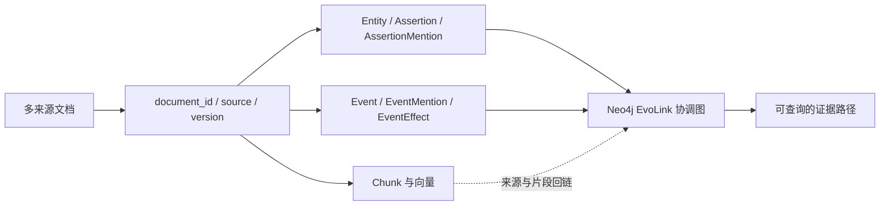
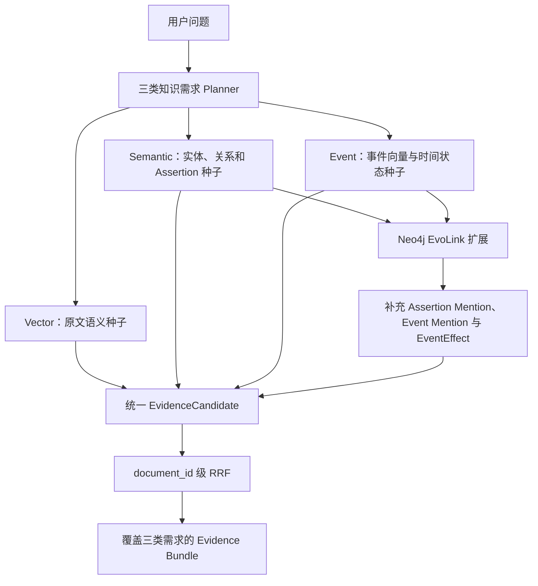
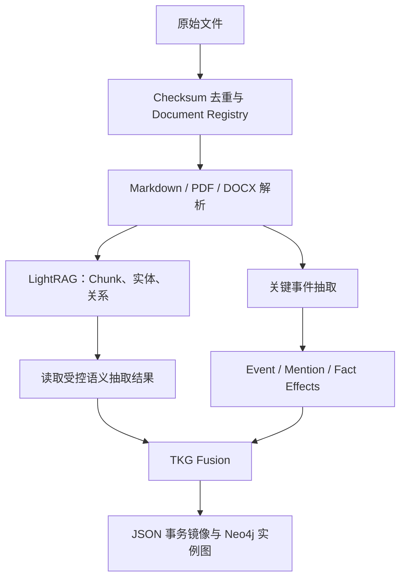
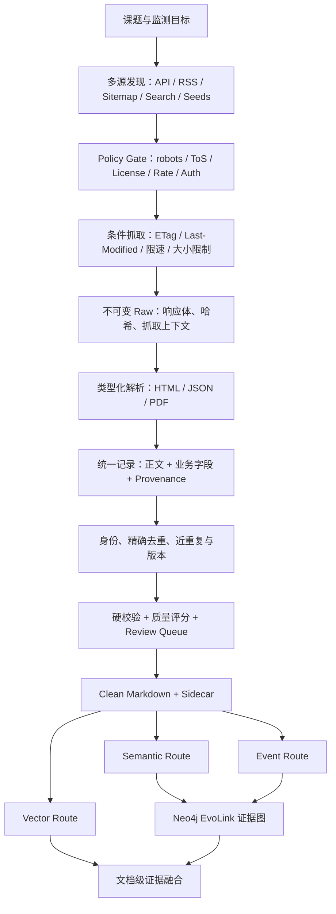
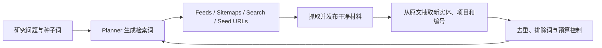
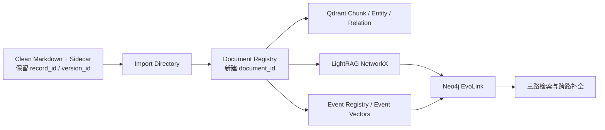

# 三通路 RAG 系统技术报告

> 报告日期：2026-08-16  
> 组织方式：方法设计—工程实现—数据管线—实验验证  
> 实验依据：`data/exports/evaluation/2026-08-14_all_static_agentic_evoneed_n30`

## 摘要

本文将所提方法明确记为 **Ours_EvoLink（实验配置名 `ours_evolink`）**。它针对的不是一般意义上的“多用几种检索器”，而是当前 RAG 中两条尚未充分汇合的技术路线：多视图知识组织已经能够分别保存文本、关系和事件，多轮 RAG 也开始判断证据是否充分；但已有方法通常没有把“缺原文、缺关系、缺状态演化”建模为三类可执行知识需求，也缺少让三种表示互相生成检索锚点的机制。

Ours_EvoLink 因此包含两个核心设计。第一，三点式 Planner 依次回答“缺哪类知识”“怎样把缺口翻译成通路查询”“现有证据是否足够以及下一步做什么”；其一级需求分为原文落证、关系语义和事件演化三类，其中演化需求继续检查前态、变化事件、时间锚点、后态和否认/替代等槽位。第二，三路不是只在末端合并分数：向量路找到的原文可以提供实体和事件锚点，语义路找到的实体或 Assertion 可以回收来源 Mention 并扩展事件，事件路找到的 Event 又可以通过 EventEffect 连接相关 Assertion。语义和事件对象在同一 Neo4j 协调图中连接，扩展结果再与向量原文按 RAG 文档身份汇合，形成可追溯证据。

索引时，系统从同一份文档构造原文 Chunk、实体—关系 Assertion 和关键 Event 三种表示。查询时，Planner 生成路由专用的关键词、实体、关系、时间和状态意图；三路分别获取原文证据、关系证据和演化证据；EvoLink 在 Neo4j 中围绕 Entity–Assertion–Event–Mention–EventEffect 做受约束扩展；最后再按 `document_id` 做 RRF，保证不同评分空间能够稳定汇合。当前主实验实现为一次规划、固定调用三路；按未满足知识需求动态选路的能力已在 `ours_evoneed` 原型中实现，但不是本文主方法的实验命名。

指定的 MultiHop-RAG 快速实验包含 30 个问题、100 篇文档和 443 个递归切分 Chunk，其中 21 题有金证据并进入检索指标，9 题为无金证据的 `null_query`。固定三通路 `ours_evolink` 取得最高的 Evidence Recall@10（0.8651）、Complete Recall@10（0.6190）、NDCG@10（0.7280）和 MRR@10（0.8349）。Agentic Hybrid 改善了 Hybrid 的证据覆盖和 Top-4 排序，但平均延迟由 0.284 秒升至 29.633 秒；Agentic EvoLink 没有提高三通路的 Top-10 覆盖，且排序指标下降。结果说明当前三通路的主要收益来自异构知识表示和跨路链接，而不是“多轮检索”这一形式本身。

---

## 第一部分　Ours_EvoLink：三类知识需求驱动的三通路协同方法

### 1. 从现有研究的 GAP 出发

Ours_EvoLink 的出发点不是“向量检索不够，所以再加两条路”，而是现有方法在知识组织和检索控制之间存在断层。

第一，Dense/Hybrid RAG 能找到语义相近的原文，却不显式保存实体连接和状态变化。第二，GraphRAG、LightRAG 等方法能够组织实体关系，但静态图容易把同一实体或关系在不同时间的状态压到一个节点或一条边上。第三，EventRAG、DyG-RAG、E²RAG 已经证明事件与时间结构对动态问题有用，但它们主要在事件图或实体—事件图内部推理，通常不会显式判断当前还缺原文、关系还是演化链。第四，Self-RAG、Adaptive-RAG、RouteRAG 等 Agentic 方法开始决定何时检索、检索文本还是图，却多以相关性、问题复杂度或静态事实缺口作为控制信号，状态演化还没有成为稳定的、可审计的知识需求类型。

由此得到三个直接 GAP：

| GAP | 已有方法做到哪里 | 仍缺什么 |
|---|---|---|
| 知识需求 GAP | 多轮 RAG 会判断“证据够不够”或“还缺哪个事实” | 没有统一区分原文落证、关系桥接和状态演化，尤其缺少前态—事件—后态槽位 |
| 多视图协同 GAP | 文本、图谱、事件可以分别建索引，也可以 late fusion | 一条通路的命中很少成为另一条通路的检索锚点；结果通常在末端被展平 |
| 可追溯演化 GAP | 事件图能恢复时间线，KG 能保存实体关系 | 缺少 `Event → Assertion lifecycle → Mention` 的可查询路径，难以解释某项事实为何、何时改变 |

因此，本文要解决的问题可以表述为：**如何把原文、关系和事件演化建模为三类知识需求，并利用共享身份和 Neo4j 证据图，让三条通路围绕同一分析目标进行跨路补全，最后返回可回溯原文的证据组合。**

这也限定了贡献边界。三路并存不是创新点，RRF 也不是创新点；真正值得讨论的是三类知识需求 Planner、EvoLink 跨路协调，以及二者如何把多视图召回推进为可解释的证据补全。

### 2. 三点式 Planner 与三类知识需求

Planner 面对的不是一个普通关键词生成任务，而是三个连续判断。

**第一点：当前问题需要哪类知识。** Planner 将需求限制为三类主类型，避免拆成几十种不可复现的问答标签。

| 知识需求 | 判断问题 | 典型缺口 | 主通路 |
|---|---|---|---|
| `TEXTUAL_GROUNDING` | 缺哪段原话、数字、条件或来源陈述？ | direct statement、number、quote、condition | Vector Route |
| `RELATIONAL_SEMANTICS` | 缺哪个实体、谓词、桥接对象或多跳路径？ | entity identity、relation、bridge entity | Semantic Route |
| `EVENT_EVOLUTION` | 某个实体或关系的状态怎样形成、变化或被否认？ | state_before、transition_event、time、state_after、supersedes/denies | Event Route |

`EVENT_EVOLUTION` 是三类 Planner 中最关键的扩展。它不是“问题里出现日期就查事件”，而是检查一个状态变化是否完整：变化前是什么状态，发生了什么事件，何时生效，变化后是什么状态，是否存在终止、替代、否认或纠正。任何槽位缺失，都可以成为下一次检索的明确目标。

**第二点：把缺口翻译成通路专用查询。** 三条通路不应共享同一条自然语言改写。文本路保留实体、日期和限定条件，寻找可引用原句；语义路生成实体入口、目标谓词、未知端点和跳数约束；事件路生成 actor–action–object–time–state 查询，并决定是否扩展前序、后序或冲突事件。

**第三点：判断证据是否足够以及下一步做什么。** Planner/Auditor 不只输出自由文本“需要更多信息”，而应记录已满足和未满足槽位、绑定的 Evidence ID、冲突状态、预算和停止原因。完整方法可维护随检索更新的 `Knowledge Need State`：

```text
KNS_t = {
  analytic_goal,
  textual_grounding_needs,
  relational_semantics_needs,
  event_evolution_needs,
  established_findings,
  supporting_evidence_ids,
  conflicts,
  remaining_budget,
  stop_reason
}
```

当前 `ours_evolink` 的主实验实现了第一次结构化规划：低层关键词、高层关系词、实体、事件类型、时间、状态意图和事件链开关；三路固定并行，以获得稳定的初始证据面。动态 KNS、检索后缺口更新和按缺口选路已经在 `ours_evoneed` 变体中实现。论文方法可以把它们组织为 Ours_EvoLink 的 Planner 设计，但工程章节和实验章节必须分别注明当前由哪个配置完成，不能把理想框架当作 `ours_evolink` 已跑出的动态路由结果。

### 3. 为什么三路缺一不可

三路对应的不是三种相似检索器，而是三种不同证据单位：

| 通路 | 最小知识单位 | 最擅长的问题 | 单独使用的失败模式 |
|---|---|---|---|
| Vector | 原文 Chunk | 原话、数字、条件、描述性事实 | 找到局部相似文本，却缺少跨文档连接 |
| Semantic | Entity、Relation、Assertion Mention | 实体身份、关系、多跳桥接 | 静态关系可能压平时间和立场；抽取可能丢细节 |
| Event | Event、Event Mention、EventEffect | 何时发生、状态变化、否认、替代 | 事件摘要不能代替原文；稳定背景关系可能不足 |

缺少 Vector Route，系统会让结构化抽取结果自我证明，且无法在图抽取遗漏时恢复原文。缺少 Semantic Route，系统能找到若干相关报道，却难以判断它们是否围绕同一实体和关系。缺少 Event Route，系统可以连接对象，却无法稳定回答“之前—变化—之后”和“当前状态”。三路同时存在的必要性不是提高候选数量，而是让最终证据同时具备原文真实性、关系连通性和时间状态完整性。

### 4. 索引阶段：为协同建立共享身份



向量通路对带稳定父文档 ID 的 Chunk 生成 Embedding，尽量少做知识判断。语义通路抽取核心实体和关系，并将关系重述为可挂接来源、有效期和状态的 Assertion；同一 Assertion 可对应多个 Assertion Mention。事件通路抽取会改变对象状态的重要发生，保留每个来源的 Event Mention，并用 EventEffect 表达它对 Assertion 的创建、更新、终止、替代、否认或确认。

EvoLink 的关键不是把三份索引复制到一起，而是统一身份。Entity 是语义路与事件参与者的共享锚点，Assertion 表示可管理的关系状态，Event 表示发生，Mention 保留原文来源，EventEffect 连接“发生”与“事实变化”。这些对象进入 Neo4j 后，跨路扩展不再依赖字符串拼接，而可以沿有类型的图关系回收证据。

### 5. 检索阶段：从三路召回到跨路补全



初始阶段采用“宽入口”：Vector Route 用原问题召回原文；Semantic Route 用具体实体和抽象关系分别寻找图入口；Event Route 先用事件规范文本向量寻找种子，再按实体、动作、时间、状态、置信度和来源数量重排。这样能减少某一路单独失败造成的不可恢复遗漏。

EvoLink 随后执行跨路补全。语义图命中的实体名称、Assertion 和事件路命中的 Event ID 被送入 Neo4j；系统在时间、状态和扩展深度约束下取得相关 Entity、Assertion、Event、Mention、EventEffect 和冲突对象。它产生三类有意义的反向查询：

- **原文 → 结构：** 文本命中暴露新的实体或事件名，作为图路和事件路的规范化锚点；
- **关系 → 原文/事件：** Assertion 命中后回收 supporting Mention，并沿 EventEffect 找到改变它的事件；
- **事件 → 关系/原文：** Event 命中后找到参与实体、受影响 Assertion 和各来源 Event Mention。

这一步是 Ours_EvoLink 与普通三路 late fusion 的差别。若只有最后的 RRF，最多只能说“多视图融合”；只有发生上述跨路锚点生成和证据回收，才能称为协同补全。

### 6. 汇合与最终证据

跨路补全后，三路仍不能直接相加原始分数。向量相似度、图路径排序和事件结构分数不在同一量纲。系统将所有结果统一为 `EvidenceCandidate`，按父 `document_id` 去重，再计算：

\[
S(d)=\sum_{c\in\{vector,semantic,event\}}\frac{1}{60+r_c(d)}
\]

每路对同一文档只贡献一次。文档入选后，优先保留每个命中通路的一条代表性原文，形成包含通路标签、结构对象、时间状态和来源片段的 Evidence Bundle。RRF 在这里承担的是稳定的跨评分空间排序，不是方法创新本身；Ours_EvoLink 的方法增量位于 RRF 之前的三类规划和 Neo4j 跨路补全。

理想状态下，最终证据选择还应直接优化三类知识需求覆盖，而不只是文档排名：已有三份同义报道时，再增加一份重复报道的边际价值很低；一份能补齐前态、变化事件或后态的证据更重要。当前实现已具备 Need Coverage 原型，但指定主实验仍以文档级 RRF 作为稳定、可复现的融合策略。

---

## 第二部分　Ours_EvoLink 的具体技术实现

### 1. 当前索引流程

在线文档服务的真实执行顺序为：保存上传原件并按 SHA-256 查重，解析为 Markdown，写入解析文本和元数据，建立 LightRAG 索引，独立抽取事件，最后融合声明级 TKG。LightRAG 索引成功后，即使事件或 TKG 子任务失败，文档仍可作为文本/图谱 RAG 数据使用；事件与 TKG 状态单独记录并可重建。



当前默认 Chunk 目标为 700 tokens、重叠 100 tokens。LightRAG 使用 Qdrant 保存 Chunk、实体和关系向量，NetworkX 保存其原生实体关系拓扑，JSON 保存文档状态；查询 LLM 和抽取 LLM 默认是 `deepseek-v4-flash`。Embedding 支持本地 `Qwen/Qwen3-Embedding-0.6B`、百炼 `text-embedding-v4` 和智谱 `embedding-3`，维度为 1024；指定实验使用智谱 `embedding-3/1024d`。可选重排器为 `BAAI/bge-reranker-v2-m3`，本次实验关闭。

**Ours_EvoLink 明确使用 Neo4j。** NetworkX 和 Neo4j 在系统中承担不同职责：NetworkX 是 LightRAG 自身的实体—关系拓扑存储；Neo4j 是 Ours_EvoLink 的跨通路协调图。评测初始化 `ours_evolink` 时，系统为该数据集创建隔离的 Neo4j workspace，将受控语义抽取和事件索引融合为 Entity、Predicate、Assertion、Event、Document、Mention、EventEffect 与 Conflict 等节点/关系。检索时，EvoLink 直接查询和扩展这个 Neo4j 图；评测配置启用 `strict_coordination_failures=True`，Neo4j 不可用会使该方法失败，而不是悄悄退化为普通三路 RRF。

### 2. 三条通路的落地方式

| 通路 | 当前索引与存储 | 当前检索 | 回到原文的方式 |
|---|---|---|---|
| 向量 | LightRAG Chunk 向量写入 Qdrant | `mode="naive"`，原问题向量召回 | `file_path → document_id → chunk` |
| 语义 | 受控实体/关系抽取；Qdrant 向量；LightRAG NetworkX 拓扑；Assertion/Mention 融入 Neo4j | LightRAG `hybrid` 的 local/global 图检索；Neo4j 回收和扩展 Assertion Mention | 关系来源 Chunk 或 Assertion Mention |
| 事件 | `EventRecord/EventMention/EventRelation/EventConflict`；事件向量为 NPZ；Event/Effect 融入 Neo4j | 事件向量种子、结构重排、一跳事件链；Neo4j EvoLink 扩展 | Event Mention 的原文、文档和字符区间 |

受控语义抽取并不追求穷举。每个片段默认最多保留 4 个实体和 4 条关系，关系两端必须在本次保留实体中；日期、数值、宽泛主题和事件不作为普通实体塞入语义图。实体解析先做名称、别名和类型的确定性匹配，再用 Embedding 找候选；高置信候选可自动合并，灰区由受约束 LLM 裁决，不确定项进入 Review Case。

事件抽取按最多 12,000 字符分片，每片最多 5 个事件，每文档最多 12 个事件。事件字段包括类型、摘要、动作、参与者、对象、起止时间、时间精度、结果、立场、置信度、原文证据和位置。事件向量文本由时间、类型、参与者、动作、对象、结果、摘要和状态组成。向量搜索负责找语义种子，Event Service 再根据实体、动作、时间、状态、置信度和来源数量排序；问题要求变化、先后或纠正时，可沿相邻事件扩展一跳。

TKG 将稳定对象和发生性对象接起来。关系被重述为 `Assertion + AssertionMention`，事件参与者与对象形成 `EventEntityLink`，事件对事实的作用形成 `EventEffect`。当前本体版本为 0.1.0，OWL 描述类与关系，SHACL 约束最低字段、取值和基数。实例图以 Neo4j 为在线查询和扩展存储，JSON 作为融合事务镜像和恢复材料。Neo4j 中所有项目节点带 `RagTKG` 标签和 `workspace_id`，约束按 workspace 与对象 ID 建立，既支持评测隔离，也避免覆盖同一数据库中的其他图数据。

### 3. Query Planning、融合与 Agentic Retrieval

固定检索只调用一次 Query Planner。Planner 输出经确定性清洗：关键词去重限长，实体最多 3 个，事件类型最多 4 个，时间只从问题中明确出现的年份重算。计划按版本、日期和问题缓存。三条通路随后异步并行，每路候选上限通常为最终 `top_k` 的 3 倍，最后做文档级 RRF。

当前有两类 Agentic 控制器：

1. `AgenticRAGGraph` 采用“检索—证据评估—查询改写—再次检索—回答”。评估器判断当前证据是否相关和充分；不充分且未达到最大轮数时，依据缺失信息重写查询。多轮结果再用 RRF 合并。
2. `EvoNeedRAGGraph` 先把问题拆成 `text_evidence`、`relation_evidence`、`evolution_evidence` 三类知识需求，并固定映射到 vector、graph、event。首轮以完整三路 EvoLink 建立锚点，后续只调用未满足需求对应的通路；证据选择同时考虑排名、需求覆盖、多通路桥接和轮次。

两者都由 LangGraph 编排，指定实验最多检索 2 轮，使用 DeepSeek 完成规划、评估、改写和带证据回答。这里需要区分两个概念：Query Planner 是单次检索前的结构化问题解析；Agentic Retrieval 则维护跨轮状态，并根据已有证据决定是否继续、查什么以及何时停止。

### 4. 方法框架与实现的对应及边界

第一部分的方法框架已经有较完整的工程对应：三种知识表示、统一问题规划、并行召回、Neo4j 协调图、来源回溯和 EvoLink 均已存在。工程实现仍有四点不应理想化：

- 固定三路的主要融合仍是 RRF。EvoLink 能跨路扩展，但尚未以“最小充分证据子图”作为统一优化目标。
- 当前 EvoLink 协调器直接接收 Planner/语义路得到的实体名称和事件路候选，并在 Neo4j 中扩展 Assertion、Event、Mention 与 Effect；向量候选参加最终 RRF 和原文落证，但尚未自动抽取锚点再反向触发图扩展。因此，第一部分的“原文命中生成结构锚点”是完整方法框架中的下一步闭合方向，不是当前主实验已经单独验证的机制。
- `ours_evolink` 已实际使用 Neo4j 中的 Entity–Assertion–Event–Mention–Effect 结构做跨路扩展；但它与另一个“五类向量种子直接进入统一 TKG”的 `ours_tkg` Retriever 不是同一配置。当前对比能评价 Ours_EvoLink 整体，却没有用结构打乱或移除 EventEffect 的消融单独证明 Assertion 生命周期中每个部件的贡献。
- Agent 的充分性判断来自 LLM，当前只有最多两轮；没有学习式路由，也没有可靠的成本—收益预测器。

截至当前工作区快照，文档注册表有 242 项，其中 240 项为 `ready`、2 项失败；事件索引记录 210 个规范事件、251 个 Mention 和 196 条事件关系。TKG 镜像包含 861 个实体、812 个 Assertion、1,203 个 Assertion Mention、672 个事件—实体链接和 350 个 EventEffect；186 篇文档的 TKG 状态为 ready，54 篇失败，另有 155 个实体治理 Review Case。0 个冲突记录不等于语料没有冲突，更可能说明当前抽取、对齐和冲突规则尚未稳定触发。

---

## 第三部分　数据抓取与知识加工方法

### 1. 数据管线要解决的不是下载，而是知识可信度

如果数据处理只有“抓网页—抽正文—切块入库”，网页端的每个问题都会被后续索引放大。正文抽错会污染向量；同一新闻的转载会被误当成多来源支持；页面更新会覆盖历史状态；发布日期错位会形成错误事件链；结构化抽取一旦出错，又很难判断错误来自网页、解析器还是模型。

因此，本系统把数据管线定义为一个**面向可追溯知识构建的多阶段系统**。其输出不是一堆文本文件，而是具有稳定身份、版本、来源、质量状态和原始证据的知识单元。三通路只消费通过质量门控的知识单元。



这条路线有两个循环。第一个是**发现循环**：从课题种子出发，抓到的新材料暴露组织名、产品名、合同号、专利号和术语，这些词进入下一轮发现。第二个是**知识生命周期循环**：同一来源对象被持续观测，内容不变则只更新观测时间，内容变化则产生新版本，再触发后续知识重建。前者解决覆盖，后者解决更新与历史。

### 2. 值得在答辩中重点讲的关键技术

这里的技术贡献不应表述为“发明了新的网页下载算法”。更准确的说法是：系统把发现、合规、原始证据、身份、版本、重复关系、质量状态和后续三路索引放进同一条可重放知识生命周期，并针对公共记录、论文、专利、新闻和智库材料保留不同的业务语义。它解决的是研究型 RAG 中数据能否追溯、更新和比较的问题。

**技术一：来源驱动，而不是“一把梭”的通用爬虫。** 不同来源的“发现方式”和“事实结构”不同。官方站点适合 Sitemap 与页面内结构化数据，USAspending 适合 API 和 award identity，OpenAlex 需要按 affiliation 检索，新闻站点适合 RSS 发现后回抓正文，历史材料适合 Sitemap 回填。系统将来源差异封装在 Adapter 中，公共 Runner 只负责共性的治理流程。这样新增来源不会复制一套抓取、去重和质量代码，也不会用同一解析假设破坏不同类型的数据。

**技术二：课题驱动的迭代式发现。** 固定关键词只能找到已知对象，难以发现新出现的项目、编号和合作方。Topic Planner 先围绕研究问题生成少量高价值检索词，再从已抓取材料中提取下一轮值得检索的实体、产品、合同/专利编号和技术术语。LLM 只允许生成检索词，不能把搜索片段当事实，也不能执行网页中的指令；没有模型时，系统用引号词、缩写、编号和专名模式做确定性回退。



这不是让 Agent 自由浏览，而是有边界的“发现—验证—扩展”：候选 URL 仍需经过 Policy Gate，搜索摘要只用于发现，正文必须重新抓取并进入完整证据管线；每轮有查询数、候选数和总抓取预算，连续没有新候选或新扩展词时停止。

**技术三：Raw 与 Derived 分层，保证可重放。** 原始响应保存为不可变研究副本，派生的解析正文、规范记录和 clean 文档与原件分开。Raw 层保存响应体、MIME、状态、ETag、Last-Modified、抓取时间、适配器及版本；Derived 层保存解析和标准化结果。解析器升级、字段映射修复或本体变化时，可以基于原件重放，而不用重新访问外部站点。这对毕业设计答辩很重要：系统不是只给出最后一份文本，而是能解释每一步是怎样从原始证据得到的。

**技术四：身份、版本和重复是三个不同问题。** 系统不把 URL、内容哈希和相似文本混为一个概念：

| 层次 | 判定方法 | 系统动作 | 解决的问题 |
|---|---|---|---|
| 来源对象身份 | provider ID 优先，否则 canonical URL | 生成稳定 `record_id` | 同一个对象长期追踪 |
| 内容完全相同 | 规范化文本 SHA-256 | 不建新版本，只更新 `last_seen_at` | 避免重复入库 |
| 同一对象内容变化 | `record_id` 相同、`version_id` 改变 | 新建 `vN`，保留 `first_seen_at` | 页面更新和历史追踪 |
| 跨对象近重复 | 64-bit SimHash，汉明距离阈值 6 | 只建立 `near_duplicate_candidate` | 发现转载/改写，不误删独立来源 |

这里最值得讲的是“不自动删除近重复”。对普通搜索引擎，去重意味着节省空间；对多源研判，两个相似页面可能是转载，也可能是两份独立来源，或者是同一事实的后续修订。系统先保留，再将关系交给来源治理，避免在入库前丢掉证据独立性和版本信息。

**技术五：结构恢复与业务语义分离。** 通用 Parser 负责从 HTML、JSON、PDF 恢复可读结构，Adapter 负责把来源特有字段映射到统一记录。HTML 层读取 meta、JSON-LD 和 Next.js `__NEXT_DATA__`，去除脚本、导航、订阅框和常见样板，保留标题层级、列表、引用和表格；API 原始 JSON 完整保留，由来源 Adapter 决定哪些字段进入正文和 sidecar；PDF 使用 Docling 尝试提取，低置信或扫描件进入复核。这样“页面怎么解析”与“合同金额字段是什么意思”不会混在同一个函数里。

**技术六：硬校验和质量评分分开。** 缺少稳定 ID、版本 ID、标题、原始文件或原始哈希不一致属于硬错误，不能靠一个较高质量分掩盖；这类记录不发布 clean 数据。正文过短、缺发布时间或解析置信度较低属于软质量问题，记录可以保留，但进入 Review Queue。系统因此不会在“全丢弃”和“全部入库”之间二选一，而是把不确定数据隔离出来，保留后续人工修复的可能。

**技术七：增量游标和失败隔离。** 抓取状态保存 ETag、Last-Modified、来源游标和最近运行结果；`304 Not Modified` 不重复解析。单条失败不会终止整个来源任务，失败条目写入 dead letter；同一来源用租约锁避免并发覆盖。只有本轮至少 90% 的尝试成功，游标才前移。这个规则防止“半次失败运行”被误记为已完成，从而永久漏掉数据。

### 3. 数据管线如何服务三通路

Clean Markdown 与 sidecar 是采集系统和 Ours_EvoLink 之间的交接面。Markdown 承载适合检索和引用的正文，并在头部保留来源、`record_id`、`version_id`、规范 URL 和抓取时间；sidecar 继续保存权威等级、记录类型、质量、许可、原始文件和派生校验和。当前导入脚本按 clean Markdown 内容创建新的 RAG `document_id`，尚未把 `record_id/version_id → document_id` 写入独立映射表。因此，三条检索通路内部可以围绕同一个 RAG 文档身份协作，但采集身份与检索身份之间仍依赖文档头部和 sidecar 回溯。这是已经保留衔接信息、但尚未完成显式身份治理的状态。

| 管线产物 | Vector Route 的用途 | Semantic Route 的用途 | Event Route 的用途 |
|---|---|---|---|
| 干净正文与结构 | 切块、Embedding、原文引用 | 实体和关系抽取的上下文 | 动作、参与者、结果和证据抽取 |
| 发布时间与业务时间 | 查询过滤和答案引用 | Assertion 有效期线索 | 事件时间锚点和先后关系 |
| 来源与权威等级 | 结果展示与来源过滤 | Assertion Mention provenance | Event Mention 与多源状态 |
| 稳定身份和版本 | 文档去重 | 同一断言的来源/版本管理 | 更新、纠正、替代事件识别 |
| 近重复关系 | 减少重复上下文 | 区分重复 Mention 与独立支持 | 避免转载被计为多源确认 |

因此，数据管线不是系统外围的“爬虫模块”。它决定三路能否在同一证据空间中对齐，也决定 EvoLink 中的多来源、版本和时间是否可信。

---

## 第四部分　数据抓取与知识加工的工程实现

### 1. 当前来源矩阵与来源专用策略

`config/sources.yaml` 当前登记 13 个固定来源，并支持课题驱动的动态来源。来源按权威级别、记录类型、发现方式和调度频率配置：

| 来源 | 发现/采集方式 | 当前值得说明的处理 |
|---|---|---|
| Anduril 官网 | Sitemap + 官网页面 | 产品种子只作提示而非封闭白名单；优先读 JSON-LD/Next.js 结构 |
| USAspending | `spending_by_award` + award detail API | 用内部 award ID 保持身份；区分潜在总值、obligation 与 outlay，避免金额混用 |
| OpenAlex | Works API | 按 affiliation-first 检索，避免把无关的 ANDURIL MATLAB 工具箱混入语料 |
| PatentsView | USPTO 新 Search API | API Key 缺失时 policy-skip，不绕过认证；专利号作为稳定提供方身份 |
| Defense News / The War Zone / Defense One | RSS 发现 + 规范文章页 | RSS 不当正文，只用于找到候选；正文重新抓取并保存 canonical URL |
| RUSI / CSET | RSS 连续监测 | 面向智库报告和出版物，保留许可与来源说明 |
| 四类 Archive | Sitemap 历史回填 | 使用发布方公开 Sitemap；关键词过滤和前缀/路径约束减少误抓 |
| Topic Generic Web | Seeds + Feed + Sitemap + Search API | 多轮关键词扩展、候选预算、排除词、已见 URL 状态和停止条件 |

每个固定来源还记录 robots/ToS 最近核验时间、允许方法、速率、并发、认证方式和内容许可。P0 主要是官方或公共记录，P1 是新闻和智库来源；这个等级当前用于治理和解释，还没有直接作为检索分数加权，报告不会把它写成已实现的可信度排序。

### 2. 一次采集任务实际怎样运行

所有 Adapter 通过同一个 Collection Runner，真实顺序如下：

| 阶段 | 输入与动作 | 关键输出/失败处理 |
|---|---|---|
| Discover | Adapter 从 API、RSS、Sitemap 或课题检索发现候选 | 追加 discovery JSONL，保留发现方式、查询和排名 |
| Policy Gate | URL 规范化，检查 scheme、域名、robots 和来源策略 | 禁止项记为 policy skip，不进入抓取 |
| Fetch | 按域限速、响应大小限制、条件请求、重定向 | 原始响应落盘；网络/服务错误区分可重试与永久失败 |
| Parse | 按 MIME 选择 HTML、JSON 或 PDF Parser | 结构化 ParsedContent、置信度、警告和复核原因 |
| Normalize | Adapter 映射标题、正文、作者、日期和业务字段 | 统一 `NormalizedRecord`，同时保留来源专用元数据 |
| Identity/Version | provider ID / canonical URL 建 ID；内容哈希建版本 | 新记录、新版本、完全重复三种结果 |
| Near-duplicate | SimHash 扫描已有版本 | 仅写候选关系，不删除原记录 |
| Validate/Score | Pydantic、原始哈希、UTF-8、正文完整度等 | 硬错误隔离；软问题发布并进入复核队列 |
| Publish | 原子写入 Markdown 和 sidecar | clean 知识单元、运行 Manifest、状态与指标 |

Runner 是唯一串联阶段的地方，Adapter 只负责发现和字段解释。这种设计的工程价值是可替换：换新闻站点不需要重写版本系统，换去重规则也不需要修改每个 Adapter。

### 3. 原始保真、Provenance 与可重放存储

采集数据按职责分区，而不是全部堆在一个目录：

```text
data/collection/
├── discovery/       # 候选及其发现过程
├── raw/             # 原始 HTTP/API/PDF 响应
├── normalized/      # record_id 下的 v1、v2…与 latest
├── clean/           # 可导入的 Markdown + sidecar
├── review_queue/    # 硬错误或低质量待复核项
├── dead_letter/     # 单条失败及重试材料
├── state/           # 游标、validators、锁、SimHash 索引
└── runs/            # 配置、代码、Adapter 版本和阶段指标
```

每份 clean Markdown 顶部包含来源、记录 ID、版本 ID和 canonical URL；正文只放可读材料。Sidecar 则保存不适合混入 Embedding 文本的治理字段，包括原始路径与 SHA-256、时间、来源等级、许可、质量、业务属性和近重复关系。这样既避免治理元数据污染语义向量，又能在回答或审计时完整回溯。

运行 Manifest 记录代码版本、来源配置哈希和每个 Adapter 版本。这使同一批数据可以回答三个问题：当时用的是哪份来源策略；当时解析代码是什么版本；这条 clean 文档来自哪个原始响应。对需要持续更新的 RAG，这比只保存最终 Markdown 更重要。

### 4. 质量、去重和增量更新的实际状态

截至当前工作区快照，`data/collection/` 有 342 个原始文件、266 个规范记录版本、246 份 clean Markdown、39 份运行 Manifest 和 170 条 Review Queue 文件。39 次运行的 Manifest 累计记录 400 个发现候选、351 次成功抓取与解析、85 次精确重复、46 次未修改响应、285 个近重复候选关系和 126 次待复核计数。Manifest 是运行累计值，目录计数是当前文件快照，两者用途不同，不能直接相减推导“丢失率”。

当前运行记录中的 `new_versions` 为 0，说明现有版本机制已经实现，但这批运行还没有形成可用于评价的页面历史更新样本。因此答辩中可以展示版本模型和幂等行为，不能声称已经通过大规模历史版本实验验证了更新检测效果。

Review Queue 数量较高并不一定是失败。The War Zone 等页面在当前解析规则下容易因正文长度或结构完整度触发复核；系统选择保留并标注，而不是为了提高“成功率”把低质量数据静默送入三路索引。真正需要优化的是复核原因分布、自动修复率和发布前后质量，而不是简单追求队列为零。

### 5. 如何进入 Ours_EvoLink

采集 Runner 有意只写 `data/collection/`，不直接修改 LightRAG、Qdrant、Neo4j 或文档注册表。当前使用 `scripts/import_directory.py` 将 `data/collection/clean` 导入 Document Service；随后才建立 Chunk/Qdrant、受控 LightRAG 图、事件索引和 Neo4j EvoLink 图。



这种分段不是多余步骤。采集失败不应破坏在线索引，索引模型变化也不应重新访问外部网站；同一 clean 快照可以被不同实验配置重复索引。代价是当前仍需显式触发导入，采集版本与索引版本之间尚无自动变更传播。

### 6. 当前限制与下一步

当前数据路线还有五个清楚的限制。第一，PDF 页级结构、复杂表格和 OCR 不完整，扫描件主要进入复核。第二，近重复只有候选边，还没有自动区分转载、引用、内容更新和独立来源。第三，虽然 clean Markdown 和 sidecar 保留了 `record_id/version_id`，导入层尚无 `record_id/version_id → document_id` 的显式映射表，也没有把版本变化自动转成重索引事件。第四，P0/P1 和来源依赖关系尚未进入 Evidence Bundle 的独立性计算，RRF 可能把转载当作多份支持。第五，采集质量目前主要是规则评分，尚未建立解析字段准确率、正文覆盖率和来源级回归集。

下一阶段最值得做的不是增加更多站点，而是完成三项可评价增强：建立 source lineage 图，区分独立来源与转载；建立版本发布事件，自动触发三路的增量删除/重建；构造一小批人工标注页面，分别评价正文、字段、表格、重复关系和版本变化。这样才能把“采集系统可运行”推进到“知识基础可验证”。

---

## 第五部分　实验与系统指标

### 1. 数据、配置与评价口径

本节只分析指定目录中的结果。数据集是从完整 MultiHop-RAG 用随机种子 42 固定抽取的快速实验集。30 个问题所需的 38 篇金证据文档全部保留，再加入 62 篇固定干扰文档，共 100 篇；来源全集有 609 篇文档、2,556 个问题。实验采用递归切分，目标 700 tokens、重叠 100，实际得到 443 个 Chunk。`n=30` 指抽取的查询数，不是独立重复实验次数，也不是每类各 30 题。

| 问题类型 | 问题数 | 金证据条目数 | 是否进入检索指标 |
|---|---:|---:|---|
| Comparison | 6 | 14 | 是 |
| Inference | 8 | 27 | 是 |
| Temporal | 7 | 18 | 是 |
| Null / 无金证据 | 9 | 0 | 否 |
| 合计 | 30 | 59 | 21 题进入检索指标 |

检索指标只对 21 个有金证据的问题求平均；延迟对 30 次查询统计。代码按文档 ID 或金证据文本包含关系判断命中。当前真正计算的指标如下：

| 指标 | 回答的问题 | 解释重点 |
|---|---|---|
| Hits@K | 前 K 个结果中是否至少有一条金证据 | 最低召回门槛，不代表证据找全 |
| Evidence Recall@K | 每题金证据被找回的比例，再按题平均 | 多证据覆盖能力 |
| Complete Recall@K | 是否找全该题全部金证据 | 多跳完整性，要求更严格 |
| MRR@K | 第一条金证据出现得多早 | 首条相关证据排序 |
| MAP@K | 多条相关证据的平均精度 | 相关证据的整体前置程度 |
| NDCG@K | 排名质量相对理想排序的折损 | 同时考虑命中和位置 |
| latency mean/p50/p95 | 检索或 Agent 工作流耗时 | 工程代价；当前非严格冷启动基准 |

Agentic 结果文件还保存生成回答、引用、证据不足标志、检索轮数和 Token，但当前汇总没有答案准确率、Citation Precision、F1、LLM Judge 或人工评分。因此下面不能用这些实验声称最终答案更正确。

### 2. 方法配置：Static 与 Agentic

目录实际包含 6 个方法。文件名不含 `agentic` 并不一定表示静态：`ours_evoneed` 在代码的 `AGENTIC_METHODS` 集合中，并实际运行多轮 LangGraph。

| 实验名 | 正确归类 | Retrieval / Route 组合 | 是否多轮 |
|---|---|---|---|
| `naive` | Static | 单路 Dense Vector | 否 |
| `hybrid` | Static | Dense + BM25，RRF 融合 | 否 |
| `ours_evolink` | Static | Vector + Semantic Graph + Event；固定全路；EvoLink 跨路扩展 | 否 |
| `agentic_hybrid` | Agentic | 每轮使用 Hybrid；评估不足后改写查询 | 最多 2 轮 |
| `agentic_ours_evolink` | Agentic | 每轮仍固定调用三路 EvoLink；评估不足后改写 | 最多 2 轮 |
| `ours_evoneed` | Agentic（命名不含 agentic） | 首轮三路 EvoLink；后续按 text/relation/evolution 缺口选择 vector/graph/event | 最多 2 轮 |

前三个是真正的静态检索。后两个 `agentic_*` 是通用“充分性评估＋查询改写”控制器；`ours_evoneed` 是类型化知识缺口控制器。三种 Agentic 方法都使用 `deepseek-v4-flash`，最大检索轮数 2，跨轮 RRF 常数 60。

### 3. 总体结果

| 方法 | H@4 | ER@4 | CR@4 | NDCG@4 | H@10 | ER@10 | CR@10 | NDCG@10 | MRR@10 |
|---|---:|---:|---:|---:|---:|---:|---:|---:|---:|
| `naive` | 0.8095 | 0.4365 | 0.1905 | 0.4686 | 0.9524 | 0.6349 | 0.2857 | 0.5612 | 0.7545 |
| `hybrid` | 0.8571 | 0.5595 | 0.3333 | 0.5736 | **1.0000** | 0.7302 | 0.4286 | 0.6563 | 0.8147 |
| `ours_evolink` | **0.9524** | 0.5952 | 0.2857 | 0.6022 | **1.0000** | **0.8651** | **0.6190** | **0.7280** | **0.8349** |
| `agentic_hybrid` | **0.9524** | **0.6825** | **0.3810** | **0.6591** | **1.0000** | 0.7778 | 0.5238 | 0.7054 | 0.8056 |
| `agentic_ours_evolink` | **0.9524** | 0.5833 | 0.2857 | 0.5539 | **1.0000** | **0.8651** | **0.6190** | 0.6870 | 0.7476 |
| `ours_evoneed` | 0.9048 | 0.6151 | 0.3333 | 0.5621 | 0.9048 | 0.7341 | 0.5238 | 0.6185 | 0.7063 |

`ours_evolink` 是本次结果中最均衡的方法。相对 `hybrid`，它的 Evidence Recall@10 提高 0.1349，Complete Recall@10 提高 0.1905，NDCG@10 提高 0.0717；21 个可评问题中有 8 题的 Evidence Recall@10 提升，没有题下降。提升主要出现在 5 个 inference、2 个 comparison 和 1 个 temporal 问题，说明 EvoLink 的收益并不限于时间题：语义断言和事件共同扩展后，也能补齐多跳证据。

不过 Top-4 的 Complete Recall 并未同步提高：`ours_evolink` 为 0.2857，低于 `hybrid` 的 0.3333。这意味着新增证据更多地进入了第 5—10 位，而不是稳定压到最前四位。该方法当前强在“找全”，不是在极小上下文预算下始终排得最好。

### 4. 不同问题类型

下表报告 Evidence Recall@10 / Complete Recall@10：

| 方法 | Comparison（6） | Inference（8） | Temporal（7） |
|---|---:|---:|---:|
| `naive` | 0.5278 / 0.1667 | 0.6250 / 0.2500 | 0.7381 / 0.4286 |
| `hybrid` | 0.6389 / 0.3333 | 0.7292 / 0.3750 | 0.8095 / 0.5714 |
| `ours_evolink` | 0.7778 / 0.5000 | **0.9375 / 0.7500** | **0.8571 / 0.5714** |
| `agentic_hybrid` | 0.8056 / **0.6667** | 0.7292 / 0.3750 | 0.8095 / 0.5714 |
| `agentic_ours_evolink` | **0.8611 / 0.6667** | **0.9375 / 0.7500** | 0.7857 / 0.4286 |
| `ours_evoneed` | 0.7500 / **0.6667** | 0.8021 / 0.5000 | 0.6429 / 0.4286 |

Inference 是固定三路表现最好的类型，Evidence Recall@10 达 0.9375，Complete Recall@10 达 0.75，且 MRR@10 为 1.0。原因与方法设计一致：多跳题往往需要若干实体关系和分散证据，语义路提供桥接，EvoLink 再把关联 Assertion、Event 和来源文档补入候选。

Comparison 仍是排序难点。`ours_evolink` 虽提高了覆盖，但 Comparison 的 NDCG@4 只有 0.4829；多来源对比需要同时保留若干证据，在四个文档预算下容易被单个主题的高相关结果挤占。Agentic Hybrid 对该类题最有帮助，两道题由不完整变为完整，使 Complete Recall@10 从 0.3333 升至 0.6667。

Temporal 并没有表现出 Agentic 优势。固定 `ours_evolink` 的 Temporal Evidence Recall@10 为 0.8571；`agentic_ours_evolink` 降至 0.7857，`ours_evoneed` 进一步降至 0.6429。逐题看，Agentic EvoLink 在一题对比问题上补回一半证据，却在一题时间问题上丢失一半证据，Top-10 总覆盖因此不变。当前查询改写和跨轮 RRF 会改变原始三路排序，时间约束并未稳定转化为更好的证据选择。

### 5. 时间、Token 与复杂度代价

| 方法 | Mean latency | P50 | P95 | 平均检索轮数 | 平均 LLM 调用 | 输入 / 输出 Token 总量 |
|---|---:|---:|---:|---:|---:|---:|
| `naive` | 3.334 s | 1.928 s | 8.330 s | — | — | — |
| `hybrid` | **0.284 s** | **0.161 s** | **0.259 s** | — | — | — |
| `ours_evolink` | 3.524 s | 2.089 s | 17.811 s | — | — | — |
| `agentic_hybrid` | 29.633 s | 22.961 s | 83.944 s | 1.63 | 3.27 | 418,164 / 11,377 |
| `agentic_ours_evolink` | 11.164 s | 10.164 s | 26.322 s | 1.73 | 3.47 | 636,683 / 11,720 |
| `ours_evoneed` | 17.369 s | 17.126 s | 24.047 s | 1.73 | 3.73 | 585,857 / 53,707 |

Agentic Hybrid 相对静态 Hybrid 的 Evidence Recall@10 提高 0.0476、Complete Recall@10 提高 0.0952，但平均延迟约为 104 倍，P95 超过 83 秒。Agentic EvoLink 相对静态 EvoLink 的 Top-10 覆盖完全相同，NDCG@10 下降 0.0410，MRR@10 下降 0.0873，平均延迟约为 3.2 倍。EvoNeed 减少了后续事件和图通路调用：30 题中 vector、graph、event 分别覆盖 93.3%、83.3%、80.0%，但效果低于固定三路；其规划和需求状态输出更长，输出 Token 达 53,707。

这些延迟不能被当作严格的系统吞吐结论。方法按固定顺序运行，索引、Embedding 和 Planner 存在缓存，`naive` 与 `hybrid` 的时间差也提示查询时缓存和远程调用条件并不完全等价。本表适合说明 Agent 循环的量级代价，不适合据此给出精确 QPS 或成本预算。

### 6. Null Query 与证据不足判断

9 个 `null_query` 没有金证据，因此未进入 Recall、MRR 和 NDCG。三个 Agentic 方法都把这 9 题标记为证据不足，Null Recall 为 100%。但它们也把不少有金证据的问题判为不足：

| 方法 | 9 个 Null 中判不足 | 21 个有证据题中判不足 | 观察 |
|---|---:|---:|---|
| `agentic_hybrid` | 9 | 9 | 能识别 Null，但误拒答偏高 |
| `agentic_ours_evolink` | 9 | 13 | 最保守，充分性判断未校准 |
| `ours_evoneed` | 9 | 10 | 略好于 Agentic EvoLink，仍有明显误拒答 |

这不是正式的无答案分类评测，因为实验汇总没有给出置信度、Precision、F1 或 AUROC，且 `insufficient_evidence` 来自回答器和状态控制器的联合结果。它只能说明当前 Agent 倾向保守，不能证明已经解决“语料中没有证据”和“检索暂时没找到证据”的区分。

### 7. Discussion：实验能证明什么

第一，实验支持三种表示具有互补性。在相同 100 篇语料和 10 文档预算下，固定三路 EvoLink 对 `hybrid` 的 21 个可评问题没有造成 Evidence Recall@10 下降，并在 8 题上补回证据。尤其是 Inference 完整召回从 0.375 提高到 0.75，说明关系与事件结构不只是给答案增加解释字段，而是改变了可找到的文档集合。

第二，提升主要发生在证据覆盖，而不是所有预算和所有指标。Top-10 的优势明显，Top-4 Complete Recall 却未超过 Hybrid。答辩中更准确的说法应是：三路增强扩大了完整证据集的召回，当前前排压缩仍需改进。若生成模型的上下文只能容纳极少文档，现有融合未必占优。

第三，多轮 Agent 不是无条件增益。Agentic Hybrid 对较弱的静态基线有补偿作用；固定三路已经有较高覆盖时，通用查询改写没有增加 Top-10 Recall，反而扰动排序并付出明显时间和 Token 成本。EvoNeed 的按缺口选路方向合理，但当前充分率只有 0.3667、需求闭合率为 0.4167，且最终仍有 49 个开放需求。它更像一个可解释的研究原型，还不是优于固定三路的成熟策略。

第四，本实验不能证明 TKG 生命周期或最终问答质量。`ours_evolink` 使用 Assertion—Event 的跨路扩展，但主指标仍是文档级检索；没有与 EventRAG、E²RAG、DyG-RAG 等直接方法比较，也没有状态时点准确率、事件链完整度、冲突区分或 EventEffect 路径指标。Agentic 方法虽然生成了回答，汇总却没有评价答案正确性和引用质量。

最后，样本只是一份固定种子的快速切分。21 个可评问题不足以支撑显著性判断，9 个 Null 又不进入主检索指标；语料规模仅 100 篇，且包含全部金文档。当前结果适合验证方法机制、筛选消融方向和发现工程代价。若要形成论文结论，应在预注册的更大切分上报告置信区间或配对检验，并加入强 GraphRAG、事件图和时态检索基线；同时把检索、答案、引用、时态状态和成本分开评价。

## 结论

当前系统已经形成一条清晰技术主线：用向量通路保住原文，用语义通路组织稳定关系，用事件通路表示发生与变化；Query Planner 把问题转换为各路可执行的检索意图，EvoLink 连接异构对象，文档级 RRF 将结果还原为可追溯证据。数据管线在此之前完成来源治理、原始保真、解析、去重和版本化，使三路共享同一知识基础。

指定实验表明，当前最可靠的配置是固定三路 `ours_evolink`。它的价值是提高多证据找全率，而不是证明 Agent 循环或 TKG 的所有设计已经有效。下一阶段最值得解决的问题不是再加一条通路，而是让 Planner 根据可验证的证据缺口选择动作，让融合直接优化最小充分证据集，并用时态、冲突、来源独立性和答案引用指标验证这些机制。
