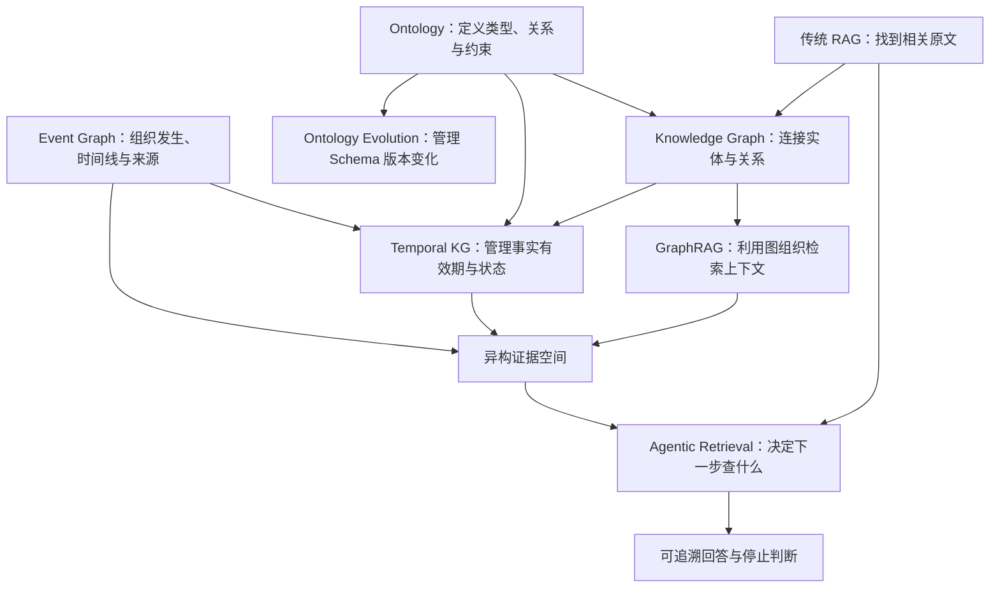

# Agentic RAG 与知识组织技术调研

> 报告日期：2026-08-16  
> 材料范围：基于当前项目已有调研、实现文档和实验结果重新整理；项目外部调研材料的主要检索截止时间为 2026-08-11。

## 摘要

RAG 的技术演进可以看成两个问题逐步交汇。一条线关注“知识怎样组织”：从独立文本块走向实体关系图、时序知识图谱、本体约束和事件图。另一条线关注“检索怎样控制”：从一次查询、一次召回走向问题分解、工具路由、证据评估、查询改写和多轮停止。Agentic RAG 位于第二条线，GraphRAG、Temporal Knowledge Graph、Ontology 和 Event Graph 位于第一条线；成熟系统需要同时解决两者。

这些概念不能相互替代。Knowledge Graph 解决对象连接，Temporal Knowledge Graph 解决事实在何时成立，Ontology 约束图中允许出现什么类型的对象和关系，Ontology Evolution 管理这些类型规则怎样变化，Event Graph 则把“发生”作为一等知识对象。Agentic Retrieval 不等于使用知识图谱，它只描述由谁、依据什么状态来选择检索动作；同样，拥有事件图也不意味着系统能够根据证据缺口主动检索。

当前项目的方法明确对应 `ours_evolink`，下文记为 **Ours_EvoLink**。它以 Vector Route、Semantic Route、Event Route 为三类持久知识空间；三点式 Planner 依次判断知识缺口、生成通路查询和评估证据充分性，一级需求分为原文落证、关系语义和事件演化；Neo4j 中的 Entity–Assertion–Event–Mention–EventEffect 图再执行跨通路补全。实验显示，固定三路 Ours_EvoLink 目前优于两种 Agentic 三路变体。项目的研究机会不在“首次把三路放在一起”，而在让 Planner 显式维护三类知识缺口，并检索可追溯的 `EventEffect → Assertion lifecycle → Mention` 证据路径。

---

## 一、从传统 RAG 到 Agentic RAG

传统 RAG 把外部知识接入大模型，基本流程是“问题—检索—拼接上下文—生成”。它解决了参数知识过时和答案缺少来源的问题，但通常隐含三个强假设：问题一次查询就能表达清楚；相似文本足以覆盖推理所需证据；固定 Top-K 能同时适应简单事实题和复杂多跳题。

这些假设在复杂问题上很容易失败。一个问题可能需要先找到桥接实体，再查其关系；已有证据可能相关却不完整；多个来源可能处在不同时间点；无答案也可能只是查询写得不好。传统 RAG 看不到“当前已经知道什么、还缺什么”，所以只能一次性决定检索内容和预算。

Agentic RAG 因此出现。它把 RAG 从固定流水线改为受状态控制的过程：Agent 先理解任务，选择检索工具，检查证据，再决定继续搜索、改写问题、调用另一种知识源或停止回答。Self-RAG 用反思信号学习何时检索和评价证据；CRAG 在检索结果不可靠时触发纠错与补充；Adaptive-RAG 根据问题复杂度选择不检索、单步检索或迭代检索。[Self-RAG](https://arxiv.org/abs/2310.11511)、[CRAG](https://arxiv.org/abs/2401.15884)、[Adaptive-RAG](https://aclanthology.org/2024.naacl-long.389/)

Agentic Retrieval 是其中更窄的一层。它不负责定义最终回答风格，而是负责检索决策：是否检索、查哪个索引、怎样改写查询、是否继续、如何分配预算。当前主流路线大致有三种：

| 路线 | 控制信号 | 优点 | 主要问题 |
|---|---|---|---|
| 问题前路由 | 问题类型、复杂度、意图 | 成本低，容易控制 | 看不到首轮检索后暴露的新缺口 |
| 检索后反思 | 相关性、充分性、冲突、缺失信息 | 能纠正失败查询 | 判断依赖 LLM，容易重复检索或误判不足 |
| 状态/计划驱动 | 子问题、证据槽位、知识需求、工具状态 | 行为可解释，可按缺口选路 | 状态设计困难，检索收益未必覆盖额外成本 |

技术边界也应明确。多轮调用不自动构成有效 Agent；只有当下一步动作由当前状态和反馈决定时，才具有 Agentic 控制。相反，一次性 Query Planner 虽然能分解关键词和路由，但如果所有问题仍固定调用全部索引，它主要是查询理解模块，不是完整 Agent。

Agentic RAG 的关键难点不是“会不会循环”，而是四个可检验问题：充分性如何定义；缺失信息能否转换为有效的新查询；不同工具的成本与收益怎样比较；什么时候停止才不会把“没找到”误判为“语料不存在”。当前项目实验也说明了这一点：Agentic Hybrid 能补偿较弱基线，但在较强的固定三路上，多轮改写没有提高 Top-10 覆盖，反而增加延迟并扰动排序。

---

## 二、Knowledge Graph 与 GraphRAG：从相似文本到可连接知识

文本向量检索把语义相近的片段放在一起，但不说明片段中的对象怎样连接。多跳问题、实体消歧和全局主题分析因此推动了 Knowledge Graph 在 RAG 中的使用。知识图谱将实体、关系和属性组织为可遍历结构，使“某公司—开发—某产品—用于—某任务”这类路径可以跨文档组合。

GraphRAG 并不是一种固定算法，而是一组把图结构用于索引、检索或上下文组织的方法。Microsoft GraphRAG 从文本抽取实体关系图，做社区发现和社区摘要，重点解决对整个语料的全局性问题；Local Search 再结合局部图邻域和原文。LightRAG 使用实体/关系的低层与高层关键词进行双层检索，强调轻量图索引和增量插入。HippoRAG 借助图传播恢复关联式多跳路径。[Microsoft GraphRAG](https://arxiv.org/abs/2404.16130)、[LightRAG](https://arxiv.org/abs/2410.05779)、[HippoRAG](https://arxiv.org/abs/2405.14831)

主流 GraphRAG 路线可以按图在系统中的作用区分：

| 图的作用 | 典型方法 | 解决的问题 | 边界 |
|---|---|---|---|
| 全局组织与摘要 | Microsoft GraphRAG | 全语料主题、群落和跨文档概括 | 社区摘要可能压缩事实细节与时间状态 |
| 实体/关系双层检索 | LightRAG | local 实体与 global 关系检索 | 主要仍是实体中心的静态语义关系 |
| 图传播与子图检索 | HippoRAG、SubgraphRAG、GFM-RAG | 多跳连接和候选扩展 | 常假设图质量足够，结构噪声会传播 |
| 层次图或超图 | HiRAG、LeanRAG、HyperGraphRAG、OG-RAG | 多粒度、高阶关系和紧凑事实块 | 复杂结构不自动解决事实演化 |
| 文本—关系联合检索 | HybGRAG、BYOKG-RAG | 同时满足文本属性和关系约束 | 已有 KG 或工具路由不等于长期知识治理 |

GraphRAG 解决了“谁与谁相关”，却不自然回答“这条关系在什么时候成立”。常见图构建会把同名实体合并，把多篇文档对同一实体对的描述聚合到一条边。这样适合稳定知识，却会把历史状态、来源立场和更新过程压平。图中存在日期属性也不等于解决了时态：日期可能只是文档元数据，未必约束关系的有效期。

另一个边界是抽取可靠性。实体和关系由 LLM 生成时，遗漏、错误类型和错误合并会直接改变图拓扑。图检索应保留到原文 Mention 的回链，并让原文向量通路作为 fallback。否则结构化表示一旦出错，系统连“图为什么这样连接”都无法核验。

---

## 三、Temporal Knowledge Graph 与 Temporal RAG：从关系存在到关系何时有效

Knowledge Graph 一般描述事实是否存在；Temporal Knowledge Graph（TKG）进一步描述事实的时间范围和状态变化。它至少要回答两类时间：事实在现实世界何时有效（valid time），以及系统何时获知或记录该事实（transaction time）。只有文档发布时间而没有断言有效期的图，不是完整的 TKG。

TKG 的出现是因为静态图无法区分三种情况：同一事实在不同时间先后成立；两个来源在同一时间真正冲突；新证据后来纠正了旧记录。把它们都保存为几条无时间边，会让查询“截至某日是什么状态”和“我们在当时知道什么”得到错误答案。

主流建模方式包括给三元组增加时间戳或区间、把关系重述为 Assertion 节点、为状态变化建立事件，以及保存快照序列。对于需要来源、立场和冲突的 RAG，Assertion 节点更合适，因为它可以挂接 `valid_from/valid_to`、状态、置信度和多个 Mention；事件再通过 effect 边说明一项事实为何创建、更新、终止或替代。

Temporal RAG 是更宽的检索概念。它要求检索器理解问题中的时间约束，并返回在正确时间范围内成立的证据。当前技术路线包括时间感知 Query Rewrite、时间增强 Embedding、按时间过滤和重排、事件时间线遍历、区间代数以及状态快照检索。TimeR⁴ 在已有 TKG 上执行 retrieve–rewrite–retrieve–rerank；DyG-RAG 使用带时间锚点的动态事件单元和时间线；IA-RAG 强调 before、after、overlap、contain 等区间关系。[TimeR⁴](https://aclanthology.org/2024.emnlp-main.394/)、[DyG-RAG](https://arxiv.org/abs/2507.13396)、[IA-RAG](https://arxiv.org/abs/2606.06044)

| 技术 | 主要知识对象 | 强项 | 仍未自动解决 |
|---|---|---|---|
| TKG | 带有效期的实体关系或 Assertion | state-at-time、历史状态、事实更新 | 从原文抽取、来源对齐与错误修复 |
| Temporal RAG | 带时间约束的文本、事实或事件 | 查询时间理解、时间过滤与重排 | 长期一致的知识状态维护 |
| Timeline Retrieval | 有序事件序列 | 先后过程和阶段变化 | 某个事件具体改变了哪项事实 |
| Bitemporal Retrieval | valid time + transaction time | 迟到证据、回溯修正和可重放 | 数据与评测构造成本很高 |

时间关系与因果关系必须分开。事件 A 先于事件 B，只能证明顺序；若要声称 A 导致 B，需要原文证据或明确的因果边。另一个难点是开放时间和不精确时间：年份、月份、日期、区间和“截至目前”不能都压成一个时间戳。最后，时间图的增量维护比静态图困难：新文档可能报道过去发生的事件，系统必须回写历史状态而不能只追加到“现在”。

---

## 四、Ontology 与 Ontology Evolution：约束知识图，而不是替代知识图

Knowledge Graph 保存实例知识；Ontology 定义这些实例可以属于什么类型、使用什么关系以及满足什么约束。简单说，图回答“有哪些事实”，本体回答“什么样的事实在这个领域里是合法且可比较的”。它可以规定 Person、Organization、Model 等类别层次，定义 `develops`、`uses`、`replaces` 等关系的语义，并通过 OWL 或 SHACL 约束字段、值域和基数。

Ontology 在 RAG 中出现，是因为开放式 LLM 抽取很容易产生同义类型、宽泛关系和不可复用 Schema。例如“发布”“推出”“正式上线”可能被抽成三个无关谓词；公司名称和产品名称可能都被标成 Concept。本体映射能降低这种漂移，并使图查询、过滤和跨文档合并更稳定。OG-RAG 进一步使用领域本体约束事实块和超图，说明本体可直接参与检索上下文选择。[OG-RAG](https://aclanthology.org/2025.emnlp-main.1674/)

本体也有明确边界。它规定“允许怎样描述”，不决定某条具体事实是否真实；它能约束 `EventEffect` 的取值，却不能仅凭 Schema 推断某事件确实终止了某关系。领域本体越严格，精确性越高，但开放域覆盖越差；本体越开放，维护成本越低，却更容易退化为不受控标签集。因此，原文 Mention 和不确定性治理不能被本体替代。

Ontology Evolution / Dynamic Ontology 出现，是因为长期运行的知识系统会遇到新实体类型、新关系和旧概念含义变化。这里需要区分两种“动态”：

- **实例变化**：某公司换了 CEO，某产品发布新版本。这是知识状态变化，应进入 TKG 或 Event Graph。
- **Schema 变化**：系统决定新增一种事件类型、拆分一个概念、废弃一个关系或修改约束。这才是本体演化。

把更多事件写进图，不等于本体在演化。可靠的本体演化通常包括新术语候选发现、使用频率与冲突统计、专家或治理规则审批、版本发布、实例迁移、向后兼容和检索回归测试。让 LLM 在索引时直接修改 Schema 虽然灵活，却会让相同文档在不同时间得到不可比较的结构。

当前研究难点集中在四处：如何从未覆盖文本中发现真正需要的新概念，而不是把抽取噪声升格为 Schema；如何判断概念是新增、重命名、拆分还是合并；如何迁移旧实例和旧查询；以及怎样评价本体变化对检索的真实收益。动态本体更接近知识治理和软件版本管理，而不是一次提示词优化。

---

## 五、Event-centric Knowledge Representation：为什么事件对动态分析重要

实体关系图偏向“是什么”和“有什么关系”，事件表示偏向“发生了什么”。当任务涉及新闻演化、合同进展、技术发布、诉讼、人员变动、实验结果、否认与纠正时，事件是更自然的知识单位。一个事件通常包含类型、触发动作、参与者、对象、时间、地点、结果、立场和来源 Mention。

Event Graph 把事件作为节点，并用共享参与者、时间先后、包含、因果、更新或替代等关系连接。它解决了把所有动态信息挤进实体边的问题。EventRAG 从多来源文本构造事件知识图，融合相似事件并让 Agent 迭代检索多事件链；DyG-RAG 用动态事件单元恢复时间线；E²RAG 分开构造实体 Mention 图和事件图，再用二部映射保留实体在具体事件中的动态上下文。[EventRAG](https://aclanthology.org/2025.acl-long.830/)、[E²RAG](https://aclanthology.org/2026.eacl-long.90/)

这些方法推动了从 Entity-centric 到 Event-centric 的转变，但事件图也有自己的难题。跨文档事件共指必须判断两段文字是在说同一次发生、同类但不同的发生，还是后续更新；时间未知或只有部分日期时，合并更困难。共享实体和时间邻近适合建立候选边，却不能自动推出因果。事件摘要由模型生成，若不保留 Mention 原文，就会把检索证据变成抽取器的二手结论。

Event Graph 与 TKG 的边界尤其重要。Event Graph 擅长恢复发生序列，TKG 擅长查询事实状态。若某机构在 \(t_2\) 宣布终止合作，事件图可以表示“宣布终止”发生在 \(t_2\)；只有把该事件通过 `TERMINATES` 连接到“机构 A partnersWith 机构 B”这项 Assertion，系统才能回答这项关系在 \(t_1\) 和 \(t_3\) 是否有效。事件序列和事实生命周期相连，才构成可解释的动态知识。

---

## 六、这些技术如何汇合到 RAG 与 Agentic Retrieval

前述技术分别解决不同层次的问题：



理想的结合方式不是把所有信息塞进一张超级图，也不是让 Agent 随意调用一堆工具，而是明确持久知识与查询状态的分工。持久层保存原文、实体、Assertion、Event、Mention、时间和来源；查询层建立只服务当前问题的工作状态，记录已经覆盖的证据、仍缺的角色和允许的下一步动作。

这种架构下，GraphRAG 提供关系路径，Temporal RAG 提供时间过滤和状态恢复，Event Graph 提供变化事件，Ontology 提供结构约束，Agentic Retrieval 根据当前知识缺口在它们之间路由。查询时构建的工作图可以临时连接本轮证据，但不应未经审核直接改变持久本体。RAS 和 KAIR/GraphAnchor 已展示“边检索边组织当前查询结构”的方向；RouteRAG 则进一步研究多轮推理中如何在文本和图之间学习路由政策。[RAS](https://iclr.cc/virtual/2026/poster/10008199)、[KAIR](https://arxiv.org/abs/2601.16462)、[RouteRAG](https://aclanthology.org/2026.findings-acl.1502/)

当前领域仍缺一个稳定答案的问题是：充分证据应怎样形式化。相关文档数量不是充分性；多来源也不一定独立；完整时间线也不代表事实状态正确。更合理的目标可能是“最小充分证据组合”：它既覆盖问题所需角色，又能回到原文，并区分支持、否认、更新和来源依赖。这个目标会同时改变检索、融合和 Agent 停止条件。

---

## 七、当前系统的技术位置

### 1. 四个核心部件与研究方向的关系

| 当前部件 | 对应研究方向 | 已有能力 | 尚未达到的边界 |
|---|---|---|---|
| Vector Route | Dense RAG、Hybrid RAG | 原文 Chunk 语义召回，保留细节和 fallback | 不显式组织跨文档关系和时间状态 |
| Semantic Route | LightRAG、GraphRAG、statement-level KG | 实体/关系双层检索；Assertion、Mention、实体治理 | 图抽取仍有噪声；生命周期各部件缺少单独消融 |
| Event Route | EventRAG、Temporal RAG、Event Graph | 事件向量种子、结构排序、一跳事件链、来源 Mention、冲突字段 | 事件共指和时间关系较启发式；因果与区间推理有限 |
| 三点式 Planner / 三类知识需求 | Adaptive/Agentic RAG、RouteRAG、S2G-RAG | 判断缺口、生成通路查询、评估充分性；原文落证、关系语义、事件演化三类需求 | `ours_evolink` 主实验为一次计划、固定三路；动态缺口更新在 `ours_evoneed` 原型中 |
| EvoLink / TKG | Entity–Event dual graph、Temporal KG | 使用 Neo4j 对 Entity—Assertion—Event—Effect—Mention 做跨路扩展 | 尚未直接优化生命周期证据路径，也缺少强直接基线 |
| Ontology v0.1 | Ontology-grounded KG | OWL 类与关系、SHACL 约束、映射表、版本号 | 本体演化仍是人工治理方案，不是自动能力 |

系统已经不只是“向量库加知识图谱”。它有三类持久知识表示、统一的 RAG 文档身份、来源 Mention、Statement-level TKG，以及实际运行的 Neo4j EvoLink 协调图。与普通 GraphRAG 相比，它更重视事件和原文回链；与纯 EventRAG 相比，它保留独立的原文和稳定关系通路；与传统 Agentic RAG 相比，它可以把下一步动作映射到原文落证、关系语义和事件演化三类知识需求。

但技术位置也应保守描述。Vector–Semantic–Event 三路本身不是足够强的研究创新：LightRAG 已结合向量与实体关系图，EventRAG 已有跨文档事件图和 Agent 多事件推理，E²RAG 已直接提出实体—事件双图，DyG-RAG 已做时间增强事件检索。当前固定三路的主要融合仍是文档级 RRF，Agentic 变体在指定实验中也没有超过固定 `ours_evolink`。

项目更有辨识度的部分是声明级生命周期：Canonical Entity 可以合并，但 Assertion Mention、有效期、来源立场和事件作用不能被压平。其关键证据路径是：

```text
原文 Mention
    → 支持或否认 Assertion
    → EventEffect 创建、更新、终止或替代 Assertion
    → 在给定时间恢复事实状态
    → 回到每个状态的来源原文
```

截至当前调研，没有必要声称这是绝对空白；更稳妥的定位是：现有方法分别覆盖事件序列、实体—事件上下文、时间约束或多轮路由，而本项目尝试把可追溯 Assertion 生命周期作为跨通路检索和 Agent 缺口判断的共同对象。

### 2. 值得继续研究的问题

第一，应把 Ours_EvoLink 的三类 Planner 从一次性问题解析推进为可验证的证据契约。`text_evidence`、`relation_evidence` 和 `evolution_evidence` 只是一级分类；时间问题还需要前态、变化事件、有效时间、后态、立场和来源等槽位。每个“已满足”状态必须绑定有效 Evidence ID，停止条件应由槽位覆盖和冲突状态共同决定。`ours_evoneed` 可以作为这一动态控制层的实验原型，但不应取代主方法命名。

第二，应从固定 RRF 走向集合级证据选择。三路命中同一文档往往高度相关，不能简单当作三票独立支持。融合需要区分独立来源、转载、同一 Assertion 的多个 Mention，以及能补足新证据角色的候选。优化目标应同时考虑相关性、角色覆盖、来源独立性、冗余和成本。

第三，应把 EventEffect 生命周期作为独立实验对象。未来评测不能只报 Recall@K，还应报告 State-at-Time Accuracy、Transition F1、Lifecycle Path Success/Completeness、Temporal Coverage、冲突类型区分和 provenance path 完整度；并用打乱时间、断开 EventEffect、移除 Mention 回链等消融证明收益来自结构，而不是更多候选。

第四，需要正式比较直接竞争方法。至少应包含 Dense/BM25、LightRAG、强图检索方法、EventRAG、E²RAG 和 DyG-RAG 或其他时态基线，并固定语料快照、Embedding、Top-K、候选预算和答案模型。当前 30 题快速集适合开发，不足以支撑最终结论。

第五，应补齐长期知识治理。采集版本变化需要自动触发增量重建；双时态模型要区分事件有效时间和系统获知时间；实体合并、Assertion 更新和本体版本迁移要可撤销、可重放。Dynamic Ontology 应从候选发现和人工审批开始，不应让索引 LLM 直接修改正式 Schema。

## 结论

RAG 的发展不是简单地从向量库升级到知识图谱，再升级到 Agent。每一层解决的是不同问题：向量检索保留原文，Knowledge Graph 连接对象，Temporal KG 管理事实状态，Ontology 约束语义，Ontology Evolution 管理 Schema 变化，Event Graph 表达发生过程，Agentic Retrieval 决定何时使用这些能力。

当前系统已经建立了这些方向之间的工程接口，但实验给出的结论很具体：异构知识表示和 EvoLink 已经带来证据覆盖收益，通用多轮 Agent 尚未稳定带来额外收益。下一步研究应把重点从“增加 Agent 步骤”转向“让 Agent 知道缺的是哪种可验证知识”，并把 `EventEffect → Assertion lifecycle → Mention` 做成可检索、可评价、可消融的核心对象。这样才能把三通路从工程组合推进为清楚的问题定义和方法贡献。

## 参考脉络

1. Edge et al. [From Local to Global: A Graph RAG Approach to Query-Focused Summarization](https://arxiv.org/abs/2404.16130), 2024.
2. Guo et al. [LightRAG: Simple and Fast Retrieval-Augmented Generation](https://arxiv.org/abs/2410.05779), 2024.
3. Gutiérrez et al. [HippoRAG: Neurobiologically Inspired Long-Term Memory for Large Language Models](https://arxiv.org/abs/2405.14831), 2024.
4. Asai et al. [Self-RAG: Learning to Retrieve, Generate, and Critique through Self-Reflection](https://arxiv.org/abs/2310.11511), 2023/2024.
5. Jeong et al. [Adaptive-RAG: Learning to Adapt Retrieval-Augmented Large Language Models through Question Complexity](https://aclanthology.org/2024.naacl-long.389/), NAACL 2024.
6. [EventRAG: Enhancing LLM Generation via Event Knowledge Graphs](https://aclanthology.org/2025.acl-long.830/), ACL 2025.
7. [DyG-RAG: Dynamic Graph Retrieval-Augmented Generation](https://arxiv.org/abs/2507.13396), 2025.
8. [E²RAG: Entity-Event Retrieval-Augmented Generation](https://aclanthology.org/2026.eacl-long.90/), EACL 2026.
9. [TimeR⁴: Time-Aware Retrieval, Rewriting, Reranking and Response for Temporal KGQA](https://aclanthology.org/2024.emnlp-main.394/), EMNLP 2024.
10. [OG-RAG: Ontology-Grounded Retrieval-Augmented Generation](https://aclanthology.org/2025.emnlp-main.1674/), EMNLP 2025.
11. [Retrieval-And-Structuring for Knowledge-Intensive Reasoning](https://iclr.cc/virtual/2026/poster/10008199), ICLR 2026.
12. [Graph-Anchored Knowledge Indexing / KAIR](https://arxiv.org/abs/2601.16462), 2026.
13. [RouteRAG: Learning Text–Graph Retrieval Policies for Multi-Round RAG](https://aclanthology.org/2026.findings-acl.1502/), ACL Findings 2026.
