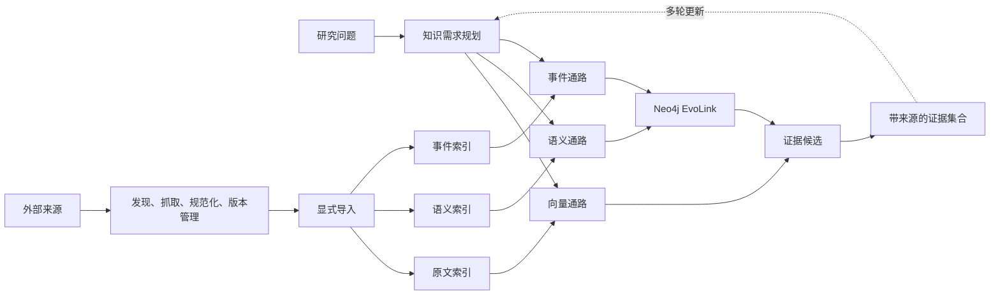
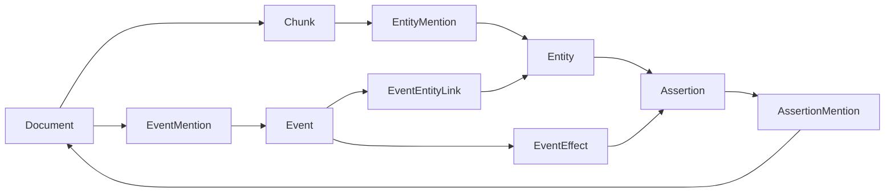
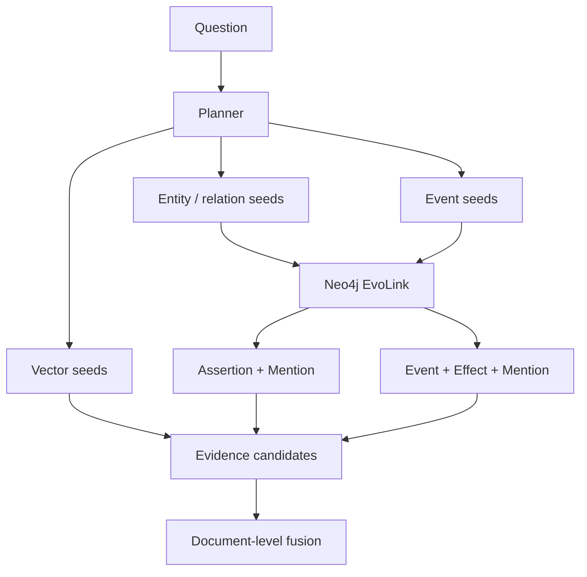

# 三通路 RAG 系统技术报告

> 报告日期：2026-08-16  
> 当前主方法：Ours_EvoLink（评测配置 `ours_evolink`）  
> Agentic 原型：`agentic_ours_evolink`、Ours_EvoNeed（评测配置 `ours_evoneed`）  
> 主要实验：`data/exports/evaluation/2026-08-14_all_static_agentic_evoneed_n30`

## 摘要

复杂检索任务缺少的通常不是笼统的“更多相关内容”，而是作用不同的知识。多文档研判至少需要回答三类问题：原始材料具体说了什么，涉及哪些实体及其关系，以及实体或关系的状态如何随事件变化。本文将它们分别定义为原文知识、关系知识和演化知识，并以此为起点设计三通路 RAG 系统。原文知识由文档 Chunk 和向量索引保存；关系知识由 Entity、Assertion 和 AssertionMention 组织；演化知识由 Event、EventMention 和 EventEffect 组织。三种表示分别建立索引，但共享文档、实体和来源身份，并在 Neo4j 中形成可查询的协调图。

查询时，Query Planner 从问题中提取原文条件、实体关系、时间与状态变化提示，生成适合三类知识空间的查询。向量通路返回原文，语义通路返回实体和关系路径，事件通路返回事件、时间与状态作用。Ours_EvoLink 随后沿 Entity–Assertion–Event–Mention–EventEffect 进行跨通路扩展，再按父文档身份融合候选。该方法与简单的“三个检索器加 RRF”不同之处在于：三种知识类型在索引阶段已通过共享身份连接，检索阶段能够从关系找到事件和原文，也能从事件回到受影响的关系及其来源。

当前实验表明，固定三通路 `ours_evolink` 在 30 个问题、100 篇文档的 MultiHop-RAG 子集上取得最高的 Evidence Recall@10（0.8651）、Complete Recall@10（0.6190）、NDCG@10（0.7280）和 MRR@10（0.8349）。通用 Agentic 改写没有进一步提高三通路的 Top-10 证据覆盖；显式知识需求规划的 `ours_evoneed v1` 也没有超过静态方法。现阶段能够成立的结论是：三类知识组织和 EvoLink 协调已经改善多证据覆盖，而“根据缺失知识类型动态选路”仍是需要继续验证的方法扩展。

---

## 1. 研究背景与问题

### 1.1 从相关文档转向必要知识

普通 RAG 通常把检索目标定义为“找到与问题语义相关的文本”。这一目标适合单事实问答，但不足以描述多跳、比较、时序和持续研判任务。在这些任务中，相关文档可能很多，真正决定分析能否继续的是当前证据池是否包含必要的知识角色。

以“公司 A 是怎样获得能力 X 的”为例，仅找到一篇同时出现 A 和 X 的报道并不充分。完整分析至少需要：

1. 哪些原文明确描述了能力 X、适用条件和来源；
2. 公司 A、公司 B、产品 X 之间是什么关系；
3. 公司 A 在某个事件之前是否已有该能力，哪个事件改变了状态，改变后形成了什么状态。

这三项并不是同一种信息的不同排序结果。第一项要求保留原始表达和上下文，第二项要求跨文档连接实体与关系，第三项要求恢复时间、事件和状态变化。因此，本项目不从“增加检索器”出发，而从检索知识需求出发。

### 1.2 三类知识需求

本文将当前方法所需知识限定为三类：

| 知识需求 | 核心问题 | 典型内容 | 主要证据对象 |
|---|---|---|---|
| 原文知识 `TEXTUAL_GROUNDING` | 材料具体说了什么 | 原句、数字、条件、限定、来源 | Document、Chunk |
| 关系知识 `RELATIONAL_SEMANTICS` | 有哪些实体，它们如何关联 | 实体身份、关系、属性、桥接实体、多跳路径 | Entity、Assertion、AssertionMention |
| 演化知识 `EVENT_EVOLUTION` | 实体或关系的状态怎样变化 | 前态、变化事件、时间、后态、终止、替代、否认 | Event、EventMention、EventEffect |

演化知识不等于“带日期的文本”。它要求存在一个需要判断的目标状态，并检查状态变化链是否完整：

```text
state_before
  → transition_event
  → temporal_anchor
  → state_after
  → supersession / termination / denial / confirmation
```

三类知识需求既是 Query Planner 的输出类型，也是索引对象和证据评价的组织原则。

### 1.3 现有研究留下的问题

向量 RAG 能够保留原文细节，却不显式保存跨文档关系。GraphRAG、LightRAG 和 HippoRAG 能够利用实体图完成多跳连接，但静态关系图容易压平同一事实在不同时间的状态。EventRAG、E²RAG 和 DyG-RAG 已经证明事件表示对于多事件和时序问题有价值，但其重点通常是事件图构建或事件检索，而不是把原文、关系和演化定义为统一的知识需求空间。

在检索控制方面，Self-RAG、CRAG 和 Adaptive-RAG 开始判断是否检索、证据是否可靠以及问题需要多少轮检索。RouteRAG 能够在 passage、graph 和 hybrid 之间学习动态路由；S2G-RAG 能够显式输出 bridge entity、attribute、relation 和 evidence span 等缺口。但已有工作尚未稳定形成以下对应关系：

```text
缺少哪一类知识
  → 应访问哪一类持久表示
  → 应生成什么查询
  → 返回的证据承担什么角色
  → 是否真正补齐该缺口
```

尤其是“实体或关系的事件驱动状态演化”还没有成为连接事件组织与多轮异构检索的一等缺口类型。

### 1.4 研究问题

本项目围绕四个问题展开：

1. 如何把复杂问题拆分为原文、关系和演化三类必要知识；
2. 如何据此构造既相互独立又保持共享身份的三通路索引；
3. 如何让三条通路在检索中互相补全，而不只在末端合并排名；
4. 如何让单轮检索和多轮 Agentic 检索使用同一套知识需求和证据对象。

### 1.5 方法贡献与当前证据边界

本文将贡献限定为以下四点：

1. **知识需求形式化。** 将复杂检索所需知识分为原文、关系和演化三类，并把演化需求展开为前态、事件、时间、后态和替代/否认等槽位。
2. **需求与索引一致。** 三类知识需求分别对应 Chunk、Entity/Assertion/Mention 和 Event/Effect/Mention，使 Query Planner 的需求类型能够直接映射到持久知识对象。
3. **跨通路证据补全。** 通过共享文档与实体身份、Mention 回链和 EvoLink 协调图，让关系、事件和原文在查询时互相生成证据锚点。
4. **单轮与多轮统一。** 单轮检索执行一次知识需求分解，多轮检索在每轮后更新未满足需求；两者使用相同的索引和证据语义。

前三点已有较完整实现，其中固定三通路 EvoLink 已有实验结果。第四点已有原型，但当前 `ours_evoneed v1` 的结果不足以证明动态选路有效，必须作为待验证扩展而不是既成结论。

---

## 2. 三类知识需求与系统设计

### 2.1 需求、索引、通路和证据的对应

系统采用统一映射，而不是让 Agent 面对一组含义不清的检索工具：

| 知识需求 | 持久表示 | 主要索引 | 查询动作 | 返回证据 |
|---|---|---|---|---|
| 原文 | Document、Chunk | Chunk Embedding | 向量语义检索 | 原始段落及位置 |
| 关系 | Entity、Assertion、AssertionMention | Entity/Relation 向量与关系图 | 实体、谓词和多跳检索 | 关系路径及来源 Mention |
| 演化 | Event、EventMention、EventEffect | 事件向量、时间与状态结构 | 事件种子、时间过滤和事件链扩展 | 事件、作用、前后状态及原文 |

这一映射使索引、检索和充分性判断可以使用同一组概念。若 Planner 判断缺少 `state_after`，系统应生成针对后态的事件查询，而不是再次用完整原问题搜索所有文本。

### 2.2 单轮检索与多轮检索

单轮检索在查询开始时完成一次知识需求分解：

```text
Question
  → textual need + relational need + evolution need
  → route-specific queries
  → three-route retrieval
  → cross-path completion
  → evidence bundle
```

Agentic 检索则在每轮后更新 Knowledge Need State：

```text
KNS_t = {
  analytic_goal,
  established_findings,
  textual_needs,
  relational_needs,
  evolution_slots,
  supporting_evidence_ids,
  conflicts,
  remaining_budget,
  stop_reason
}
```

二者不是两套系统。固定 `ours_evolink` 是宽入口版本：一次规划后调用三路，优先获得稳定的初始证据面。Ours_EvoNeed 是选择性版本：首轮建立锚点，后续根据未满足需求调用对应通路。

### 2.3 总体架构



系统物理上保留多种索引，逻辑上通过稳定 ID 和 Neo4j 证据图连接。这样既避免把所有内容强行塞进一张巨图，也避免三个通路成为互不相识的检索器。

---

## 3. 三通路协同索引

### 3.1 索引输入和共享身份

三通路索引的输入不是裸网页，而是经过规范化的文档及 sidecar。每条记录至少携带：

- 稳定 `record_id`、`version_id` 和导入后的 `document_id`；
- 标题、正文、来源 URL、发布时间与抓取时间；
- 内容校验值、来源类型和处理状态；
- Clean Markdown 文件与结构化元数据。

Chunk、EntityMention、AssertionMention 和 EventMention 均保存父文档身份或来源片段。共享身份是跨通路协同的前提；如果三条索引只保留各自的内部编号，查询时只能做分数合并，无法恢复证据路径。

### 3.2 原文索引

文档解析为 Markdown 后，按目标 700 tokens、重叠 100 tokens 的策略递归切分。每个 Chunk 保存父文档、文件路径和片段内容，并使用当前 Embedding 模型生成稠密向量。向量写入 Qdrant，用于回答“原文说了什么”。

原文索引尽量少做知识判断。它保留数字、限定条件和自然语言细节，也在结构化抽取遗漏时提供 fallback。当前系统支持本地 `Qwen/Qwen3-Embedding-0.6B`、智谱 `embedding-3` 和百炼 `text-embedding-v4`；指定实验使用 `zhipu/embedding-3/1024d`。

### 3.3 语义索引

语义通路以受控 LLM 抽取为入口。LightRAG 对 Chunk 调用实体/关系抽取 Prompt，限制实体类型、记录数量和关系端点，减少日期、数值、宽泛主题和普通动作进入语义图。当前测试配置每个片段最多保留 4 个实体和 4 条关系。

关系不会只作为不可挂属性的普通边保存。系统将其转换为：

```text
Entity(subject)
  → Assertion(predicate, object, status, valid interval)
  → AssertionMention(document, evidence span, stance)
```

这样同一关系可以保留多个来源，并能够在后续挂接有效期、冲突和事件作用。LightRAG 同时为 Chunk、Entity 和 Relation 建立向量索引，并在 NetworkX 中保存原生关系拓扑；融合后的 Entity、Assertion 和 Mention 进入 Neo4j。

### 3.4 事件索引

事件通路采用独立于实体关系抽取的 Prompt、切片和 Schema。抽取器按最多 12,000 字符的文档片段处理，每片最多 5 个关键事件，每文档最多 12 个事件。事件必须包含明确核心动作和至少一个命名参与者，并优先保留会影响时间、状态、冲突或当前判断的发生。

主要字段包括：

- event type、summary、action；
- participant、object、role；
- start/end time 与时间精度；
- result、stance、confidence；
- evidence 文本、文档和字符位置；
- `fact_effects`，即事件对某项事实的作用。

事件类型、参与者、动作、对象、结果、摘要、时间和状态被拼成规范事件文本，再用当前 Embedding 生成事件向量。评测实现采用延迟构建：事件先保存为结构化记录，首次事件查询时批量生成并缓存 `event_vectors.npz`。向量命中用于寻找事件种子，最终证据仍是 EventMention 对应的原文，而不是模型生成的摘要。

### 3.5 实体解析和合并

语义抽取与事件参与者抽取可能产生不同表面形式。系统采用分层实体解析：

```text
本体类型映射
  → 规范名、别名和组织后缀规则
  → 同类型词法候选
  → 名称 + 类型 + 描述 Embedding
  → 高置信且领先的候选自动合并
  → 灰区由受约束 LLM 裁决
  → 不确定案例进入 ReviewCase
```

Embedding 候选会做 L2 归一化和余弦相似度计算；只有达到自动合并阈值、与次候选有足够间隔且词法条件满足时才自动匹配。LLM 只能输出 `MATCH_EXISTING`、`CREATE_NEW`、`AMBIGUOUS` 或 `REJECT`，且不能选择候选列表外的实体。合并不删除源 Entity，而是保存 `merged_into_id`、MergeRecord 和引用移动信息，以支持回滚。

### 3.6 关系、事件和来源治理

对象合并遵循“规范对象可以共享，来源 Mention 必须保留”的原则：

- 同一主体、谓词、客体和有效期复用 Assertion，但新增 AssertionMention；
- 相容时间、参与者、动作和对象指向同一发生时，可复用 Event，但保留每份 EventMention；
- `DENIES` 保留肯定和否定 Mention，并可生成 ConflictCase；
- `TERMINATES` 关闭 Assertion 的 `valid_to`；
- `SUPERSEDES` 标记旧 Assertion 被替代；
- 不确定或传闻事件不得直接修改事实生命周期；
- 新类型未通过本体映射时进入治理队列，不允许 LLM 自动修改正式 Schema。

OWL 描述类、层次和语义关系，SHACL 约束最低字段、取值和基数。Ontology 是知识治理层，不是第四条检索通路。Dynamic Ontology 也尚未自动实现；新增类型需要统计、审批、版本迁移和回归评测。

### 3.7 三通路连接



这张连接图支持三种证据路径：

1. 关系命中后回收支撑该关系的原文，并寻找改变该关系的事件；
2. 事件命中后找到参与实体、受影响 Assertion 及其前后状态；
3. 结构对象最终都能回到 Document 和 Mention。

当前 EvoLink 已实现语义与事件对象的跨路扩展。向量候选会参加最终融合和原文落证，但“任意向量 Chunk 自动抽取锚点并重新触发图谱/事件扩展”尚未完整闭合，不应描述为已实现的全双向传播。

### 3.8 增量索引与失败隔离

文档服务依次执行保存、解析、LightRAG 索引、事件抽取和 TKG 融合。文本/图谱索引成功后，即使事件或 TKG 失败，文档仍可用于原文和语义检索；各子任务状态单独记录并可重建。文档重建先移除该文档贡献的 Mention、Effect 和决策，再重新融合；其他来源仍支持的规范对象不会被删除。

数据搬迁和融合重算必须区分。`migrate_tkg_to_neo4j.py` 只迁移已有快照，不调用 LLM；若要让旧文档经过新的本体映射、Embedding 或实体解析器，必须重新索引。

---

## 4. 三通路检索

### 4.1 Query Planner

当前 Query Planner 每个问题调用一次 LLM，输出：

- low-level 与 high-level keywords；
- focal entities；
- event types；
- time range；
- state intents；
- 是否扩展事件链。

输出经过确定性清洗：关键词去重限长，实体最多 3 个，事件类型最多 4 个，时间范围只接受问题中明确出现的年份。规划按版本、日期和问题缓存，失败时使用确定性 fallback。

从方法目标看，Planner 应首先生成三类 Knowledge Need，再生成通路专用查询：

| 通路 | Query 应保留的内容 | 不应只做什么 |
|---|---|---|
| 向量 | 原实体、日期、数字、条件、原文措辞 | 只列实体名称 |
| 语义 | 实体入口、目标关系、桥接对象、跳数 | 复制完整自然语言问题 |
| 事件 | actor、action、object、time、before/after state | 只加入年份关键词 |

当前 `ours_evolink` 已生成实体、关系、时间和事件提示，但仍固定调用全部三路；按缺口选择路由属于 Ours_EvoNeed 的扩展。

### 4.2 三路召回

三路异步执行，候选上限通常为最终 `top_k` 的 3 倍：

- 向量通路调用 LightRAG `naive`，以原问题检索 Chunk；
- 语义通路调用 LightRAG `hybrid`，结合实体和高层关系词检索实体、关系及来源；
- 事件通路用规范事件向量寻找种子，再按实体、动作、时间、状态、置信度和来源数量重排，并可扩展相邻事件。

这三个输出都转换为统一 `EvidenceCandidate`，记录通路、父文档、片段、分数和结构诊断。

### 4.3 EvoLink 跨通路补全

EvoLink 以 Planner/语义路得到的实体名和事件路候选作为种子，在 Neo4j 中扩展 Entity、Assertion、Event、Mention 和 EventEffect。它产生的不是另一份独立排名，而是一个局部证据图。



若没有这一步，三路只是 separate stores + late fusion。EvoLink 的作用是补充证据角色，例如从命中的合作关系找到终止事件，或从收购事件找到被创建的能力关系和原文来源。

### 4.4 证据融合

不同通路的相似度、图路径分数和事件结构分数不在同一量纲，因此当前稳定实现采用文档级 RRF：

\[
S(d)=\sum_{c\in\{vector,semantic,event\}}\frac{1}{60+r_c(d)}
\]

同一路对同一父文档只贡献一次。候选按 `document_id` 去重，并保留各通路代表片段和诊断信息。RRF 是稳定的评分汇合方法，不是本文的创新本身；方法增量主要位于 RRF 之前的知识需求规划、共享身份和 EvoLink 扩展。

未来应从文档排名进一步转向证据集合选择：在固定预算下优先覆盖原文、关系、前态、变化事件和后态，减少同义报道的重复占位。

### 4.5 Agentic 检索

当前工程有两类多轮控制器：

1. `AgenticRAGGraph` 执行检索—充分性评估—查询改写—再次检索。第二轮仍调用相同底层检索器，缺口以自由文本描述。
2. `EvoNeedRAGGraph` 显式维护 `text_evidence`、`relation_evidence` 和 `evolution_evidence`，将其映射到 vector、graph 和 event，后续优先调用未满足需求对应的通路。

指定实验最多检索 2 轮。`ours_evoneed` 的实验版本为 v1；当前代码中的新版规划逻辑已经继续修改，但不能用 v1 结果替代新版评测。单轮与多轮共享三类知识需求，但只有多轮系统需要维护证据池、未满足槽位、预算和停止原因。

---

## 5. 数据获取与知识准备

### 5.1 课题驱动的数据发现

数据管线既支持固定来源采集，也支持基于 `TopicProfile` 的课题发现。TopicProfile 保存研究问题、初始关键词、排除词、来源范围、每轮查询数、最大候选数、抓取预算和轮数。

若配置 LLM，Topic Planner 首先为课题补充少量高价值检索词，优先选择别名、缩写、专有名词和技术术语。系统 Prompt 明确把网页视为不可信数据，模型只能输出 JSON 检索词，不能执行网页指令，也不能生成或猜测事实。

### 5.2 LLM 驱动的多轮扩展

每轮发现流程为：

```text
当前检索词
  → 搜索与候选 URL
  → 来源策略检查和抓取
  → 解析、规范化和发布 Clean Markdown
  → 从新材料抽取下一轮检索词
  → 更新 TopicState
```

LLM 从已抓取材料中选择原文明示的组织、产品、项目、合同/专利编号、技术术语或人物。每轮最多读取前 6 份文档、每份最多 6,000 字符，并有最大扩展词数量。若 LLM 不可用或失败，系统使用确定性规则提取引号专名、带数字标识符、大写缩写和连续英文专名。

流程由预算约束：达到最大抓取量、没有新候选或没有新扩展词时停止。每轮保存 terms、discovered、fetched、published、errors 和 stop reason，保证发现过程可追踪。

### 5.3 来源策略、抓取与失败处理

不同来源通过 adapter 接入，共享统一 Runner。SourceConfig 记录发布者、权威等级、记录类型、适配器版本、速率限制、最大响应大小和许可证说明。在线抓取必须显式启用 `--live`；默认离线模式用于 fixture 测试。

抓取器执行域名限速、响应大小限制和单条失败隔离。失败抓取不会覆盖此前成功原件；游标只有在本轮达到成功阈值后才推进。每次运行保存 manifest、错误记录、锁和来源状态。

### 5.4 规范化、去重与版本

各来源记录被转换为统一 NormalizedRecord，包括正文、标题、时间、来源、规范 URL、记录类型以及可选的实体、产品和关系候选。质量检查把硬性有效性与软性完整度分开：无效记录不能被高质量分掩盖，低完整度但有效的记录可以保存并进入复核。

身份与版本判断顺序为：

```text
provider record ID
  → canonical URL
  → raw SHA-256
  → normalized text hash
  → SimHash near-duplicate candidates
```

相同规范化 Hash 不创建新版本；内容变化时在同一 record ID 下创建新版本。SimHash 使用 64 位指纹和 Hamming Distance 发现近重复，只建立候选关系，不自动删除数据。

这里需要明确：采集层的近重复不是 Embedding 相似度。Embedding 从显式导入后的知识索引阶段开始使用。

### 5.5 从数据记录到知识库

采集 Runner 只写入 `data/collection`，不会自动调用 LightRAG、Qdrant 或知识图谱索引。它的交付边界是 Clean Markdown、sidecar、版本记录和 run manifest。知识库变更由显式导入触发：

```text
Clean Markdown + sidecar
  → import_directory.py
  → 文档解析与 Chunk Embedding
  → LLM 实体/关系抽取
  → LLM 事件与 fact_effects 抽取
  → Entity/Relation/Event Embedding
  → 实体解析和事件归并
  → Assertion lifecycle 与 Mention
  → Neo4j、Qdrant 和事件索引
```

因此，完整数据流程包含两类 AI 能力：上游 LLM 用于课题检索词规划和基于新材料的查询扩展；下游 LLM 与 Embedding 用于知识抽取、语义索引、事件索引和实体解析。原始正文不由 LLM 改写，模型推断对象必须与原文 Mention 分开保存。

---

## 6. 系统实现与状态边界

### 6.1 主要组件

| 层次 | 当前实现 | 职责 |
|---|---|---|
| 数据采集 | Source adapters、CollectionRunner、TopicRunner | 发现、抓取、规范化、版本和来源记录 |
| 文档处理 | 文档服务、Markdown/PDF/DOCX 解析 | 文档注册、解析和索引任务 |
| 原文/语义索引 | LightRAG、Qdrant、NetworkX | Chunk、Entity、Relation 向量与图拓扑 |
| 事件索引 | EventService、Event Registry、NPZ vectors | 事件抽取、归并、时间/状态检索 |
| 协调图 | Neo4j | Entity、Assertion、Event、Mention、Effect 与冲突 |
| 规划与融合 | Query Planner、RetrievalOrchestrator、EvoLink、RRF | 三路查询、并行召回、跨路扩展和证据融合 |
| Agentic | LangGraph 控制器 | 充分性判断、需求更新、改写和停止 |

### 6.2 已实现与待验证能力

| 能力 | 当前状态 | 报告中的表述 |
|---|---|---|
| 三路索引与共享文档身份 | 已实现 | 可作为系统能力 |
| Entity、Assertion、Event、Mention、Effect 连接 | 已实现 | 可作为知识组织能力 |
| Neo4j EvoLink 扩展 | 已实现并评测 | 可作为当前主方法组成 |
| 固定三路 `ours_evolink` | 已完整评测 | 当前主要实验结论 |
| 通用 Agentic 改写 | 已实现并评测 | 对比基线与失败分析 |
| `ours_evoneed v1` | 已实现并评测 | 原型，结果未超过静态方法 |
| EvoNeed 新版规划 | 已修改 | 需要重新评测 |
| 向量命中自动触发全结构修复 | 部分实现 | 后续工作 |
| 自动动态本体 | 未实现 | 研究方向，不是当前能力 |

### 6.3 Neo4j 的位置

Neo4j 不是用于替代所有向量和事件存储。NetworkX 保存 LightRAG 原生实体关系拓扑，Qdrant 保存向量，事件 Registry 保存事件结构和向量缓存；Neo4j 保存跨通路实例图并承担 EvoLink 查询。评测 workspace 隔离，严格模式下 Neo4j 失败会使 `ours_evolink` 失败，不会静默降级为普通 RRF。

---

## 7. 实验评测

### 7.1 研究问题

当前实验主要回答：

- RQ1：固定三通路是否比文本和普通混合检索获得更完整证据？
- RQ2：收益在比较、推断和时序问题上是否一致？
- RQ3：通用 Agentic 多轮检索是否带来与成本相称的增益？
- RQ4：显式三类知识需求规划 v1 是否优于固定三路？

未来还需回答：

- RQ5：收益来自事件通路、三路聚合还是 EvoLink？
- RQ6：实体解析、事件抽取和 EventEffect 连接本身是否准确？

### 7.2 数据和设置

实验目录为 [`data/exports/evaluation/2026-08-14_all_static_agentic_evoneed_n30`](../../data/exports/evaluation/2026-08-14_all_static_agentic_evoneed_n30/summary.md)。数据集包含：

- 100 篇文档；
- 443 个 Chunk；
- 30 个问题；
- 6 个 comparison、8 个 inference、7 个 temporal 问题带 gold evidence；
- 9 个 `null_query` 没有 gold evidence，不进入检索指标平均；
- Chunk size 700，overlap 100；
- Zhipu `embedding-3/1024d`；
- Agentic 最大检索轮数 2；
- `ours_evoneed` 配置版本为 v1。

基线中的 `hybrid` 是稠密向量与 BM25 的混合检索，不等同于 LightRAG 的 graph hybrid 模式。

### 7.3 Top-10 主结果

| 方法 | Evidence Recall@10 | Complete Recall@10 | NDCG@10 | MRR@10 | Mean Latency |
|---|---:|---:|---:|---:|---:|
| naive | 0.6349 | 0.2857 | 0.5612 | 0.7545 | 3.334 s |
| hybrid | 0.7302 | 0.4286 | 0.6563 | 0.8147 | 0.284 s |
| **ours_evolink** | **0.8651** | **0.6190** | **0.7280** | **0.8349** | 3.524 s |
| agentic_hybrid | 0.7778 | 0.5238 | 0.7054 | 0.8056 | 29.633 s |
| agentic_ours_evolink | **0.8651** | **0.6190** | 0.6870 | 0.7476 | 11.164 s |
| ours_evoneed v1 | 0.7341 | 0.5238 | 0.6185 | 0.7063 | 17.369 s |

固定 `ours_evolink` 相对 hybrid 的 Evidence Recall@10 提高 0.1349，Complete Recall@10 提高 0.1905，说明三路系统的优势主要体现在多证据覆盖。其平均延迟高于 hybrid，P95 延迟达到 17.811 秒，因此当前结果不能支持“更高效率”的结论。

### 7.4 Top-4 结果

| 方法 | Evidence Recall@4 | Complete Recall@4 | NDCG@4 |
|---|---:|---:|---:|
| naive | 0.4365 | 0.1905 | 0.4686 |
| hybrid | 0.5595 | 0.3333 | 0.5736 |
| ours_evolink | 0.5952 | 0.2857 | 0.6022 |
| agentic_hybrid | **0.6825** | **0.3810** | **0.6591** |
| agentic_ours_evolink | 0.5833 | 0.2857 | 0.5539 |
| ours_evoneed v1 | 0.6151 | 0.3333 | 0.5621 |

Top-4 呈现不同结论：Agentic Hybrid 的前排证据覆盖最好，而固定 EvoLink 的优势主要出现在 Top-10。报告和答辩不能只展示一个 cutoff。

### 7.5 按问题类型分析

`ours_evolink` 的 Evidence Recall@10 为：

| 问题类型 | Query 数 | Evidence Recall@10 | Complete Recall@10 | NDCG@10 |
|---|---:|---:|---:|---:|
| comparison | 6 | 0.7778 | 0.5000 | 0.6405 |
| inference | 8 | **0.9375** | **0.7500** | **0.8370** |
| temporal | 7 | 0.8571 | 0.5714 | 0.6784 |

三通路在 inference 问题上表现最强。Temporal Recall 高于 hybrid 的 0.8095，但 temporal Complete Recall@10 与 hybrid 均为 0.5714，因此当前小样本尚不能证明事件通路对所有时序问题有稳定显著优势。

### 7.6 EvoLink 运行诊断

固定 EvoLink 在 30 个问题上均调用 vector、graph 和 event：

- 平均向量路返回 7.53 篇文档；
- 平均语义路返回 9.57 篇文档；
- 平均事件路返回 6.10 篇文档；
- 累计实体种子 693、Assertion 种子 643、事件种子 208；
- 关联得到 Assertion 854、Event 686、EventEffect 213；
- 每题协调图平均 79.63 个节点、91.57 条边。

这些数字证明协调器实际运行并产生了结构扩展，但不能单独证明每类边带来效果。还需要 separate three-path + RRF、移除 EvoLink、断开 EventEffect 等消融。

### 7.7 Agentic 结果与失败分析

`agentic_ours_evolink` 与固定 `ours_evolink` 的 Top-10 Evidence Recall 和 Complete Recall 完全相同，但 NDCG、MRR 和延迟更差。这说明“评估不足后整体改写，再调用全部三路”没有带来新的 gold evidence，反而可能改变已有候选排序。

`ours_evoneed v1` 的初始需求分布明显偏向文本：55 个 text、20 个 relation、9 个 evolution；按缺口生成的 route action query rate 中，vector 为 0.933，graph 为 0.567，event 仅 0.300。其需求关闭率约 0.4167，最终充分率约 0.3667。规划器没有稳定识别演化缺口，也没有证明选择性路由优于宽入口检索。

这组负结果直接支持后续改进方向：Planner 不能只输出类型标签，还要把每个需求绑定到目标实体、目标关系、时间槽位和 Evidence ID，并验证下一轮是否真正关闭缺口。

### 7.8 论文级实验仍缺什么

正式论文需要补充：

1. 多随机种子、更大查询集、置信区间和显著性检验；
2. Vector、Vector+Semantic、Vector+Event、Separate-3Path+RRF、EvoLink 等消融；
3. HippoRAG、EventRAG、E²RAG 等直接基线，或说明不可复现边界；
4. 最终答案正确性、引用忠实度和证据支持率；
5. Need type 分类、route selection、gap closure 和每轮边际证据增益；
6. 实体抽取/合并、事件抽取/共指、EventEffect attachment 和 Mention backlink 的独立评测；
7. 索引时间、存储、LLM token、在线调用和 P95 延迟。

若将“协同索引”作为论文贡献，不能只依赖最终 Retrieval Recall；必须证明知识对象的抽取和连接本身达到可接受准确度。

---

## 8. 结果分析、研究位置与后续工作

### 8.1 当前能够支持的结论

当前实验支持三个有限但清楚的结论：

1. 在该 MultiHop-RAG 小规模数据上，固定三通路 EvoLink 获得了最好的 Top-10 证据覆盖和整体排序；
2. 主要收益表现为多证据完整性，而不是绝对低延迟或所有 Top-4 指标；
3. 通用 Agentic 重写和 EvoNeed v1 没有超过固定 EvoLink，多轮形式本身不保证获得增量知识。

### 8.2 与相关方法的区别

| 方法 | 主要知识空间 | 检索控制 | 演化知识 | 与本文的主要区别 |
|---|---|---|---|---|
| LightRAG | 文本 + 实体关系图 | low/high-level 固定检索 | 无独立演化表示 | 没有 Event/Effect 通路和三类需求 |
| HippoRAG | KG + PPR | 单轮图传播 | 非重点 | 擅长关系桥，不诊断知识类型缺口 |
| EventRAG | Event KG | Agent 迭代事件检索 | 事件链 | 主要在事件图内工作，不保持三类独立需求 |
| E²RAG | Entity mention 图 + Event 图 | cue 检索和一跳传播 | 保留动态上下文 | 主要是单轮实体—事件表示，不维护跨轮需求状态 |
| RouteRAG | Passage + HippoRAG 2 | GRPO 学习 Passage/Graph/Hybrid | 无独立事件动作 | 路由是隐式训练策略，不显式表示知识缺口 |
| S2G-RAG | 文本 Evidence Context | 结构化 gap + 文本改写 | 时序约束有限 | 缺口主要是静态事实，未映射到三类持久知识空间 |
| 本文 | 原文 + Assertion + Event/Effect | 一次规划或跨轮需求更新 | 前态—事件—后态 | 需求、索引、动作和证据角色统一，并保留 Mention 回链 |

本文不能声称首次结合 KG 与事件，也不能声称首次根据证据不足改写查询。更可信的创新位置是：把事件驱动状态演化作为与原文、关系并列的知识需求，并用这三类需求共同组织索引、单轮检索和多轮控制。

### 8.3 下一阶段最小方法版本

下一阶段不需要立即重训复杂路由模型或重建高成本全量 TKG，可以集中完成四项改动：

1. Planner 输出带目标对象的 NeedItem，而不是孤立标签；
2. Evolution Need 固定检查 before、event、time、after、supersession/denial 槽位；
3. 每轮新增证据必须绑定 Evidence ID，Auditor 只根据有效绑定关闭需求；
4. 证据融合由纯 RRF 增加需求覆盖和重复惩罚，在固定预算下选择较完整的证据组合。

建议保留方法命名：静态协调方法为 **Ours_EvoLink**，缺口驱动的多轮扩展为 **Ours_EvoNeed**。两者共享索引和证据模型，EvoNeed 不应被写成完全不同的系统。

### 8.4 工程与研究边界

数据采集适配器、锁、游标、失败重试和存储目录是重要工程保障，但不应成为论文主创新。Embedding 提供商切换、并发和缓存影响可复现性与成本，适合放实现或附录。真正需要在答辩中重点解释的是：三类知识为什么必要，索引对象如何对应这些需求，EvoLink 如何补充证据角色，以及实验为什么显示静态方法优于当前 Agentic 原型。

## 结论

本项目的主线不是“向量库、知识图谱和事件索引同时使用”，而是从复杂任务所需知识出发，建立原文、关系和演化三类知识需求，并使数据组织、索引对象、查询动作和证据评价保持一致。数据管线负责把多来源材料转化为带身份、版本和来源的文档；三通路索引把同一文档组织为 Chunk、Assertion 和 Event；EvoLink 连接关系、事件和 Mention；单轮与多轮检索则在同一知识空间上执行一次性或持续的需求规划。

当前结果已经表明固定三通路 EvoLink 能提高证据覆盖，但尚未证明选择性 Agentic 路由有效。后续工作的重点不应是增加更多 Agent 步骤，而应是让每个检索动作对应一个可验证的知识缺口，并用证据绑定、缺口关闭和成本共同评价。

## 参考文献

1. Lewis et al. [Retrieval-Augmented Generation for Knowledge-Intensive NLP Tasks](https://arxiv.org/abs/2005.11401), 2020.
2. Edge et al. [From Local to Global: A Graph RAG Approach to Query-Focused Summarization](https://arxiv.org/abs/2404.16130), 2024.
3. Guo et al. [LightRAG: Simple and Fast Retrieval-Augmented Generation](https://arxiv.org/abs/2410.05779), 2024.
4. Gutiérrez et al. [HippoRAG: Neurobiologically Inspired Long-Term Memory for Large Language Models](https://arxiv.org/abs/2405.14831), 2024.
5. [EventRAG: Enhancing LLM Generation via Event Knowledge Graphs](https://aclanthology.org/2025.acl-long.830/), ACL 2025.
6. [E²RAG: Entity-Event Retrieval-Augmented Generation](https://aclanthology.org/2026.eacl-long.90/), EACL 2026.
7. [DyG-RAG: Dynamic Graph Retrieval-Augmented Generation](https://arxiv.org/abs/2507.13396), 2025.
8. Trivedi et al. [Interleaving Retrieval with Chain-of-Thought Reasoning for Knowledge-Intensive Multi-Step Questions](https://aclanthology.org/2023.acl-long.557/), ACL 2023.
9. Asai et al. [Self-RAG: Learning to Retrieve, Generate, and Critique through Self-Reflection](https://arxiv.org/abs/2310.11511), 2023/2024.
10. Jeong et al. [Adaptive-RAG](https://aclanthology.org/2024.naacl-long.389/), NAACL 2024.
11. [RouteRAG: Learning Text–Graph Retrieval Policies for Multi-Round RAG](https://aclanthology.org/2026.findings-acl.1502/), ACL Findings 2026.
12. [S2G-RAG](https://aclanthology.org/2026.acl-long.1185/), ACL 2026.
