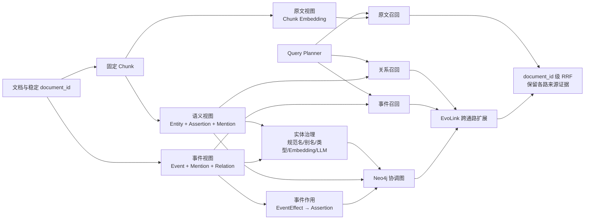

# EvoLink 三通路知识融合技术报告

> 日期：2026-08-19
> 对应实现：`ours_evolink`
> 主要评测：`data/exports/evaluation/20260819/retrieval_metrics`
> 报告范围：说明 EvoLink 如何组织和融合原文、实体关系与事件演化知识，并判断其研究位置、创新点与证据边界。

## 摘要

复杂问题需要的往往不是更多相似内容，而是几类作用不同的证据：原始内容说明“材料具体表达了什么”，实体关系说明“有哪些对象以及它们如何连接”，事件说明“对象或关系的状态何时、因何发生变化”。EvoLink承接已经语义化、向量化并完成来源对齐的多模态内容，把它们进一步加工为三个互补知识视图：原文 Chunk、实体—断言图和事件—状态变化图。三种表示保持各自适合的索引与检索方式，但共享文档身份、实体身份和来源 Mention；事件还通过 `EventEffect` 与受影响的断言连接。查询时，系统用一个 Query Planner 生成共同的实体、关系、时间和状态提示，三路并行召回，再从实体或事件种子沿 Neo4j 协调图扩展到另一通路，最后按父文档执行 RRF，并为每条通路保留可回溯的来源证据。

EvoLink位于多模态处理的下游。图片、表格、版面、音视频转写和文本等上游数据先经过解析、语义化与向量化，被对齐为带有统一文档身份、来源位置和语义表示的内容单元；EvoLink不重复学习这些底层跨模态表示，而是在完成基础对齐之后，进一步按照原文、实体关系和事件演化三种知识视图进行知识融合。因此，它既继承了多模态数据的来源和语义，又把研究重点放在对齐后的知识如何组织、连接和检索。整个流程属于混合融合：上游完成模态表示与基础对齐，索引阶段完成对象级和关系级知识融合，查询阶段完成跨视图融合，排序阶段完成决策级融合。

当前 n30 实验显示，`ours_evolink` 相比 `hybrid` 的 Evidence Recall@10 从 0.7302 提升到 0.8651，Complete Recall@10 从 0.4286 提升到 0.6190，nDCG@10 从 0.6563 提升到 0.7280。不过，这组实验验证的是“受控三通路 + EvoLink”的整体效果，还不能单独证明每一种连接边或索引治理步骤的贡献。论文中最稳妥的创新主张，应放在“面向对齐后多模态数据的知识视图融合，以及基于共享身份和事实生命周期的跨通路证据补全”，而不是声称重新解决了底层图像—文本表征对齐问题。

---

## 1. 问题：为什么不能只把三路结果拼起来

### 1.1 三类知识解决的不是同一个问题

EvoLink对检索对象作如下划分：

| 知识视图 | 回答的问题 | 典型内容 | 单独使用的缺口 |
|---|---|---|---|
| 原文视图 | 文档具体说了什么 | 原句、数字、条件、引语、上下文 | 不显式组织跨文档关系和状态变化 |
| 语义视图 | 有哪些实体，它们如何连接 | 实体、别名、类型、关系断言、多跳桥接 | 静态关系容易压平时间、否认、终止与替代 |
| 事件视图 | 什么在何时发生，改变了什么 | 参与者、动作、对象、时间、结果、立场、状态作用 | 事件摘要不能代替完整原文，也不天然拥有稳定实体身份 |

三者并不是三个措辞不同的文本检索器。原文是高保真但结构弱的证据；实体关系是结构稳定但时间表达较弱的知识；事件是以发生、时间和状态变化为中心的知识。如果只在检索末端把三份排名相加，会留下三个问题：

1. 同一对象在不同通路中可能有不同名称，无法可靠互跳；
2. “某事件影响某关系”没有显式边，事件命中不能补回关系证据；
3. 融合后的答案可能只保留摘要或图节点，失去可核验的来源原文。

因此，本项目的问题不是“怎样组合三个分数”，而是：

> 如何让三种异构知识表示既保持各自的信息优势，又能围绕同一实体、同一事实和同一来源互相补证。

### 1.2 EvoLink在多模态处理链中的位置

Baltrušaitis等人的经典综述把多模态机器学习的关键问题概括为表示、翻译、对齐、融合和协同学习[1]。这几个环节不必由同一个模型全部承担。在当前系统定位中，上游负责把语言、图片、表格、版面或音视频转写等不同来源解析为可统一引用的内容单元，并通过语义化、向量化和来源映射完成基础对齐；EvoLink接收这些已经对齐的结果，承担后续知识组织与知识融合。因此，EvoLink可以合理地被定义为**多模态数据的下游知识融合方法**，而不是底层多模态编码器。

进入EvoLink以后，融合单位从“输入模态”转为“知识视图”。多视图学习认为，同一对象可以由多组特征或多种结构描述，各视图具有互补性[2][3]。2025年的 Multi-View Knowledge Graph 综述进一步把视图概括为结构、语义、表示以及知识/模态视图，并按特征级、决策级和混合方式讨论融合[4]。按照这一框架，不同模态已经对齐的内容继续被组织为原文、实体关系和事件演化三种知识视图。

因此，报告建议采用以下术语层次：

- 系统位置：**面向对齐后多模态数据的下游知识融合**；
- 方法机制：**异构多视图知识融合**；
- RAG语境：**三通路证据融合**。

这一界定将两种对齐区分开来：上游的跨模态对齐解决“不同媒体中的内容如何进入统一语义空间”，EvoLink的知识级对齐解决“这些内容形成的实体、关系、事件和来源如何指向同一现实对象并参与协同检索”。后者是本方法真正研究的问题。

---

## 2. 现有研究怎样做融合

### 2.1 按融合发生的位置分类

多模态研究通常把融合分为三类[1][5]：

| 类型 | 做法 | 优点 | 常见问题 |
|---|---|---|---|
| 早期融合 | 在建模前拼接原始数据或浅层特征 | 较早学习跨模态相关性 | 异构数据难以直接对齐，维度和噪声可能互相干扰 |
| 中间融合 | 各模态先编码，再通过共享空间、注意力、图连接等交互 | 能保留模态特性并建模跨模态关系 | 需要可靠的对齐对象和交互结构 |
| 晚期融合 | 各模态独立作出结果，再合并分数或决策 | 模块独立、易替换、对缺失模态较稳健 | 融合发生太晚，无法让一条通路补全另一条通路的内部缺口 |

这一分类对 EvoLink 的启发是：只做三路 RRF 属于晚期融合，工程简单，但无法表达事件与关系之间的结构性联系；若强行把三种表示压成一个向量，则属于早期或特征级融合，却会损失事件时间、断言状态和来源结构。EvoLink最终采用混合方案，而不是只选其中一种。

### 2.2 多源知识融合关注身份、冲突和可信度

知识融合研究的核心并不只是拼接特征。多源知识融合通常需要处理实体匹配、实体消歧、语义对齐、冲突检测和质量评估[6]。Knowledge Vault也表明，来自文本、表格、页面结构和已有知识库的抽取结果存在不同噪声，需要结合来源与概率评估事实正确性，而不是无条件写入统一知识库[7]。近期不确定知识图谱综述同样强调：异构来源带来的冲突、抽取不确定性、来源信息和时间信息必须在知识整合过程中保留[8]。

这说明，索引期融合至少应回答四个问题：

1. 两个名称是否指向同一实体；
2. 两条抽取结果是否支持同一事实；
3. 不同来源是相互支持、否认还是无法判断；
4. 融合后的知识能否回溯到每一条原始证据。

EvoLink中的实体治理、AssertionMention、EventMention、Conflict和ResolutionDecision，属于这一类知识融合问题，而不是一般向量拼接。

### 2.3 时序知识图谱把“事实成立”扩展为“事实何时成立”

静态知识图谱通常将知识表示为三元组 `(subject, relation, object)`。时序知识图谱进一步记录事实的时间点或有效区间，因为忽略时间会把已经终止或被替代的事实仍当作当前事实[9]。但仅给三元组增加时间戳，仍不完全等于事件建模：事件还需要参与者、动作、对象、结果和状态作用。

EvoLink采用两种对象分工：

- Assertion表示可被支持、否认、终止或替代的关系事实；
- Event表示导致变化的一次发生；
- EventEffect明确说明事件对哪条Assertion产生 `creates / updates / terminates / supersedes / denies / confirms` 作用。

这比简单地把事件名称作为关系边更适合回答“为什么当前关系已经变化”以及“哪条来源说明了这次变化”。

### 2.4 图 RAG 与事件 RAG 的研究位置

GraphRAG从文本构建实体图、执行社区聚类并生成社区摘要，重点解决全局性语料理解问题[10]。LightRAG把图结构与向量表示结合，通过低层实体和高层主题进行双层检索[11]。HippoRAG使用无模式知识图谱和 Personalized PageRank，从查询概念种子出发完成图上的关联扩散[12]。这些方法证明了实体图和图传播对跨文档、多跳检索的价值，但主要组织的是实体及其关系。

EventRAG则从叙事文档构建事件知识图，合并跨文档等价事件并进行迭代检索，重点处理事件中心、时间依赖和逻辑关系问题[13]。它说明事件不应只是普通实体关系抽取的附属字段。

与这些工作的关系可以概括为：

| 方法 | 主要索引对象 | 主要融合位置 | 与 EvoLink 的差别 |
|---|---|---|---|
| GraphRAG | 实体、关系、社区摘要 | 图构建与答案汇总 | 不以事件改变关系状态为核心 |
| LightRAG | 实体/关系图 + 文本向量 | 双层图检索与向量/图结合 | 有文本和语义双视图，但事件演化不是独立一等视图 |
| HippoRAG | 开放三元组图 + passage | 查询种子到PPR传播 | 强调关联扩散，不显式表示事件对事实生命周期的作用 |
| EventRAG | 事件知识图 | 事件归并与迭代事件检索 | 强化事件视图，但没有把原文、稳定关系和事件作用组织成三类证据角色 |
| EvoLink | 原文、Assertion、Event/Effect | 索引对齐 + 跨图扩展 + 文档秩融合 | 关注三类证据之间的身份、状态和来源连接 |

因此，EvoLink不是要证明“图融合”或“事件图”从未出现，而是试图补上一个更具体的空缺：文本证据、稳定关系和事件演化各自保留，且能通过共享身份和事实生命周期在检索时互相补全。

---

## 3. EvoLink 的方法结构

### 3.1 总体流程



这个流程包含四个不同层次的融合：

1. **表示层分解**：同一文档形成原文、语义和事件三种表示；
2. **知识对象层融合**：统一实体身份、文档身份和来源 Mention；
3. **关系层融合**：用事件参与关系和EventEffect连接事件、实体与断言；
4. **检索结果层融合**：跨通路扩展后按文档秩融合，并保留各路证据。

### 3.2 三路索引分别保存什么

#### 原文通路

文档按固定规则切分为 Chunk，Chunk生成Embedding。它保留完整措辞、数字、限定条件和局部上下文，是抽取遗漏时的安全网。原文通路不试图把所有内容结构化。

#### 语义通路

受控抽取器从Chunk中选择关键实体和关键关系。融合时，普通关系不直接保存为无来源边，而是重述为：

```text
Entity --SUBJECT--> Assertion --OBJECT--> Entity
AssertionMention --SUPPORTS--> Assertion
AssertionMention --FROM_DOCUMENT--> Document
```

Assertion作为一等节点，具有置信度、状态、`valid_from`、`valid_to` 和多个Mention。这样，同一个关系可以由多个文档支持，也可以保留不同立场。

#### 事件通路

事件独立抽取，不与普通关系共用同一次抽取调用。每个Event包含类型、摘要、动作、参与者、对象、时间、结果、立场、置信度及最多三条 `fact_effects`。跨文档等价事件根据事件类型、参与者/对象重叠和相容时间归并；每个来源仍保留独立EventMention。共享实体的时间相邻事件形成 `precedes / same_time / related` 边。

三路都使用Embedding，但对象不同：原文向量编码Chunk；语义图中的实体和关系向量用于定位图节点；事件向量编码事件规范文本。Embedding在这里是各通路的召回接口，不是三种知识已经完成融合的标志。

### 3.3 融合的第一步：共享文档身份与来源身份

每个Chunk、AssertionMention和EventMention都保留 `document_id` 与 `source_segment_id`。这提供了两个基础能力：

- 不同通路的候选可以回到同一父文档进行去重和合并；
- 结构化知识可以重新落回原始证据，而不是用抽取摘要自证。

文档身份是最弱但最稳的对齐键。即使实体治理失败，只要图或事件候选仍保留来源文档，最终结果就能交付可核验文本。

### 3.4 融合的第二步：语义实体与事件参与者共用身份

事件中的actor、object以及fact effect中的subject、object都会加入实体治理候选。当前治理顺序是：

1. 本体类型规范化；
2. 同类型规范名和别名签名精确匹配；
3. 以名称和描述Embedding生成候选；
4. 仅在高相似、名称相似且与次候选有足够间隔时自动合并；
5. 中间区域可交给LLM在候选集内裁决；
6. 歧义对象建立隔离身份和ReviewCase，不强制错误合并；
7. ResolutionDecision记录合并依据、候选和相似度。

治理结果使语义通路中的“Acme”和事件通路中的“Acme Corp”能够指向同一Entity。随后建立：

```text
Event --HAS_PARTICIPANT(role=actor/object)--> Entity
```

这是第一类真正的跨通路连接。检索命中实体后可以找到相关事件；命中事件后也可以找到参与实体及其关系邻域。

### 3.5 融合的第三步：事件作用到关系事实

共享实体只能说明“某事件涉及这个对象”，不能说明“事件改变了什么”。EvoLink的关键连接是：

```text
Event --HAS_EFFECT--> EventEffect --AFFECTS--> Assertion
```

`EventEffect`具有六种类型：创建、更新、终止、替代、否认和确认。系统按事件有效时间依次应用作用，并更新Assertion状态：

- `creates / confirms / updates`：关系进入active；
- `terminates`：关系进入inactive并写入终止时间；
- `supersedes`：旧关系进入superseded，新关系生效；
- `denies`：关系进入disputed，但肯定与否定Mention都保留；
- uncertain事件保留作用记录，但不直接改变关系生命周期。

这一设计把“实体关系图”和“事件图”从两个并列索引变成一个可解释的状态变化结构：

```text
旧 Assertion
  ← SUPERSEDES / TERMINATES ← Event
  → 新 Assertion 或当前状态
  → Mention → 来源文档
```

这是 EvoLink 相对普通三路RRF最重要的方法差别。

### 3.6 融合的第四步：查询期跨通路扩展

Query Planner对问题只分析一次，输出低层关键词、高层关键词、实体、事件类型、时间范围、状态意图和是否扩展事件链。三个召回任务并行执行：

- 原文路：原问题对Chunk做向量召回；
- 语义路：低层实体词和高层关系/主题词驱动图检索；
- 事件路：事件向量种子结合实体、动作、时间、状态和来源信号排序，并可扩展一跳事件链。

`ours_evolink`随后收集两类种子：

1. Planner和语义图结果中的实体名；
2. 事件召回结果中的event ID。

种子进入Neo4j协调图后，系统扩展出相关Entity、Assertion、Event、EventEffect和Mention。扩展结果再变回两类可交付候选：

- AssertionMention变成graph candidate；
- EventMention变成event candidate。

这意味着扩展不是只返回图节点，而是回到来源证据。例如：

```text
问题命中事件
  → event_id
  → EventEffect
  → 受影响 Assertion
  → AssertionMention
  → 另一篇支持关系的原文
```

反向也成立：

```text
问题命中实体或关系
  → Entity / Assertion
  → 参与事件或状态作用
  → EventMention
  → 描述变化过程的原文
```

这里的融合发生在最终排序之前，因此属于跨视图中间融合，而不是单纯晚期分数融合。

### 3.7 融合的第五步：文档级RRF与证据保真

三条通路的原始分数不可直接比较：向量路是余弦相似度，图路包含图检索排序，事件路还有结构化加权信号。系统因此按父文档执行Reciprocal Rank Fusion：

```text
score(d) = Σ_c 1 / (60 + rank_c(d))
```

同一文档在同一通路中只贡献一次RRF分数，避免一篇文档因产生很多图节点而占据过高权重。每个入选文档优先保留每条通路排名最高的一条可追溯证据，再用其他不重复片段补足。RRF解决的是异构分数量纲问题；它本身不是EvoLink的核心创新，但保证了混合系统的稳定交付。

---

## 4. 索引过程如何承接多模态数据融合

答案是：**它承接上游多模态对齐，并在索引阶段完成知识级融合。** 整体处理链可以写成：

```text
多模态原始数据
  → 模态专用解析、语义化与向量化
  → 文档身份、来源位置和语义空间对齐
  → 原文 / 关系 / 事件三种知识视图
  → 实体级、事实级和来源级融合
  → 三通路协同检索
```

前两步处理不同输入模态之间的表示差异，EvoLink主要负责后三步。因而，“多模态数据融合”是完整系统的上位任务，“三视图知识融合”是EvoLink在其中承担的具体方法。

### 4.1 表示构建与知识融合的分界

以下步骤主要完成模态语义化或知识视图构建：

- 对Chunk生成向量；
- 从Chunk抽取实体关系；
- 从文档独立抽取事件；
- 分别建立向量索引和事件注册表。

这些工作对于多模态对齐和下游融合是必要的，但如果三个产物没有共享身份，也不能跨结构访问，那么它们仍只是对齐后的并行表示，尚未完成知识级融合。

### 4.2 可以称为融合的部分

以下步骤已经满足信息融合的实质：

- 用稳定 `document_id` 对齐三路来源；
- 用实体治理把语义实体和事件参与者映射到统一Entity；
- 把关系重述为可追溯Assertion，而不是无来源边；
- 用EventEffect表达事件对Assertion生命周期的作用；
- 保留多来源Mention、立场、置信度和冲突；
- 将上述对象同步到一个可跨通路遍历的Neo4j协调图。

所以，EvoLink索引流程更准确地说是：

> 承接上游已经语义化、向量化和来源对齐的多模态内容，将其转换为三种知识视图，再进行实体级、事实级和来源级知识融合。

这也是报告或答辩时应画出的分界线。抽取回答“每一路有什么”，融合回答“不同路中的对象如何确认是同一个、如何发生作用、如何回到来源”。

### 4.3 EvoLink属于哪一种融合架构

EvoLink不是纯早期、纯中间或纯晚期融合，而是混合架构：

| 阶段 | 当前机制 | 对应融合类型 |
|---|---|---|
| 表示构建 | 三路独立抽取与编码 | 模态/视图专用编码 |
| 索引治理 | 文档对齐、实体消歧、事件归并 | 对象级中间融合 |
| 知识连接 | Event—Entity、EventEffect—Assertion | 关系级中间融合 |
| 查询协调 | 共享计划、双向种子、跨图扩展 | 查询条件下的跨视图融合 |
| 结果排序 | document RRF与证据保留 | 决策级晚期融合 |

这种混合方式的理由很直接：三种知识不能过早压平，但也不能等到最终排序才认识彼此。

---

## 5. EvoLink解决了哪些问题

### 5.1 相关文本不能显式说明证据角色

普通向量检索只知道片段与问题相似，不知道片段是在提供原始事实、桥接关系还是变化证据。EvoLink在索引对象和返回candidate中保留通路类型，使回答器能够区分证据角色。

### 5.2 静态关系不能表达关系如何变化

同一主体和谓词可能先指向对象A，后来更新为对象B；也可能被正式终止或否认。EvoLink通过Assertion有效区间、状态和EventEffect保存变化，而不是让新旧关系同时作为“当前事实”存在。

### 5.3 事件和关系索引彼此孤立

并列索引只能依赖同一问题分别命中两边。EvoLink建立Event—Entity和EventEffect—Assertion边，使一边的种子可以结构化补回另一边的证据。

### 5.4 跨通路名称不一致

事件参与者和语义实体经过同一实体治理流程，别名与上下文相似候选可以映射到统一ID；不确定匹配则保留为ReviewCase。这比按字符串直接连接更能抑制错误跨图边。

### 5.5 融合后丢失来源

实体、断言和事件都通过Mention回到Document和source segment。系统输出的是原文证据，而不是只输出抽取器生成的摘要。多来源支持和冲突也不会因规范节点归并而丢失。

### 5.6 不同通路分数不可比

文档级RRF使用名次而不是原始分数融合，并限制每个通路对同一文档只贡献一次，减少分数量纲和图节点数量造成的偏置。

---

## 6. 方法创新应当怎样表述

### 6.1 最值得主张的创新

#### 创新一：把跨模态基础对齐继续推进到知识视图融合

常见多模态管线在完成语义化、向量化或共享空间对齐后，往往直接进入统一向量检索。EvoLink把这一结果视为知识融合的起点：对齐后的内容继续被分解为原文、关系和演化视图，并通过实体身份、事实生命周期和来源关系进行第二阶段对齐。其价值不在于重新设计底层多模态编码器，而在于补充“多模态内容已经对齐以后，如何形成可推理、可治理和可检索的知识结构”。

#### 创新二：从证据类型反推知识表示，而不是先有检索器再拼装

系统先区分原文证据、关系证据和演化证据，再分别设计Chunk、Assertion和Event/Effect。这使“问题需要什么知识—索引保存什么对象—检索返回什么证据”保持一致。单纯使用vector、KG和event三个组件并不新；由证据角色驱动三种持久表示及其接口，是更完整的方法主线。

#### 创新三：用EventEffect连接事件与关系生命周期

现有图RAG通常以实体关系为中心，事件RAG通常以事件链为中心。EvoLink没有把两者简单并置，而是明确建模事件对Assertion的创建、更新、终止、替代、否认和确认，使事件检索可以解释关系状态，关系检索也能找到导致变化的事件。

#### 创新四：索引期对齐与查询期补证使用同一协调结构

实体治理、来源Mention和EventEffect在索引期建立；查询时同一结构接收实体种子和事件种子，跨通路扩展后回到来源证据。它不是“建一个统一大图然后只做图检索”，而是保留三路专用召回，再用协调图完成互补扩展。

#### 创新五：融合后仍保持证据可追溯和通路可区分

融合对象没有抹去各自来源。最终EvidenceBundle能够说明某篇文档由哪些通路命中，并保留每条通路最有代表性的原文。对于研判、答辩和审计场景，这比只输出一个综合向量或最终答案更有价值。

### 6.2 可以作为系统贡献、但不宜单独声称原创的部分

- 向量检索、知识图谱检索和事件检索本身均有大量先行研究；
- 实体规范化、Embedding候选和LLM裁决属于已有实体消歧技术组合；
- Neo4j只是实现载体，不是方法创新；
- RRF是成熟的秩融合方法；
- Query Planner生成关键词、实体和时间提示也不是单独的新算法。

这些组件的价值在于支撑上述跨通路知识组织，而不是分别包装成创新点。

### 6.3 推荐的论文贡献表述

可以把核心贡献压缩为三点：

1. 面向已经语义化、向量化和来源对齐的多模态数据，提出由原文、关系和演化证据需求驱动的三视图知识组织方法，把跨模态基础对齐推进到知识对象与证据角色层；
2. 提出EvoLink协调结构，通过共享实体、来源Mention和事件—断言作用边连接语义知识与事件演化，使任一路径的检索种子能够补回另一视图的可追溯证据；
3. 设计保留通路差异的混合融合流程：专用索引并行召回、查询期跨视图扩展和文档级秩融合，在不压平结构语义的情况下形成统一EvidenceBundle。

更谨慎的一句话方法定义是：

> EvoLink是一种面向对齐后多模态数据的下游知识融合方法：它将已完成语义化、向量化和来源对齐的内容组织为原文、实体关系和事件演化三种知识视图，并通过共享身份、事实生命周期作用和来源回链进行索引期知识对齐与查询期跨视图补证。

---

## 7. 当前实验能说明什么

### 7.1 主结果

当前主实验使用MultiHop-RAG固定子集：30个问题、100篇文档、443个Chunk；其中21个问题具有当前scorer可计算的Gold Evidence。`ours_evolink` 与两个主要基线的@10结果如下：

| 方法 | Hits@10 | Evidence Recall@10 | Complete Recall@10 | MRR@10 | nDCG@10 |
|---|---:|---:|---:|---:|---:|
| naive | 0.9524 | 0.6349 | 0.2857 | 0.7545 | 0.5612 |
| hybrid | 1.0000 | 0.7302 | 0.4286 | 0.8147 | 0.6563 |
| ours_evolink | **1.0000** | **0.8651** | **0.6190** | **0.8349** | **0.7280** |

相对 `hybrid`，`ours_evolink` 的Evidence Recall@10提高13.49个百分点，Complete Recall@10提高19.05个百分点，nDCG@10提高7.17个百分点。这组结果支持以下判断：

- 多表示证据组织有助于找回更多必要证据；
- 提升主要体现在证据覆盖和完整性，而不只是“至少命中一篇”；
- 对inference问题，Evidence Recall@10达到0.9375，Complete Recall@10达到0.75，符合跨文档补证的设计目标。

### 7.2 协调图确实参与了查询

30次查询均运行三条通路。平均每次查询的候选文档数为：vector 7.53、graph 9.57、event 6.10。EvoLink诊断累计记录：

- 693个实体种子；
- 643个断言种子；
- 208个事件种子；
- 854个扩展断言；
- 686个扩展事件；
- 213条关联作用；
- 每次查询平均79.63个证据图节点和91.57条边。

这些数据证明跨通路协调代码实际执行并产生了结构扩展，而不是配置上存在但未使用。

### 7.3 不能由当前结果推出的结论

当前主表没有一个在完全相同索引和召回配置下关闭 `link_evidence` 的 `ours` 对照，因此不能把全部增益都归因于EvoLink连接。增益可能同时来自：

- 受控语义索引；
- 独立事件通路；
- 事件结构排序；
- EvoLink跨通路扩展；
- 最终三路RRF。

此外，样本只有30问，实际计分21问；外部HippoRAG、EventRAG和E²RAG虽然使用同一scorer，但索引适配条件并不完全一致。因此当前结果适合证明系统可行性和整体效果，不足以支撑“融合机制在所有数据集上显著优于现有方法”的强结论。

### 7.4 为了单独证明融合创新，下一步应补的实验

最重要的不是立即扩大所有数据，而是补齐机制消融：

| 消融 | 保持不变 | 关闭内容 | 回答的问题 |
|---|---|---|---|
| Three-path late fusion | 三路索引、三路召回、RRF | EvoLink跨图扩展 | 只做晚期融合能达到多少 |
| EvoLink without EventEffect | 实体共享、来源回链 | Event—Assertion作用边 | 状态作用连接是否有增量 |
| EvoLink without entity governance | 三路内容和RRF | 治理后的统一实体ID | 实体对齐是否减少错连或漏连 |
| EvoLink without provenance return | 图扩展结构 | Mention回链 | 可追溯原文是否影响证据命中与可核验性 |
| Full EvoLink | 全部机制 | 无 | 完整方法 |

除现有检索指标外，还应加入融合质量指标：实体对齐F1、EventEffect链接准确率、跨通路边precision、来源回链准确率、冲突识别F1、每个Gold evidence chain被完整覆盖的比例。这样才能把“检索效果好”进一步解释为“融合结构正确且确实发挥作用”。

---

## 8. 当前局限与风险

### 8.1 上游能力与当前评测边界

EvoLink可以定位为多模态数据的下游知识融合，但论文必须分别说明上游和下游：上游负责模态专用解析、语义化、向量化和基础对齐；EvoLink负责对齐后的知识视图构建与融合。当前n30检索实验主要验证文本化内容进入三视图后的效果，还没有单独报告图片、表格、音频或视频各模态的端到端贡献。因此，现阶段可以主张方法适用于对齐后的多模态数据，不能仅凭当前实验主张已经全面验证了所有输入模态。

### 8.2 抽取误差会变成结构误差

事件的actor、object和fact effect由LLM抽取。如果fact effect错误，系统可能建立错误的状态作用边。当前通过置信度、uncertain不改状态、歧义ReviewCase和来源Mention降低风险，但还缺少专门的EventEffect标注集和准确率评测。

### 8.3 实体对齐仍是关键瓶颈

错误合并会把不相关事件和断言连接起来，漏合并则阻断跨通路扩展。DWIE Gold Mention结果可以评价实体治理，但尚不能完全覆盖跨文档、跨通路、领域别名和同名实体问题。

### 8.4 当前查询控制仍偏固定

`ours_evolink`默认三路全开；Planner主要提供共同提示，而不是为每条通路都生成完全不同的查询。`ours_evoneed`已经尝试按缺失证据类型动态选路，但当前结果没有超过固定三路。因此，动态融合应作为后续工作，不应混入EvoLink已经验证的核心贡献。

### 8.5 索引成本

三路抽取、实体治理和Neo4j协调图带来额外成本。方法需要用索引时间、LLM调用数、Embedding调用数、节点/边规模和增量更新成本与检索收益共同评价。EvoLink的合理目标不是“索引最便宜”，而是在可控抽取预算下换取更完整、可追溯的证据链。

---

## 9. 结论

EvoLink处在多模态数据处理的下游：上游先把不同模态语义化、向量化并对齐到统一文档和来源空间；EvoLink再按证据需求形成三种知识视图，通过共享身份、事件作用和来源回链建立跨视图连接，最后让这些连接在查询时产生可验证的证据补全。它的重点既不是重复解决底层跨模态编码，也不是单纯增加检索路由，而是把对齐后的多模态内容进一步转化为可治理、可演化、可协同检索的知识。

索引阶段确实包含融合，但不能把“抽取三路”整体都称作融合。其核心融合动作是：

1. 文档与来源对齐；
2. 语义实体和事件参与者统一身份；
3. 事件通过EventEffect作用于关系断言；
4. 查询种子沿协调图跨通路扩展；
5. 不同通路的结果按文档秩融合，同时保留各自证据。

从研究创新看，最有辨识度的是“事件—断言生命周期连接”和“索引期对齐、查询期补证、来源可追溯”这一整套跨通路机制。三路Embedding、Neo4j、RRF或Planner都是实现这一机制的组成部分，而不是各自独立的创新。当前实验已经证明完整系统在小规模多跳检索中的证据覆盖优势；下一步必须用关闭EvoLink、关闭EventEffect和关闭实体治理的消融，进一步证明增益究竟来自哪一种融合机制。

---

## 参考文献

[1] Baltrušaitis, T., Ahuja, C., & Morency, L.-P. [Multimodal Machine Learning: A Survey and Taxonomy](https://doi.org/10.1109/TPAMI.2018.2798607). IEEE TPAMI, 2019.

[2] Zhao, J., Xie, X., Xu, X., & Sun, S. [Multi-view learning overview: Recent progress and new challenges](https://doi.org/10.1016/j.inffus.2017.02.007). Information Fusion, 2017.

[3] Li, Y., Yang, M., & Zhang, Z. [A Survey of Multi-View Representation Learning](https://arxiv.org/abs/1610.01206). 2016.

[4] Yang, Z., Tao, X., Cai, T., et al. [A Survey on Multi-View Knowledge Graph: Generation, Fusion, Applications and Future Directions](https://www.ijcai.org/proceedings/2025/1197). IJCAI, 2025.

[5] Sleeman, et al. [Multimodal Classification: Current Landscape, Taxonomy and Future Directions](https://doi.org/10.1145/3543848). ACM Computing Surveys, 2022.

[6] Zhao, X., Jia, Y., Li, A., Jiang, R., & Song, Y. [Multi-source knowledge fusion: a survey](https://doi.org/10.1007/s11280-020-00811-0). World Wide Web, 2020.

[7] Dong, X. L., et al. [Knowledge Vault: A Web-Scale Approach to Probabilistic Knowledge Fusion](https://research.google/pubs/knowledge-vault-a-web-scale-approach-to-probabilistic-knowledge-fusion/). KDD, 2014.

[8] Jarnac, L., Chabot, Y., & Couceiro, M. [Uncertainty Management in the Construction of Knowledge Graphs: A Survey](https://doi.org/10.4230/TGDK.3.1.3). TGDK, 2025.

[9] Cai, B., et al. [Temporal Knowledge Graph Completion: A Survey](https://www.ijcai.org/proceedings/2023/734). IJCAI, 2023.

[10] Edge, D., et al. [From Local to Global: A Graph RAG Approach to Query-Focused Summarization](https://arxiv.org/abs/2404.16130). 2024.

[11] Guo, Z., et al. [LightRAG: Simple and Fast Retrieval-Augmented Generation](https://arxiv.org/abs/2410.05779). 2024.

[12] Gutiérrez, B. J., et al. [HippoRAG: Neurobiologically Inspired Long-Term Memory for Large Language Models](https://proceedings.neurips.cc/paper_files/paper/2024/file/6ddc001d07ca4f319af96a3024f6dbd1-Paper-Conference.pdf). NeurIPS, 2024.

[13] Yang, Z., et al. [EventRAG: Enhancing LLM Generation with Event Knowledge Graphs](https://aclanthology.org/2025.acl-long.830/). ACL, 2025.

## 工程依据

- 三路编排与EvoLink调用：[`src/rag_graph_demo/retrieval/orchestrator.py`](../../src/rag_graph_demo/retrieval/orchestrator.py)
- 跨通路扩展与Evidence Graph：[`src/rag_graph_demo/retrieval/evolink.py`](../../src/rag_graph_demo/retrieval/evolink.py)
- 文档级RRF：[`src/rag_graph_demo/retrieval/fusion.py`](../../src/rag_graph_demo/retrieval/fusion.py)
- 实体、断言、事件作用融合：[`src/rag_graph_demo/services/tkg_fusion_service.py`](../../src/rag_graph_demo/services/tkg_fusion_service.py)
- 实体治理：[`src/rag_graph_demo/services/entity_resolution_service.py`](../../src/rag_graph_demo/services/entity_resolution_service.py)
- 事件抽取与查询：[`src/rag_graph_demo/services/event_service.py`](../../src/rag_graph_demo/services/event_service.py)
- Neo4j协调图：[`src/rag_graph_demo/storage/neo4j_tkg_store.py`](../../src/rag_graph_demo/storage/neo4j_tkg_store.py)
- 当前主实验：[`data/exports/evaluation/20260819/retrieval_metrics`](../../data/exports/evaluation/20260819/retrieval_metrics)
