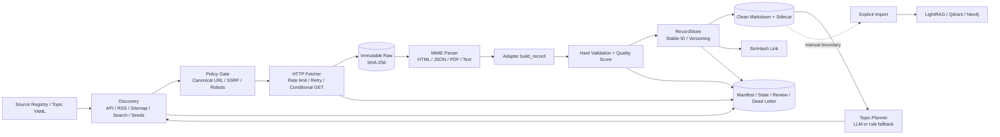
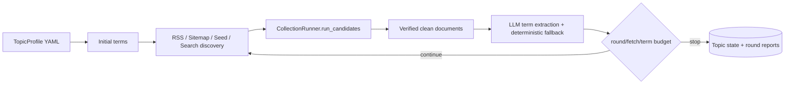

# Anduril OSINT 数据管线专项技术报告

> 文档类型：As-built 专项技术报告
> 项目：`rag_prepare` / `rag-graph-demo`
> 报告版本：v1.0
> 基准日期：2026-08-25
> 代码基准：当前工作区
> 核心边界：本报告覆盖发现、采集、解析、规范化、去重、版本化、质量控制和可审计落盘；不把 Embedding、Qdrant、LightRAG 或知识图谱索引算作采集管线内部阶段。

---

## 1. 文档现状与结论

在本报告生成前，项目中没有一份同时满足“数据管线专项”、“当前实现态”和“覆盖课题驱动 OSINT 扩展”的最新技术报告。现有文档的定位如下：

| 文档 | 日期 | 定位 | 不足 |
|---|---|---|---|
| `ANDURIL_DATA_PIPELINE_AGENT_BRIEF.md` | 2026-08-03 | 实施任务书与验收要求 | 主要描述“要实现什么”，不是当前 as-built 状态 |
| `TECHNICAL_REPORT.md` | 2026-08-06 | 整体 RAG 系统技术报告 | 数据管线只是其中一层，且早于后续 OSINT 课题驱动能力 |
| `RUNBOOK.md` | 持续更新 | 运行命令与故障处理 | 不代替架构、数据契约与风险说明 |

因此，本文档作为截至 2026-08-25 的数据管线专项基准报告。

## 2. 执行摘要

当前数据管线已形成可运行的闭环：

1. 从配置化来源、RSS/Atom、Sitemap、种子 URL、政府/学术/专利 API 或可配置搜索 API 发现候选。
2. 通过 URL 规范化、SSRF 防护和 robots 检查后抓取 canonical 原文。
3. 原始响应按 SHA-256 不可变落盘，支持 ETag/Last-Modified 条件请求、限速、重试和体积限制。
4. 将 HTML、JSON、PDF 等内容解析为统一 `NormalizedRecord` v1.0，并保留来源、时间、哈希、适配器版本和业务扩展字段。
5. 用稳定 `record_id` 和内容 `version_id` 实现幂等与版本化；SimHash 只生成近似重复关系，不自动删除证据。
6. 通过硬校验、质量评分、复核队列、死信和 run manifest 建立可审计性。
7. 额外提供课题 YAML 驱动的多轮 OSINT 发现：首轮抓取后从正文扩展组织、产品、项目、合同/专利编号和技术词，再进入下一轮。

技术上已经是一条可重复执行、可增量更新、可失败恢复的证据采集管线。但它仍是“单机、文件存储、手工触发”的研究型实现，并非具有分布式调度、指标告警和严格合规闸门的生产级数据平台。

## 3. 系统边界

### 3.1 管线内

- 来源注册、权威层级和访问/保留策略配置。
- 候选发现、canonical 原文抓取与不可变原件保存。
- MIME 识别、文本解析、元数据规范化和业务扩展建模。
- 精确去重、近似重复连接、内容版本化和条件请求。
- 质量校验、人工复核队列、失败重试、死信和运行报告。
- 课题驱动的迭代发现与查询词扩展。

### 3.2 管线外

- 不自动写入 LightRAG、Qdrant、Neo4j 或项目文档注册表。
- 不把搜索引擎摘要或 LLM 生成文本当作已核验证据。
- 不绕过登录、付费墙、验证码、robots 限制或平台访问控制。
- 不在采集阶段进行最终情报判断、实体强制合并或产品关联事实化。

从 clean 目录进入 RAG 的推荐边界是显式执行 `scripts/import_directory.py`，而不是由 Collection Runner 隐式触发索引。

## 4. 总体架构



主编排器是 `src/rag_graph_demo/collection/runner.py` 中的 `CollectionRunner`。适配器只负责来源特定的发现与建模，通用的策略、抓取、解析、校验、去重和落盘都由编排器统一执行。

## 5. 管线阶段

### 5.1 来源注册与发现

`config/sources.yaml` 当前注册 13 个来源，共用 6 类专用适配器；另有 `generic_web` 供课题驱动抓取使用。

| 来源类型 | 来源 | 适配器 | 权威级别 |
|---|---|---|---|
| 企业官方 | Anduril 官网 | `anduril_site` | P0 |
| 政府合同 | USAspending | `usaspending` | P0 |
| 学术元数据 | OpenAlex | `openalex` | P0 |
| 专利 | PatentsView | `patentsview` | P0 |
| 新闻/智库 RSS | Defense News、The War Zone、Defense One、RUSI、CSET | `rss_feed` | P1 |
| 历史补采 | Defense News、The War Zone、RUSI、CSET archive | `sitemap_archive` | P1 |

`DiscoveryCandidate` 只保存候选 URL/provider ID、标题、摘要、排名、查询和发现溯源。搜索摘要不会被直接提升为 clean 正文。

### 5.2 策略闸门

策略层依次执行：

- 小写化 scheme/host、移除 fragment 和跟踪参数、保留会影响资源的查询参数。
- 仅允许 HTTP(S)，阻止 localhost、私网、link-local、云元数据 IP 等 SSRF 目标。
- 检查 robots.txt；明确禁止的 URL 记录原因并跳过。
- 每来源保留访问方法、限速、并发、认证环境变量、许可和保留策略。

实时网络默认关闭；CLI 必须显式传入 `--live` 才会访问真实来源，否则使用本地 fixtures。

### 5.3 抓取与原始证据

`HttpFetcher` 提供：

- 每域名最小时间间隔。
- ETag 与 Last-Modified 条件请求，304 记为成功且不重复解析。
- 对传输错误、429 和 5xx 指数退避与 jitter，最多默认重试 3 次。
- 默认 25 MiB 响应上限，最多 10 次重定向。
- 综合 Content-Type 与 magic bytes 识别 MIME。
- 原件按 adapter/日期/SHA-256 落盘，相同字节不重写。

### 5.4 解析与规范化

通用解析层处理 HTML、JSON、PDF 和文本，并尽量提取标题、作者、日期、canonical URL、JSON-LD/页面结构化数据与 Markdown 正文。适配器再将来源特有字段建模为合同、论文或专利扩展。

关键规范化规则：

- 日期保留 `full/month/year/none` 精度，不伪造缺失的月日。
- 金额使用十进制字符串，同时保留原币种和 provider 原字段名，不用浮点数。
- `award_ceiling`、`current_award_amount`、`obligation`、`outlay` 等金额概念分离保存。
- 业务元数据写入 sidecar，clean Markdown 保留人类可读的证据头和正文。

### 5.5 身份、去重与版本

| 机制 | 当前规则 |
|---|---|
| `record_id` | 优先用 provider record ID，否则使用 canonical URL 哈希；与内容变化无关 |
| `version_id` | 规范化内容的 SHA-256 |
| 重复观测 | 同一 `record_id + version_id` 只刷新 `last_seen_at` |
| 页面更新 | `record_id` 不变，新增 `vN.json`、`vN.md` 和 sidecar |
| 近似重复 | 64-bit SimHash，默认汉明距离阈值 6；只添加 `near_duplicate_candidate` 关系 |

这一设计保留了转载、历史页面和多来源证据，避免把“看起来相似”直接当成“可删除的同一记录”。

### 5.6 质量闸门

硬校验包括 schema 版本、ID、标题、canonical URL、原件路径与哈希、UTF-8 以及完整 Pydantic 模型复验。硬校验失败的记录不发布 clean 文件，而是进入复核队列。

软质量分数根据正文长度、发布日期、canonical/provider 身份和解析置信度计算。低质量但结构合法的记录仍然保留，同时进入人工复核队列。

### 5.7 运行状态与失败恢复

- 每来源有独立文件锁，防止同源并发执行。
- 每来源保留 cursor、ETag/Last-Modified validators 和 health 快照。
- 候选级失败相互隔离，单条坏数据不会中断整个运行。
- 成功率达到 90% 才推进成功 cursor。
- 可重试错误记入 manifest；永久失败写入 dead letter。
- 每次运行记录发现、接受、跳过、抓取、解析、新记录、新版本、重复、复核和错误计数。

## 6. 统一数据契约

`NormalizedRecord` 当前 schema 版本为 `1.0`，主要包括：

| 字段组 | 主要内容 |
|---|---|
| 身份与版本 | `record_id`、`version_id`、`version_index`、`record_type` |
| 来源 | `source_id`、publisher、authority tier、provider record ID |
| 文档元数据 | 标题、canonical URL、语言、作者、发布/更新时间及日期精度 |
| 内容与溯源 | Markdown 正文、原始/规范化哈希、raw/clean 路径、MIME、license、adapter 版本 |
| 知识候选 | 实体链接、产品链接及其 `explicit/strong_inference/unresolved` 置信等级、记录关系 |
| 业务扩展 | 合同、论文、专利三类结构化扩展，及保底 `extension` |
| 质量 | 解析置信度、完整度、待复核标志与 warnings |

输出中的 clean Markdown 适合后续显式导入，sidecar 保存不应混入正文的结构化元数据。

## 7. 课题驱动 OSINT 扩展

`src/rag_graph_demo/osint/` 在确定性 Collection 管线之上增加迭代发现层，而不复制抓取、解析和落盘逻辑。



当前示例课题为 `config/topics/counter_uas.yaml`，包含反无人机问题、中英文关键词、排除词、RSS/Sitemap 入口、最多轮次、候选数、抓取数和扩展词预算。

如果存在 DeepSeek 密钥，Planner 使用结构化 JSON 输出规划和扩展检索词；否则回退到引号词、编号、缩写和专有名词抽取。网页内容被明确当作不可信数据，Planner 提示词要求忽略其中指令，以降低 prompt injection 风险。

## 8. 落盘与可审计性

```text
data/
├── collection/
│   ├── discovery/<source_id>.jsonl
│   ├── raw/<adapter>/<date>/<sha256>.<ext>
│   ├── normalized/<record_id>/vN.json
│   │   └── normalized/<record_id>/latest.json
│   ├── clean/<record_id>/vN.md
│   │   └── clean/<record_id>/vN.sidecar.json
│   ├── runs/<run_id>/manifest.json
│   ├── runs/<run_id>/errors.jsonl
│   ├── state/<source_id>.json
│   ├── state/simhash_index.jsonl
│   ├── review_queue/*.json
│   └── dead_letter/*.json
└── osint/<topic_id>/state.json
```

从原始字节、规范化记录、clean 文本到后续 RAG 导入的链路可通过 `record_id`、`version_id`、哈希和路径进行复核。

## 9. 当前验证结果

2026-08-25 对以下范围执行了离线测试：

```bash
UV_CACHE_DIR=.uv-cache uv run pytest \
  tests/unit/collection \
  tests/unit/osint \
  tests/unit/test_source_mapper.py \
  tests/unit/test_parser.py -q
```

结果：**98 项测试全部通过**。覆盖策略、HTTP、解析、规范化、去重、适配器、编排、CLI、课题模型、发现、Planner 和 Collection bridge。这一结果验证代码逻辑与离线回归，不等于已重新验证所有外部站点的当日可访问性、条款或数据完整性。

## 10. 当前运行数据快照

当前工作区的 `data/collection/` 是本地运行数据，被 `.gitignore` 排除，不是可复现的仓库基准。截至报告日的文件级快照为：

| 指标 | 数量 | 说明 |
|---|---:|---|
| 原始响应文件 | 342 | 分布在 Anduril、OpenAlex、RSS、Sitemap archive 和 USAspending |
| 规范化记录目录 | 266 | 当前均只有 v1 |
| Clean Markdown / sidecar | 246 / 246 | 可显式导入的已发布文档 |
| Run manifest | 39 | 最后一批运行日期为 2026-08-03 |
| Review queue | 150 | 多为短文本、日期缺失或历史页面复核 |
| Dead letter | 0 | 当前快照中无死信文件 |
| OSINT topic state | 0 | `data/osint/` 尚无实际运行结果 |

因此，**代码能力已更新，但本地数据并不是 2026-08-25 的新鲜快照**。需要使用 `--live` 重新运行并复核来源策略，才能宣称“数据最新”。

另外，20 个 archive 来源的规范化记录没有对应 clean 目录，而相同文章已在非 archive 来源下发布。这不影响当前 246 篇 clean 语料的使用，但暴露了跨来源去重与发布状态需要显式对账。

## 11. 主要风险与差距

### P0：在宣称生产可用前必须处理

1. **来源合规信息过期。** `sources.yaml` 中 robots/ToS 人工检查日期是 2026-08-03，应在下次 live run 前重新核验。
2. **robots 获取失败默认放行。** `RobotsCache.default_allow=True`，适合研究型容错，但严格合规环境应支持按来源 fail-closed。
3. **缺少生产调度和观测。** `schedule_hint` 只是元数据，目前没有定时调度器、指标后端、告警、SLA 和 dashboard。

### P1：建议近期完成

1. **运行数据过时。** 现有 run 与来源状态停留在 2026-08-03，应以固定配置做一次可追溯增量更新。
2. **OSINT 课题驱动尚无真实运行快照。** 需要对 `counter_uas` 至少完成一轮 live run，记录发现数、发布数、扩展词和停止原因。
3. **复核队列积压。** 150 个复核项尚无明确的处置状态、责任人、审核结论和关闭时间。
4. **跨来源发布对账不完整。** 需要为 archive 与常规来源的同文章建立稳定的 `duplicate_of/syndicated_from` 对账报告，并解释 normalized 与 clean 的差异。
5. **PDF 边界有限。** 当前适合文字型 PDF，扫描件 OCR、页级表格还原和版式质量指标尚未形成完整闭环。
6. **课题来源分级粗粒度。** 动态课题抓取统一通过 P2 `generic_web` 来源进入，后续应根据实际 publisher 映射回 P0/P1/P2 和正确 `record_type`。

### P2：中期演进

- 将文件锁和 JSONL/JSON 状态迁移到具有事务与租约的队列/数据库。
- 为 adapter 增加 schema compatibility 测试和外部 API 合同检测。
- 补充发布到索引的显式 promotion manifest，记录导入批次、目标索引版本和回滚点。
- 建立数据新鲜度、来源成功率、重试率、复核队列龄、版本变更率和哈希校验失败率指标。

## 12. 建议的运行与验收流程

### 12.1 无网络回归

```bash
UV_CACHE_DIR=.uv-cache uv run pytest \
  tests/unit/collection tests/unit/osint -q
```

### 12.2 重新核验来源策略

逐项检查 `config/sources.yaml` 的 robots、ToS、API 文档、license、限速和认证要求，更新检查日期和 notes 后再开启 live run。

### 12.3 分层增量采集

```bash
uv run python -m rag_graph_demo.collection.cli --live run --group p0 --no-index
uv run python -m rag_graph_demo.collection.cli --live run --group p1 --no-index
```

首次建议使用 `--limit` 做小规模验证，不应在未查看 manifest 和 review queue 时直接扩大数量。

### 12.4 课题驱动验收

```bash
uv run python -m rag_graph_demo.osint.cli \
  --topic config/topics/counter_uas.yaml plan

uv run python -m rag_graph_demo.osint.cli \
  --topic config/topics/counter_uas.yaml run --live --rounds 1

uv run python -m rag_graph_demo.osint.cli \
  --topic config/topics/counter_uas.yaml status
```

验收时应同时检查 topic state 和关联 run manifest，而不只看 clean 文件数。

### 12.5 显式提升到 RAG

只将已通过校验并处理必要复核项的 clean 版本导入知识库，并保留导入批次与 `record_id/version_id` 映射。

## 13. 最终判断

当前项目已实现一条边界清晰、可审计、可版本化、默认离线安全的 OSINT 证据数据管线，并通过了 98 项专项回归测试。它已足以支撑研究和 Demo 环境的增量采集，但尚不应被描述为生产级数据平台。

下一个可验证里程碑不是继续增加文档，而是：重新核验来源策略，跑一次有限额的 P0/P1 增量 live run 和一轮 `counter_uas` 课题驱动运行，处理复核积压，并用新的 manifest 更新本报告的运行数据快照。
